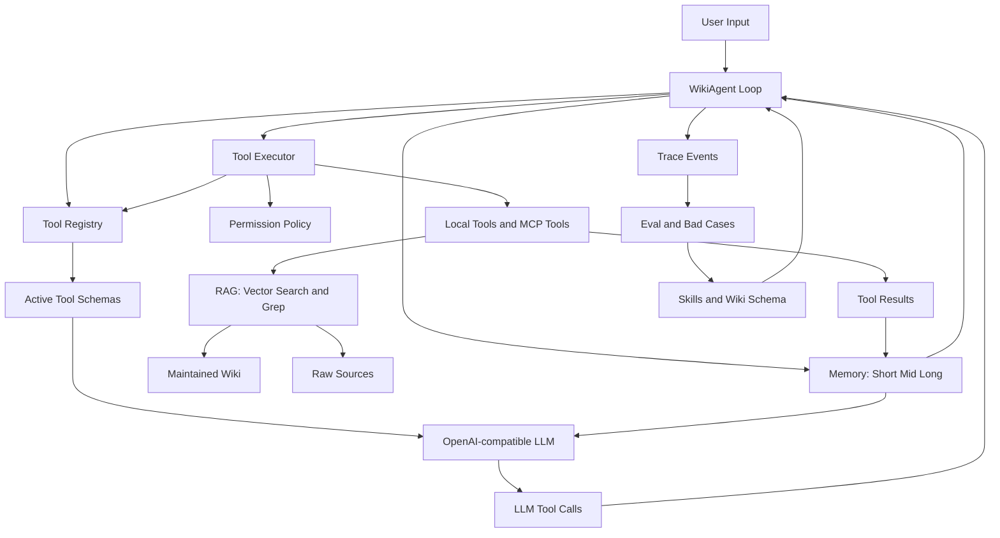

# wiki-agent

`wiki-agent` 是一个本地优先的 LLM Wiki / Agentic RAG 项目，用来展示一个 Agent 系统如何从“会检索 Markdown 笔记”演进为“会维护长期知识资产”的工程实现。

它不是只把文件切 chunk 后交给向量检索，而是把 Agent loop、memory、tool、permission policy、observability、MCP、skill 和 eval 组合起来，让 LLM 能按任务规划、选择工具、读取证据、维护 wiki，并把失败样例沉淀为可改进的数据。

这个项目采用一个简单的 Agent 视角：

```text
概念上：agent = loop + memory + tool
工程上：agent = loop + memory + tool + policy + observability
```

- `loop` 是由 LLM 驱动的规划-执行循环：模型基于当前 memory 决定下一步是回答还是调用工具，工具结果再写回 memory，触发下一轮再规划
- `memory` 不只是聊天历史，而是分成短期、中期、长期三层：短期保留最近上下文，中期承接压缩摘要，长期通过 wiki、skills、eval 和 bad cases 沉淀可复用知识
- `tool` 是广义工具，代表模型可调用的外部能力：RAG 检索、skill 加载、文件系统、Shell、API、测试命令都属于这个范畴
- `policy` 提供权限、审批、预算和终止约束
- `observability` 通过 trace、日志和评测让 Agent 行为可解释、可调试

## 架构图



项目适合学习和实验：

- Agent loop 如何处理 `tool_calls`。
- RAG 索引、embedding、向量检索如何组合。
- LLM Wiki 如何把 raw sources、maintained wiki、schema、eval 和 bad case 串成闭环。
- 工具权限、人工审批、沙箱和 trace 如何形成安全边界。
- 多种 chunker、embedding、vector store 如何逐步替换实验。

## 核心设计取舍

- **Agent loop 保持清晰**：`src/agent.ts` 只负责 LLM 驱动的规划-执行循环、模型调用、工具调度和 trace；工具执行、权限判断、协议适配都拆到独立模块。
- **Memory 明确分层**：短期 memory 负责最近对话，中期 memory 负责压缩后的摘要，长期 memory 通过 wiki、skills、eval、bad cases 沉淀跨会话知识资产。
- **工具是广义能力入口**：RAG、grep、skill、MCP、本地文件、Git、Shell、测试命令都通过统一 `IAgentTool` 接口进入 Agent。
- **检索采用 vector + grep 双通道**：语义问题优先 `search_notes`，明确术语、配置名、错误文本优先 `grep_notes`。
- **工具 schema 按需暴露**：所有工具注册到 `ToolRegistry`，但每轮只暴露 core tools 和已加载 tool group，降低上下文占用。
- **MCP 优先，本地工具兜底**：Filesystem/Git/SQLite 等成熟能力通过 MCP 接入；MCP 覆盖的本地等价工具会跳过，避免重复暴露。
- **先沉淀数据，再谈训练**：当前重点是 trace、eval、bad case、wiki schema 和 skill，为未来 reranker、tool routing 或后训练准备数据资产。

## 和普通 RAG 的区别

普通 RAG 通常是：

```text
raw documents
-> chunk / embed
-> query-time retrieval
-> answer
```

`wiki-agent` 的目标形态是：

```text
raw sources
-> agent-maintained wiki
-> wiki-first retrieval
-> cited answer
-> bad case / eval / skill / schema improvement
```

这意味着知识不会只在每次提问时被临时拼接，而是逐步沉淀到 `wiki/` 中，形成可审阅、可版本管理、可持续维护的 Markdown 知识层。

## 当前验证数据规模

`notes/` 是本地真实知识源目录，已加入 `.gitignore`，不随代码提交。下面的统计用于记录当前项目验证规模，后续迭代可以同步补充在这个规模下的检索、问答、wiki 维护和 bad case 表现。

统计快照：2026-07-16。

- 总文件数：2151
- 总目录数：357
- 总体积：约 596.6 MiB
- 一级目录数：6
- 一级目录文件量分布：1417、521、190、17、3、3
- 当前 RAG 直接支持的文本类型：`.md`、`.markdown`、`.txt`
- 当前可直接进入索引的文件数：约 1244 个，其中 `.md` 1212 个，`.txt` 32 个

主要文件类型分布：

- `.md`：1212
- `.html`：429
- `.csv`：120
- `.png`：87
- `.py`：81
- `.pyc`：47
- `.xlsx`：38
- `.txt`：32
- `.tsv`：23
- `.pl`：19
- `.jpg`：13
- `.pdf`：10
- 其他少量类型：`.pptx`、`.docx`、`.cpp`、`.mp4`、`.awk`、`.h`、`.zip`、`.json`、`.gif`、`.sh`、`.tex`、`.toml`、`.cmd`、`.xmind`、`.yml`、无扩展名文件等

这个规模已经不是玩具数据集：它同时包含 Markdown 知识笔记、HTML 页面、表格数据、图片、脚本和代码文件。当前系统先把 `.md` / `.txt` 作为第一批验证对象；其他类型需要通过 source policy、ignore 规则和后续 loader 扩展逐步接入。

## 前置要求

需要先准备这些本机依赖：

```powershell
# Node.js / npm
winget install OpenJS.NodeJS
node --version
npm --version

# Git，本地 Git 工具和 Git MCP 都会用到
winget install Git.Git
git --version

# uv / uvx，Git 和 SQLite MCP 使用 uv tool 安装 Python MCP server
powershell -ExecutionPolicy ByPass -c "irm https://astral.sh/uv/install.ps1 | iex"
uvx --version
```

项目依赖和 MCP server 工具安装：

```powershell
# 如果是从代码库安装已有依赖，执行这一条即可
npm install

# 如果是从零给项目补齐 npm 依赖，对应的具体包安装命令是：
npm install openai dotenv @modelcontextprotocol/sdk @modelcontextprotocol/server-filesystem
npm install --save-dev typescript tsx @types/node

# 安装 Git / SQLite MCP server
uv tool install mcp-server-git
uv tool install mcp-server-sqlite

# 确认 MCP server 命令可被当前 shell 找到
where.exe mcp-server-filesystem
where.exe mcp-server-git
where.exe mcp-server-sqlite

# 检查 MCP server 是否能启动并列出工具
npm run mcp:check
```

安装完成后，`config/mcp.servers.jsonc` 会直接调用 `mcp-server-filesystem`、`mcp-server-git` 和 `mcp-server-sqlite`，启动时不再依赖临时拉取。

还需要准备 DeepSeek 或其他 OpenAI-compatible LLM API key，并写入本地 `.env`。

可先检查 API 的 DNS、HTTPS 和认证是否可用；该命令请求轻量的 `/models`
端点，不调用模型生成：

```powershell
# 使用 .env 中的 BASE_URL 与 API_KEY
npm run check:llm

# 临时检查其他 OpenAI-compatible Provider，例如后续的 HY3 配置
$env:BASE_URL="https://your-provider-api-base-url"
$env:API_KEY="your_api_key"
npm run check:llm
```

返回 `HTTP 200` 表示网络与认证均正常；`401` 或 `403` 表示服务已可达，
但 Key 或权限有问题；DNS、HTTPS 连接失败或超时则说明应检查公司网络、
代理或服务端可用性。

## 快速开始

```bash
npm install
cp .env.example .env
```

编辑 `.env`，至少填入：

```env
BASE_URL=https://api.deepseek.com
API_KEY=your_api_key
MODEL_NAME=deepseek-v4-pro
```

常用命令：

```bash
npm run dev
npm run ask -- "检索我的 Agent 笔记"
npm run index:notes -- notes
npm run eval:rag
npm run mcp:check
npm test
```

## 目录结构

```text
wiki-agent/
├── src/                 # TypeScript 源码
├── scripts/             # 项目级辅助脚本，例如 RAG 索引和评测
├── skills/              # 可按需加载的 skill Markdown
├── wiki/                # Agent 维护的结构化 Markdown wiki
├── notes/               # 默认 Markdown 知识源示例
├── examples/            # 示例数据，例如 RAG 评测问题
├── badcases/            # Agent 失败样例模板和后续沉淀
├── config/              # 示例配置，例如 MCP server 列表
├── var/                 # 运行产物：索引、trace 等，不进入 Git
├── docs/                # 代码导读
├── .env.example         # 运行配置模板
└── package.json
```

`src/` 主要模块：

```text
src/
├── main.ts              # CLI 入口，初始化 memory、registry、agent
├── agent.ts             # Agent loop：模型调用、工具调度、trace 写入
├── memory.ts            # 对话记忆和自动压缩
├── trace.ts             # Trace sink、JSONL 默认实现和 trace level 过滤
├── permissions.ts       # 工具权限决策
├── sandbox.ts           # 本地沙箱路径保护
├── limits.ts            # 工具输出和文件读取限制
├── config.ts            # 环境变量解析
├── cli/                 # CLI 适配器
├── prompts/             # system prompt
├── protocol/            # OpenAI tool-call 协议适配
├── mcp/                 # MCP server 配置、client 和 tool adapter
├── rag/                 # RAG 文档加载、chunk、embedding、vector store、pipeline
├── tools/               # Agent 工具实现
├── utils/               # 通用工具函数
└── tests/               # Node 内置测试
```

## 运行流程

### Agent Loop

```text
用户输入
-> MemoryManager 追加 user message
-> WikiAgent 调用 LLM
-> LLM 返回文本或 tool_calls
-> handleToolCalls 调度工具
-> ToolExecutor 执行权限检查、审批、参数校验和工具调用
-> 工具结果写回 memory
-> LLM 继续规划或输出最终答案
```

`handleToolCalls()` 会按工具的 `isReadOnly` 分流：

- 只读工具并发执行。
- 写文件、Shell、测试等有副作用工具串行执行。
- 工具结果按原始 tool call 顺序写回 memory，保持 OpenAI tool 协议合法。

### LLM Wiki Layer

知识层采用三层结构：

```text
raw sources
-> agent-maintained wiki
-> query / eval / bad case loop
```

- `notes/` 保存原始资料，尽量作为 source of truth。
- `wiki/` 保存 LLM 维护的结构化知识页，包括 `index.md`、`log.md`、`contradictions.md` 和各类页面目录。
- `wiki/AGENTS.md` 定义 wiki schema，规定页面类型、frontmatter、引用规则、ingest/query/lint 流程。
- `badcases/` 保存失败样例，后续转成 eval、skill、schema 或 prompt 的改进输入。

### RAG 索引

默认索引命令：

```bash
npm run index:notes
```

默认通过 `config/knowledge.sources.jsonc` 索引多个知识源。该文件支持注释，并通过同目录的 JSON Schema 提供字段说明、校验和自动补全。可以用环境变量指定其他配置文件：

```env
KNOWLEDGE_SOURCES_CONFIG_PATH=config/knowledge.sources.jsonc
```

配置文件中每个 source 的 `name` 会写入检索结果的 `source` 前缀，例如 `wiki/index.md`、`raw/agent-rag.md`。CLI 显式传入目录时仍可临时索引单根目录：

```jsonc
{
  "$schema": "./knowledge.sources.schema.json",
  "sources": [
    {
      "name": "wiki",
      "root": "wiki",
      "kind": "wiki",
      "enabled": true,
      "index": true,
      "priority": 100,
      "ignore": []
    },
    {
      "name": "raw",
      "root": "notes",
      "kind": "raw",
      "enabled": true,
      "index": true,
      "priority": 50,
      "ignore": ["**/__pycache__/**", "**/finalData/**"]
    }
  ]
}
```

```bash
npm run index:notes -- notes
```

默认输出：

```text
var/knowledge/index.json
```

索引数据流采用惰性读取和流式写入。每次只读取一个文件，逐个生成 chunk
和向量并写入临时索引，完成后再替换正式索引：

```text
iterateSourceDocuments / iterateSourceDocumentsFromRoots
-> chunkDocument
-> Embedder.embed
-> VectorStore.replaceChunks
```

默认实现：

- `RAG_CHUNKER=auto`：Markdown 使用 Markdown-aware chunker，文本使用固定长度 chunker。
- `RAG_EMBEDDER=tf`：本地词频向量，不依赖外部 embedding 服务。
- `RAG_STORE=json`：流式构建单个 JSON 索引，查询时全量加载并计算余弦相似度。

当前可索引的 Markdown/Text 数据约 26 MiB，单 JSON 索引足以满足本地使用。
若未来接入大量 HTML、表格或固定维度 embedding，再考虑迁移到专用向量数据库。

索引期间，命令行会持续显示已处理文档数、chunk 数、耗时和当前文件；
交互式终端会原地刷新，重定向日志时则每 5 秒输出一行。完成后还会汇总
来源、切分参数、索引大小、处理吞吐量和进程峰值内存。

2026-07-16 使用默认配置实测：共索引 1,253 个文件、生成 47,119 个 chunk，
索引文件约 93.18 MiB，构建过程峰值工作集约 214.6 MiB。

`search_notes` 会优先返回 `wiki/` source 命中；证据不足时再使用 raw source 命中补充。`grep_notes` 同样会在 configured knowledge roots 中搜索，并在结果里保留 source prefix。

核心接口在：

- `src/rag/embeddings.ts`：`Embedder`
- `src/rag/vectorStore.ts`：`VectorStore`
- `src/rag/indexPipeline.ts`：索引编排

后续实验 LanceDB、pgvector、Qdrant、OpenAI embedding、本地 embedding 模型时，优先新增 adapter，不需要重写索引入口。

## MCP / Tool Loading

工具统一继承 `BaseAgentTool`，并声明：

- `name`：LLM 调用工具时使用的唯一名称。
- `schema`：暴露给 LLM 的工具说明和参数结构。
- `permission`：能力类别，例如 `read`、`write`、`shell`、`rag`。
- `riskLevel`：权限策略使用的风险等级。
- `isReadOnly`：决定同一轮工具调用可否并发。
- `requiresApproval`：是否强制人工审批。

工具加载采用“核心工具 + 按需分组”：

- 启动时所有本地工具和 MCP 工具都会注册到 `ToolRegistry`，因此执行层知道完整工具全集。
- 每轮发给 LLM 的 schema 只包含当前已暴露的工具，避免工具数量增长后持续占用上下文。
- 默认暴露 `core` 工具：`search_notes`、`grep_notes`、`read_note`、`related_notes`、`load_skill`、`load_tool_group`。
- 当任务需要文件、Git、SQLite、代码修改或 shell 能力时，LLM 先调用 `load_tool_group` 激活对应分组；下一轮模型调用才会看到该组完整 schema。
- 每个新的用户任务开始前会重置为 `core`，避免 REPL 中上一轮加载过的工具组长期占用后续上下文。

工具分组：

- `core`：RAG 检索、笔记读取、skill 加载和 `load_tool_group`。
- `filesystem`：`list_dir`、`read_file`、`write_file`、`glob_search`、`grep_search`，以及 Filesystem MCP 工具。
- `git`：`git_status`、`git_diff`，以及 Git MCP 工具。
- `sqlite`：SQLite MCP 工具。
- `coding`：`apply_patch`、`run_tests`。
- `shell`：`execute_command`。

启动时会先注册 MCP 工具，再注册本地工具。如果 MCP 已经提供等价能力，本地对应工具会跳过，避免模型同时看到两套做同一件事的工具。当前过滤规则：

- Filesystem MCP 覆盖 `list_dir`、`read_file`、`write_file`、`glob_search`。
- Git MCP 覆盖 `git_status`、`git_diff`。
- `grep_search`、RAG、skill、`apply_patch`、`run_tests`、`execute_command` 仍由本地工具提供。

### MCP 接入

项目通过 `src/mcp/` 提供通用 MCP 接入层：

```text
MCP server config
-> StdioMcpClient
-> listTools()
-> McpAgentTool adapter
-> ToolRegistry
-> LLM tool schema
```

Agent loop 不感知具体 MCP server。Filesystem、Git、SQLite 或后续其他 MCP 都以相同方式接入：在 `.env` 中用 `MCP_CONFIG_PATH` 指向 MCP 配置文件，配置文件声明 stdio server 的 `command`、`args`、工具名前缀和默认风险等级。

```env
MCP_CONFIG_PATH=config/mcp.servers.jsonc
```

MCP tool 的风险等级按以下顺序确定：

- server tool 标注 `readOnlyHint=true` 时视为 `safe`。
- server tool 标注 `destructiveHint=true` 时视为 `write`。
- server tool 标注 `openWorldHint=true` 时视为 `network`。
- 没有 annotation 时使用 server 配置中的 `defaultRiskLevel`。

因此，新增 MCP server 时通常只需要补一段配置；如果某个 server 的工具风险无法通过 annotation 表达，再调整该 server 的默认风险等级。

## 安全与权限设计

Agent 能调用文件、Git、Shell、MCP 等外部能力，因此安全边界是核心设计之一。本项目把安全拆成三层：

- **工具风险声明**：每个工具声明 `permission`、`riskLevel`、`isReadOnly`、`requiresApproval`。
- **统一权限策略**：`PermissionPolicy` 根据风险、审批模式和 shell 安全规则返回 `allow`、`ask`、`deny`。
- **运行时沙箱**：文件、搜索、Shell 和 Coding 工具都限制在指定根目录内。

### 审批模式

`APPROVAL_MODE` 支持：

- `prompt`：风险工具执行前询问用户。
- `auto`：通过安全检查的工具自动执行。
- `deny`：拒绝所有需要审批的工具。

`PermissionPolicy` 会综合工具风险、Shell 命令 allowlist、危险 token 和审批模式，返回 `allow`、`ask` 或 `deny`。

### 沙箱

文件、搜索和通用 Shell 工具使用 `AGENT_SANDBOX_ROOT`：

```env
AGENT_SANDBOX_ROOT=C:\AgentSandbox
```

`resolveSafePath()` 会拒绝目录穿越。`ShellExecuteTool` 的 `cwd` 固定为沙箱根目录。

Coding 工具使用独立工作区根目录：

```env
AGENT_WORKSPACE_ROOT=.
```

`ApplyPatchTool`、`GitStatusTool`、`GitDiffTool`、`RunTestsTool` 都在该工作区内运行。

## 可观测性与评测

Agent 系统很难只靠最终答案调试，所以项目把 trace、成本估算、RAG eval、bad case 模板作为一等能力。

每次 `WikiAgent.run()` 都会写 trace。当前默认 sink 是 `JsonlTraceSink`，写入本地 JSONL 文件：

```env
TRACE_DIR=var/traces
TRACE_LEVEL=info
```

Trace 架构已经做成可插拔：

```text
TraceLogger
-> TraceSink
-> JsonlTraceSink
```

`TraceLogger` 负责补默认 level、按 `TRACE_LEVEL` 过滤事件；`TraceSink` 负责事件输出。后续如果要接 OpenTelemetry，可以新增 `OpenTelemetryTraceSink`，把 `agent.run`、`agent.step`、`llm.call`、`tool.execute`、`rag.search` 映射成 span 或 span event，而不需要改 Agent loop。

基础事件：

- `run_start`
- `step_start`
- `assistant_message`
- `tool_result`
- `run_end`

`TRACE_LEVEL=debug` 时会写入更多内部事件：

- `permission_decision`
- `rag_search`
- `memory_compaction`
- `model_call_budget`

轻量成本观测也写在 trace 中，用字符数和 `chars / 4` 估算 token，不做精确计费：

- `model_call_budget.input`：本轮发给模型的 messages 体量。
- `model_call_budget.toolSchemas`：本轮工具 schema 体量。
- `model_call_budget.output`：本轮模型输出文本体量。
- `model_call_budget.usage`：Provider 返回的实际 token 用量；DeepSeek 还会记录
  `cacheHitTokens`、`cacheMissTokens` 与由二者计算的 `cacheHitRate`。
- `tool_result.observation`：单个工具 observation 写回模型前的体量。
- `memory_compaction.before/after`：memory 压缩前后的上下文体量。

建议排查顺序：

1. 看 `run_start.instruction`。
2. 看 `assistant_message.toolCalls`。
3. 看 `tool_result.args`。
4. 看 `tool_result.status` 和 `observationPreview`。
5. 如果怀疑 token 消耗过大，开启 `TRACE_LEVEL=debug`，看 `model_call_budget`、`tool_result.observation` 和 `memory_compaction`。

## Skill 懒加载

启动时只把 `skills/` 下每个 skill 的 `name` 和 `description` 注入 system prompt。任务命中 skill manifest 时，LLM 需要先调用：

```text
load_skill({ "name": "..." })
```

工具返回 skill 全文后，下一轮模型才能按 skill 的具体方法执行。这样避免把所有 skill 全文一次性塞进上下文。

内置维护型 wiki skills：

- `analyze_knowledge_sources`：真实目录接入前做 source audit，产出 source policy、ignore 规则和首批验证范围。
- `ingest_source`：把 raw source 整理进 maintained wiki，并更新 index/log/contradictions。
- `answer_from_wiki`：优先基于 wiki 回答，证据不足再回查 raw sources。
- `lint_wiki`：检查孤立页面、缺引用、重复概念、过期结论和冲突。
- `capture_badcase`：把失败回答、检索遗漏或工具选择错误沉淀为 bad case 和 eval 候选。

## Bad Case And Eval Loop

推荐把每次明显失败都沉淀为可复现数据：

```text
bad answer / weak retrieval / wrong tool choice
-> badcases/*.md
-> examples/*-eval/questions.json
-> update skill / schema / prompt / tool description
-> rerun eval
```

已有样例：

- `badcases/TEMPLATE.md`：失败样例模板。
- `examples/rag-eval/questions.json`：普通 RAG 检索评测。
- `examples/wiki-eval/questions.json`：wiki-first 检索评测样例。
- `examples/tool-routing-eval/questions.json`：工具路由评测样例数据。

Wiki eval 使用独立入口，并复用与 `search_notes` 相同的 wiki-first 排序：

```bash
npm run index:notes
npm run eval:wiki
```

## 端到端作品集演示

推荐用 `examples/wiki-demo/` 展示完整闭环：

```text
examples/wiki-demo/raw/*.md
-> ingest_source
-> wiki/sources + wiki/concepts + wiki/index.md + wiki/log.md
-> search_notes / grep_notes
-> answer_from_wiki
-> capture_badcase
-> examples/*-eval/questions.json
```

这个 demo 重点展示的不是“能调用一次 LLM”，而是 Agent 工程中更重要的部分：

- 如何把原始资料变成长期可维护的 wiki。
- 如何让模型在 vector search、grep search、read note、skill、tool group 之间做选择。
- 如何用 trace 解释一次 Agent 行为。
- 如何把失败样例沉淀为 eval、skill、schema 或 prompt 的改进。

## 未来演进

短期方向是继续完善 LLM Wiki 层：

- 让 `ingest_source` 更稳定地生成 source/concept/decision 页面。
- 让 `lint_wiki` 能检查孤立页、缺引用、重复概念和冲突。
- 让 `answer_from_wiki` 形成稳定的 wiki-first 回答格式。
- 把真实 bad case 持续补进 `badcases/` 和 `examples/*-eval/`。

中期方向是增强评测和工具路由：

- 增加 tool-routing eval 脚本，评估模型是否正确调用 `load_tool_group`。
- 对比 vector、grep、wiki-first retrieval 在不同问题类型下的表现。
- 用 trace 中的 `assistant_message.toolCalls` 和 `rag_search` 做行为分析。

长期方向是在积累足够数据后探索训练或后训练：

- 用 bad case 和人工修正记录准备偏好数据。
- 训练轻量 reranker 或 tool routing classifier。
- 用真实任务样本评估是否需要 SFT/RL，而不是过早引入训练复杂度。

## 配置

`.env.example` 中的主要配置：

```env
BASE_URL=https://api.deepseek.com
API_KEY=your_api_key
MODEL_NAME=deepseek-v4-pro

AGENT_SANDBOX_ROOT=C:\AgentSandbox
AGENT_WORKSPACE_ROOT=.
MAX_LOOP_STEPS=20
TRACE_DIR=var/traces
TRACE_LEVEL=info
APPROVAL_MODE=prompt

TOOL_OUTPUT_MAX_CHARS=12000
READ_FILE_MAX_BYTES=200000
SHELL_TIMEOUT_MS=5000
SHELL_MAX_BUFFER_BYTES=1048576
RUN_TESTS_MAX_TIMEOUT_MS=120000

MEMORY_MAX_MESSAGES=40
MEMORY_KEEP_RECENT_MESSAGES=18
MEMORY_MAX_CHARS=60000

KNOWLEDGE_SOURCES_CONFIG_PATH=config/knowledge.sources.jsonc
KNOWLEDGE_INDEX_PATH=var/knowledge/index.json
RAG_STORE=json
RAG_EMBEDDER=tf
RAG_CHUNKER=auto
RAG_CHUNK_SIZE=900
RAG_CHUNK_OVERLAP=120
```

## 测试

```bash
npm test
```

测试脚本会清理 `dist/`、编译 TypeScript，然后递归运行：

```text
dist/src/tests/**/*.test.js
```

测试覆盖：

- Agent loop
- tool call 协议适配
- 工具注册和执行管线
- 权限策略
- 沙箱、限制和 trace
- 文件、搜索、Shell、Coding、RAG 工具
- RAG pipeline 和 JSON vector store
- memory 压缩
- skill manifest 懒加载

`npm run eval:rag` 默认读取 `examples/rag-eval/questions.json`，直接评估基础检索；
`npm run eval:wiki` 默认读取 `examples/wiki-eval/questions.json`，从更多候选中优先返回
`wiki/` 结果。两个命令都可以通过第一个命令行参数指定评测问题文件。

RAG eval 支持对比向量检索和 grep 检索：

```bash
# 默认：只评估向量检索 search_notes
npm run eval:rag

# 只评估 grep 检索 grep_notes
$env:RAG_EVAL_MODE="grep"; npm run eval:rag

# 同时输出 vector 和 grep 两组结果，方便比较 accuracy、topSources
$env:RAG_EVAL_MODE="both"; npm run eval:rag
```

Wiki-first 评测同样支持 vector、grep 与 both 模式：

```bash
npm run eval:wiki
$env:RAG_EVAL_MODE="both"; npm run eval:wiki
```

评测问题可以提供 `grepTerms`，让 grep 分别检索多个词项、按同一行命中的词项数排序；
也可提供 `grepQuery`，用于补充一个需要完整短语匹配的查询。`question` 始终用于向量检索。

实际运行 Agent 时，可以用 trace 看 grep 是否有帮助：

- `assistant_message.toolCalls`：模型是否选择了 `grep_notes`。
- `rag_search.toolName`：区分 `search_notes` 和 `grep_notes`。
- `rag_search.matchCount/topMatches`：grep 是否命中正确文件和行。
- `tool_result.observation`：grep 返回内容是否过大、是否需要降低 `maxResults` 或 `contextLines`。
