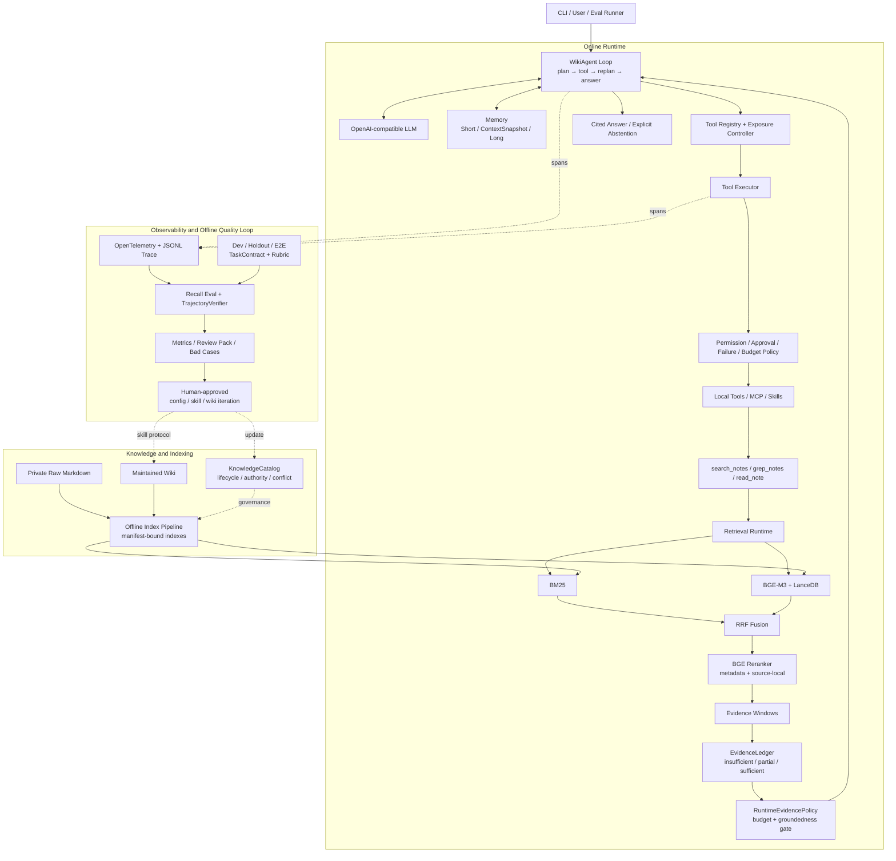

# wiki-agent

[](https://github.com/liushupeng/wiki-agent/actions/workflows/ci.yml)

一个面向本地 Markdown 知识库的 TypeScript Agentic RAG 项目。它不仅检索文档，还把 Agent loop、工具治理、证据策略、长期知识维护、可观测性与可复现评测组合成完整工程闭环。

```text
raw sources
  -> hybrid retrieval
  -> evidence-aware agent
  -> cited answer / explicit abstention
  -> trace + eval + bad case
  -> maintained wiki
```

## 已验证结果

当前公开评测快照：

- 25 篇仓库内公开技术语料，作为可直接运行的 fixture，用于快速验证索引、检索与离线评测链路
- 检索开发集：严格通过 50/50，Recall@20、Hit@5、Hit@1 均为 100%
- 独立 Holdout：严格通过 15/15，15 个 expected source 与开发集零重叠
- Agent E2E：TaskContract 10/12，人工 rubric 12/12；两个自动失败均为正确拒答但未逐字命中必需短语

指标、方法、性能和适用边界见[公开评测摘要](docs/evaluation/SUMMARY.md)。公开语料规模较小，100% 检索指标用于证明管线可复现，不能等价为通用问答准确率。

## 解决的问题

普通 RAG 往往止于“切分—向量检索—回答”。`wiki-agent` 继续处理生产型 Agent 更难的部分：

- 如何让 BM25 与 Dense 检索互补，并定位长文档内的正确片段
- 如何限制工具、写入范围、循环步数和 RAG 调用预算
- 如何在证据不足时阻止模型继续断言
- 如何维护文档版本、权威性、冲突状态和生命周期
- 如何把结果质量与执行轨迹分开评测
- 如何用 Trace、Holdout 和 bad case 驱动下一轮改进

## 架构



实线表示运行时或索引数据流，虚线表示治理与离线反馈。Wiki 更新目前由 Skill 协议驱动并经过人工审批，不是评测结果自动写回生产知识库。

主要模块：

- `src/agent.ts`：LLM 驱动的规划—工具—回答循环
- `src/context/`：上下文快照、EvidenceLedger、证据充分性与运行时策略
- `src/rag/`：索引、Hybrid Retrieval、Retriever 复用和 KnowledgeCatalog
- `src/tools/`：统一工具接口、权限和执行器
- `src/context/`：会话记忆、压缩、证据策略与长期记忆提案
- `src/trace/`、`scripts/observability/`：Trace、指标和运行摘要
- `scripts/evaluation/`：Recall、Agent E2E、轨迹复核和人工评测汇总

## 核心能力

### Hybrid Retrieval

- BM25 中文词法召回
- BGE-M3 Dense embedding
- Reciprocal Rank Fusion（RRF）
- BGE Reranker 精排
- Metadata-prefixed 与来源内片段重排
- `fast`、`balanced`、`deep` 三档检索及空结果升级
- Retriever/模型实例复用与 CPU 并发门控

### Evidence-aware Agent

- RAG observation 写入结构化 EvidenceLedger
- `insufficient | partial | sufficient` 三态证据评估
- 运行时反馈剩余 RAG 预算
- 达到预算后隐藏 RAG 工具
- 零证据却继续断言时强制降级为明确拒答
- 低权威或冲突证据不会被标记为充分

### Safety and Governance

- 工具权限、审批模式和写入 scope
- 沙箱路径校验、输出上限和命令超时
- `KnowledgeCatalog` 文档生命周期：
  `active | superseded | archived | quarantined | deleted`
- 文档版本、权威性、质量、有效期和冲突状态参与索引与排序
- 长期记忆先提案、校验、审批，再事务写入

### Evaluation and Observability

- 50 题检索开发集
- 15 题独立 Holdout
- 12 题 Agent E2E（含 2 个拒答负例）
- TaskContract 验证工具、预算、证据、安全和终止行为
- TrajectoryVerifier 可离线重放 JSONL Trace
- 人工 rubric 不依赖 LLM Judge
- OpenTelemetry、JSONL Trace 与 SLI/SLO 汇总

## 快速开始

要求：

- Node.js 22+
- npm
- 一个 OpenAI-compatible LLM API
- 本地 Markdown 语料
- Hybrid 模式需要首次下载 BGE-M3 与 Reranker 模型

安装：

```bash
git clone https://github.com/liushupeng/wiki-agent.git
cd wiki-agent
npm ci
```

创建本地配置：

```bash
cp .env.example .env
```

至少在 `.env` 中配置：

```env
BASE_URL=https://api.deepseek.com
API_KEY=your_api_key
MODEL_NAME=your_model
AGENT_SANDBOX_ROOT=.
AGENT_WORKSPACE_ROOT=.
RAG_RETRIEVAL_MODE=balanced
RAG_INDEX_VARIANT=raw-wiki
```

将 Markdown 知识源放入 `notes/`，然后检查配置和本地模型：

```bash
npm run check:config
npm run check:rag-models
```

构建同一语料快照上的 BM25 与 Dense 索引：

```bash
npm run index:knowledge -- -- --profile bm25-v1 --variant raw-wiki
npm run index:knowledge -- -- --profile bge-m3-v1 --variant raw-wiki
```

启动一次问答：

```bash
npm run ask -- "总结我的 Agent 笔记并给出来源"
```

## 开发与验证

```bash
# TypeScript 编译
npm run build

# 清理、编译并运行全部离线测试
npm test

# 配置与知识目录检查
npm run check:config
npm run check:knowledge-catalog

# 最近 24 小时运行指标
npm run ops:summary -- -- --since-hours 24
```

GitHub Actions 会在 `master`、`main` 分支推送及 Pull Request 上使用 Node.js 22 执行 `npm ci` 和 `npm test`。CI 不调用付费模型，也不依赖私有语料。

## 评测

检索开发集：

```bash
npm run eval:recall -- -- --retrieval-profile hybrid-bge-m3-metadata-source-aggregate-v1 --variant raw-only --retriever vector
```

用真实 tokenizer 检查候选 chunk 大小是否超过 embedding 上限：

```bash
npm run eval:chunks -- bge-m3-v1 raw-wiki
```

独立 Holdout：

```bash
npm run eval:recall -- -- --retrieval-profile hybrid-bge-m3-metadata-source-aggregate-v1 --variant raw-only --retriever vector evaluation/holdout/questions.json
```

Agent E2E 会调用真实模型，先运行免费 preflight，再显式选择题目或使用 `--all`：

```bash
npm run eval:agent -- -- --retrieval-profile hybrid-bge-m3-metadata-source-aggregate-v1 --variant raw-wiki --all --preflight --max-steps 8 --max-output-tokens 2048 evaluation/e2e/questions.json
```

完整评测协议、命令和指标定义见[公开评测摘要](docs/evaluation/SUMMARY.md)与[项目参考文档](docs/wiki-agent-project-reference.md)。

## 目录

```text
src/                 Agent、RAG、Memory、Tools、Observability
scripts/             索引、检查、评测和运维脚本
config/              检索、知识源、MCP、权限与 SLO 配置
evaluation/          开发集、Holdout、E2E 和 bad cases
examples/            可公开复现的合成技术知识库
skills/              按需加载的 Agent skills
wiki/                Agent 维护的结构化知识层
docs/                系统指南、公开评测与完整项目参考
notes/               本地私有语料，不进入 Git
models/              本地模型缓存，不进入 Git
var/                 索引、Trace、评测原始产物，不进入 Git
```

## 文档导航

- [公开评测摘要](docs/evaluation/SUMMARY.md)：聚合指标、方法、失败类型与边界
- [系统指南](docs/wiki-agent-system-guide.md)：端到端系统边界与实现说明
- [完整项目参考](docs/wiki-agent-project-reference.md)：配置、设计取舍、评测协议和命令细节
- [安全政策](docs/security/SECURITY.md)：本地数据边界、安全控制、已知限制与漏洞报告建议
- [环境变量模板](.env.example)：运行时配置说明

## 项目边界

当前实现是 local-first CLI 和工程验证项目，不是多租户 SaaS：

- 没有 Web UI、账号系统或远程部署控制面
- 默认单机 CPU 运行，性能指标不代表并发服务能力
- 私有语料、模型、索引和原始 Trace 不进入 Git
- LLM 行为仍受模型版本和服务状态影响
- KnowledgeCatalog 已提供治理机制，但治理质量仍依赖元数据维护

这些边界是刻意保留的：项目重点是证明 Agent runtime、RAG、证据治理、可观测性和评测闭环，而不是包装一个演示页面。

## License

[MIT](LICENSE)
