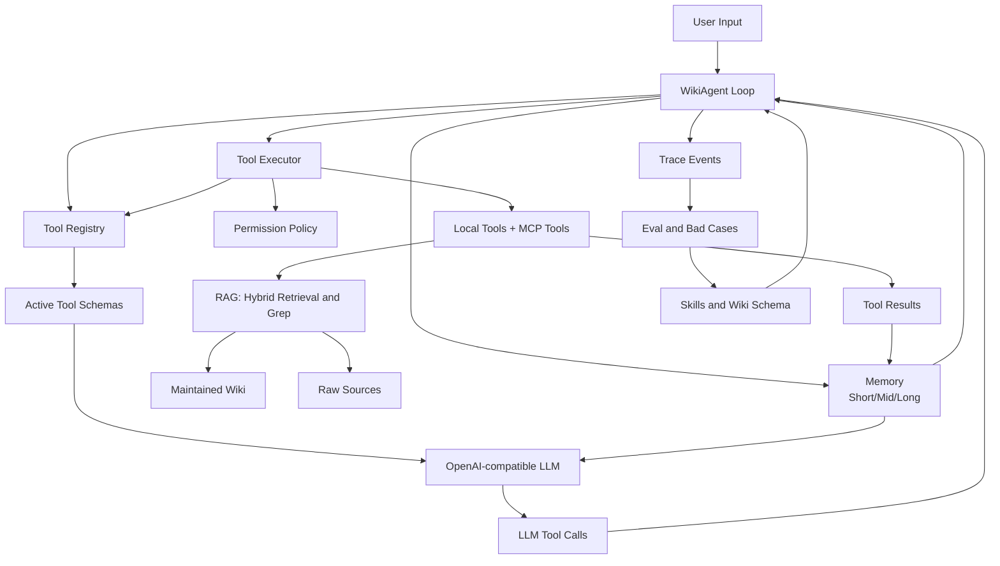
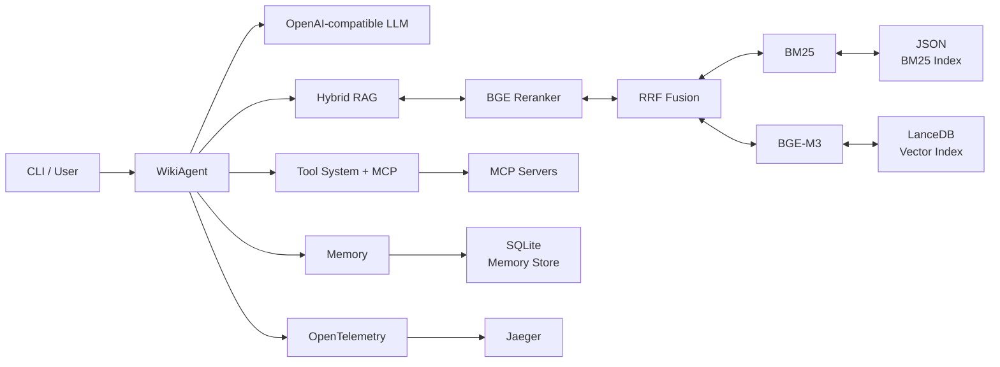

# wiki-agent 完整项目参考

> 仓库概览与快速开始见[根 README](../README.md)，聚合评测结果见[公开评测摘要](evaluation/SUMMARY.md)。

`wiki-agent` 是一个 LLM Wiki / Agentic RAG 项目，用来展示一个 Agent 系统如何从“会检索 Markdown 笔记”演进为“会维护长期知识资产”的工程实现。它不是只把文件切 chunk 后交给向量检索，而是把 Agent loop、memory、tool、permission policy、observability、MCP、skill 和 eval 组合起来，让 LLM 能按任务规划、选择工具、读取证据、维护 wiki，并把失败样例沉淀为可改进的数据。

这个项目采用一个简单的 Agent 视角：

```text
概念上：agent = loop + memory + tool
工程上：agent = loop + memory + tool + policy + observability
```

- `loop` 是由 LLM 驱动的规划-执行循环：模型基于当前 memory 决定下一步是回答还是调用工具，工具结果再写回 memory，触发下一轮再规划
- `memory` 用于保持 Agent 的对话连续性：短期 memory 保留最近上下文，中期 memory 承接压缩摘要；用户明确保存的长期 memory 与会话消息持久化在本地
- `tool` 是广义工具，代表模型可调用的外部能力：RAG 检索、skill 加载、文件系统、Shell、API、测试命令都属于这个范畴
- `policy` 提供权限、审批、预算和终止约束
- `observability` 通过 trace、日志和评测让 Agent 行为可解释、可调试

## 知识图谱

### 业务流程



### 技术栈



- **应用层**：Node.js、TypeScript、OpenAI-compatible API
- **检索层**：BM25 + JSON 索引、BGE-M3 + LanceDB、BGE reranker
- **本地推理**：Transformers.js、ONNX Runtime
- **集成与可观测性**：MCP、SQLite、OpenTelemetry、Jaeger

## 核心设计取舍

- **Agent loop 保持清晰**：`src/agent.ts` 只负责 LLM 驱动的规划-执行循环、模型调用、工具调度和 trace；工具执行、权限判断、协议适配都拆到独立模块。
- **Memory 与 Wiki 分层**：短期 memory 负责最近对话，中期 memory 负责压缩后的摘要；用户明确保存的长期 memory 与会话历史存于 `var/memory/`。`wiki/`、skills、evaluation 是独立的长期知识与质量资产，不属于 `MemoryManager`。
- **工具是广义能力入口**：RAG、grep、skill、MCP、本地文件、Git、Shell、测试命令都通过统一 `IAgentTool` 接口进入 Agent。
- **检索采用 hybrid + grep 双通道**：语义问题由 `search_notes` 使用 BM25、BGE-M3、RRF 与 Reranker，明确术语、配置名、错误文本优先 `grep_notes`。
- **工具 schema 按需暴露**：所有工具注册到 `ToolRegistry`，但每轮只暴露 core tools 和已加载 tool group，降低上下文占用。
- **MCP 优先，本地工具兜底**：Filesystem/Git/SQLite 等成熟能力通过 MCP 接入；MCP 覆盖的本地等价工具会跳过，避免重复暴露。需要更严格策略的本地工具可通过 MCP 配置排除同名远端能力。
- **先沉淀数据，再谈训练**：检索 Reranker 已落地；当前继续沉淀 trace、eval、bad case、wiki schema 和 skill，为 tool routing、泛化评测与后训练准备数据资产。

### 四项 offline-first Harness 契约

- **TaskContract + TrajectoryVerifier**：题目可声明必须/禁止工具、预算、终止原因、证据与安全条件；验证器直接重放 JSONL v2，不创建 Agent、不调用模型。未配置 contract 的旧题继续使用原判分。
- **EvidenceLedger + RuntimeEvidencePolicy**：成功的 RAG observation 会写入结构化证据账本，并产生 `insufficient | partial | sufficient` 三态。运行时会反馈证据库存与剩余 RAG 预算，达到预算后隐藏 RAG 工具；检索完全没有产生可引用证据且模型仍给出断言时，最终回答会被证据闸门降级为明确拒答。
- **ContextSnapshot**：中期记忆不再逐消息截断，而是确定性保留目标、工具 call ID、已确认事实、source/chunk/citation、失败尝试和未完成项。被裁掉的长正文会标记为需要重新读取。
- **MemoryProposal**：模型只能通过 `propose_memory` 创建提案。提案经确定性核验、用户审批后，才由 SQLite 事务写入长期记忆；现有 `remember` 仍表示用户已经明确批准的快捷提交。

记忆提案 REPL 命令：

```text
propose [preference|constraint|fact] <内容>
proposals [status]
approve <proposal-id>
reject <proposal-id>
```

## wiki-agent VS 普通 RAG

普通 RAG 通常是：

```text
raw documents
-> chunk / embed
-> query-time retrieval
-> answer
```

`wiki-agent` 的目标形态是：

```text
raw sources
-> agent-maintained wiki
-> wiki-first retrieval
-> cited answer
-> bad case / eval / skill / schema improvement
```

这意味着知识不会只在每次提问时被临时拼接，而是逐步沉淀到 `wiki/` 中，形成可审阅、可版本管理、可持续维护的 Markdown 知识层。

## 快速开始

### 环境依赖

需要先准备这些本机依赖：

```powershell
# Node.js / npm
node --version
npm --version

# Git，本地 Git 工具和 Git MCP 都会用到
git --version

# uv / uvx，Git 和 SQLite MCP 使用 uv tool 安装 Python MCP server
powershell -ExecutionPolicy ByPass -c "irm https://astral.sh/uv/install.ps1 | iex"
uvx --version
```

项目依赖和 MCP server 工具安装：

```powershell
# 按 package-lock.json 安装应用、RAG、MCP 与可观测性依赖
npm ci

# 安装 Git / SQLite MCP server
uv tool install mcp-server-git
uv tool install mcp-server-sqlite

# 确认 MCP server 命令可被当前 shell 找到
where.exe mcp-server-filesystem
where.exe mcp-server-git
where.exe mcp-server-sqlite

# 检查 MCP server 是否能启动并列出工具
npm run check:mcp
```

还需要准备 DeepSeek 或其他 OpenAI-compatible LLM API key，并写入本地 `.env`。`.env.example` 会作为可提交的默认配置层自动加载；`.env` 只需保存密钥和本机覆盖项，无需复制所有默认值。

可先检查 API 的 DNS、HTTPS 和认证是否可用；该命令请求轻量的 `/models` 端点，不调用模型生成：

```powershell
# 检查合并后的配置，再检查 LLM API 连通性
npm run check:config
npm run check:llm

# 临时检查其他 OpenAI-compatible Provider
$env:BASE_URL="https://your-provider-api-base-url"
$env:API_KEY="your_api_key"
npm run check:llm
```

返回 `HTTP 200` 表示网络与认证均正常；`401` 或 `403` 表示服务已可达，但 Key 或权限有问题；DNS、HTTPS 连接失败或超时则说明应检查本地网络、代理或服务端可用性。

### 常用命令

```bash
npm run ask -- "readiness probe 失败时 Pod 会发生什么？请给出来源。"
npm run ask -- --session <sessionId> "继续上一会话的任务"
npm run index:knowledge -- -- --profile bm25-v1 --variant raw-only
npm run eval:recall -- -- --retrieval-profile hybrid-bge-m3-metadata-source-aggregate-v1 --variant raw-only --retriever vector
npm run eval:agent -- -- --retrieval-profile hybrid-bge-m3-metadata-source-aggregate-v1 --variant raw-wiki --question-ids e2e-single-k8s-readiness evaluation/e2e/questions.json
npm run check:mcp
npm run check:knowledge-catalog
npm run ops:summary -- -- --since-hours 24
npm test
```

## 目录结构

```text
wiki-agent/
├── src/                 # TypeScript 源码
├── scripts/             # 项目级辅助脚本，例如 RAG 索引和评测
├── skills/              # 可按需加载的 skill Markdown
├── wiki/                # Agent 维护的结构化 Markdown wiki
├── examples/            # 进入版本控制的公开可复现语料
├── notes/               # 本地 Markdown 知识源，不进入 Git
├── evaluation/          # 开发集、独立 Holdout 与失败案例
├── config/              # RAG 索引/检索、知识源、MCP、write scopes 与评测配置
├── models/              # 本地 Transformers.js / ONNX 模型缓存
├── var/                 # 运行产物：索引、trace 等，不进入 Git
├── docs/                # 外部设计参考资料
├── .env.example         # 运行配置模板
└── package.json
```

`src/` 主要模块：

```text
src/
├── main.ts              # CLI 入口，初始化 memory、registry、agent
├── agent.ts             # Agent loop：模型调用、工具调度、span 生命周期
├── context/             # 模型上下文：对话记忆、工具结果预算
├── trace/               # Telemetry、JSONL v2、artifact 与 OTLP backend
├── permissions.ts       # 工具权限决策
├── sandbox.ts           # 本地沙箱路径保护
├── limits.ts            # 工具输出和文件读取限制
├── env.ts               # 默认环境层与本机覆盖加载
├── config/              # write scopes 等运行配置解析
├── evaluation/          # 评测 CLI、实验编排与报告结构
├── cli/                 # CLI 适配器
├── prompts/             # system prompt
├── protocol/            # OpenAI tool-call 协议适配
├── mcp/                 # MCP server 配置、client 和 tool adapter
├── rag/                 # RAG 文档加载、chunk、embedding、vector store、pipeline
├── tools/               # Agent 工具实现
├── utils/               # 通用工具函数
└── tests/               # Node 内置测试
```

## 运行流程

### Agent Loop

```text
用户输入
-> MemoryManager 追加 user message
-> WikiAgent 调用 LLM
-> LLM 返回文本或 tool_calls
-> handleToolCalls 调度工具
-> ToolExecutor 执行权限检查、审批、参数校验和工具调用
-> 工具结果写回 memory
-> LLM 继续规划或输出最终答案
```

`handleToolCalls()` 会按工具的 `isReadOnly` 分流：

- 只读工具并发执行。
- 写文件、Shell、测试等有副作用工具串行执行。
- 工具结果按原始 tool call 顺序写回 memory，保持 OpenAI tool 协议合法。
- 单次 run 内，同一工具的等价参数连续失败两次后，第三次相同调用会返回 `retry_limit_reached`，要求模型改用其他参数、工具或向用户澄清；成功调用会清除该调用的失败计数。
- 所有工具结果在写回 memory 前都会经过统一 Context Policy：保留结构化字段并压缩长字符串、数组和对象；超过 `CONTEXT_TOOL_RESULT_MAX_CHARS` 时返回带截断说明的有效 JSON。

### LLM Wiki Layer

知识层采用三层结构：

```text
raw sources
-> agent-maintained wiki
-> query / eval / bad case loop
```

- `notes/` 保存用户自己的本地原始资料，尽量作为 source of truth；该目录不进入 Git。仓库内公开复现使用 `examples/public-knowledge/`。
- `wiki/` 保存 LLM 维护的结构化知识页，包括 `index.md`、`log.md`、`contradictions.md` 和各类页面目录。
- `wiki/AGENTS.md` 定义 wiki schema，规定页面类型、frontmatter、引用规则、ingest/query/lint 流程。
- `evaluation/badcases/` 保存失败样例，后续转成 eval、skill、schema 或 prompt 的改进输入。

### RAG 索引

先查看索引命令帮助（不构建索引）：

```bash
npm run index:knowledge
```

实际构建必须显式指定 profile：

```bash
npm run index:knowledge -- -- --profile bm25-v1
```

索引 profile 在 `config/rag.indexes.jsonc` 中声明多个 variant；每个 variant 显式绑定一个 knowledge sources 配置。日常 `ask` 默认使用 active profile 的 active variant，也可通过 RAG 工具选项覆盖。该配置文件支持注释，并通过同目录的 JSON Schema 提供字段说明、校验和自动补全。

配置文件中每个 source 的 `name` 会写入检索结果的 `source` 前缀，例如 `wiki/index.md`、`raw/agent-runtime.md`。索引 variant 通过 `sourceConfigPath` 绑定语料配置；公开评测的 `raw-only` 与 `raw-wiki` 分别使用 `config/evaluation/raw-only.sources.jsonc` 和 `config/evaluation/raw-wiki.sources.jsonc`，并绑定仓库内的合成技术语料。`config/knowledge.sources.jsonc` 则供本地运行时的 grep 等工具读取用户自己的 `notes/` 与 Wiki。

```jsonc
{
  "$schema": "./knowledge.sources.schema.json",
  "sources": [
    {
      "name": "wiki",
      "root": "wiki",
      "kind": "wiki",
      "enabled": true,
      "index": true,
      "priority": 100,
      "ignore": []
    },
    {
      "name": "raw",
      "root": "notes",
      "kind": "raw",
      "enabled": true,
      "index": true,
      "priority": 50,
      "ignore": ["**/__pycache__/**", "**/finalData/**"]
    }
  ]
}
```

```bash
npm run index:knowledge -- -- --profile bm25-v1
npm run index:knowledge -- -- --profile bm25-v1 --variant raw-only
```

每个 profile/variant 写入独立目录：

```text
var/indexes/bm25-v1/raw-only/index.json
var/indexes/bm25-v1/raw-only/manifest.json
var/indexes/bm25-v1/raw-wiki/index.json
var/indexes/bm25-v1/raw-wiki/manifest.json
var/indexes/bge-m3-v1/raw-only/index.lance/
var/indexes/bge-m3-v1/raw-only/manifest.json
```

索引数据流采用惰性读取和流式写入。每次只读取一个文件，逐个生成 chunk
和向量并写入临时索引，完成后再替换正式索引：

```text
iterateSourceDocuments / iterateSourceDocumentsFromRoots
-> chunkDocument
-> Embedder.embed
-> VectorStore.replaceChunks
```

默认 profile `bm25-v1` 使用本地中文 bigram BM25 与 JSON 后端；`tf-v1` 保留为词频余弦对照实验。profile 定义于
`config/rag.indexes.jsonc`：它固定 embedding、chunk 参数、向量后端；variant 固定语料 source config 与索引目录名。
`manifest.json` 记录 profile、variant、source config、文档数和 chunk 数；查询端会验证这些身份及 embedding，不一致时拒绝查询并要求重建。

TF 与 BM25 profile 使用 JSON store，便于本地实验和检查；BGE-M3 profile 已使用
LanceDB 保存 1024 维稠密向量。物理索引由 profile 隔离，混合检索只融合相同语料
快照上的 BM25 与 BGE-M3 结果。

索引期间，命令行会持续显示已处理文档数、chunk 数、耗时和当前文件；
交互式终端会原地刷新，重定向日志时则每 5 秒输出一行。完成后还会汇总
来源、切分参数、索引大小、处理吞吐量和进程峰值内存。

文档数、chunk 数、索引大小、吞吐和峰值内存会随 source ignore 规则与 profile
变化，构建完成后以对应索引目录中的 `manifest.json` 和命令行摘要为准。

`search_notes` 使用检索 profile 时按该 profile 的融合与重排策略返回结果；未指定检索 profile 的单索引回退路径会优先返回 `wiki/` 命中。`grep_notes` 在 configured knowledge roots 中搜索，并在结果里保留 source prefix。

`config/knowledge.catalog.jsonc` 管理文档 `active / superseded / archived / quarantined / deleted` 生命周期、版本、权威性、质量、有效期、一致性和可选 claim 级来源。新建索引时只有当前有效的 `active` 文档会进入索引；明确标注的 authority/quality/consistency 会进入 Reranker 元数据并提供小幅软排序先验。catalog 指纹写入 manifest，catalog 变化后旧索引会拒绝查询并要求重建。`npm run check:knowledge-catalog` 可检查来源路径、删除状态和可选 content hash。

核心接口在：

- `src/rag/embeddings.ts`：`Embedder`
- `src/rag/vectorStore.ts`：`VectorStore`
- `src/rag/indexPipeline.ts`：索引编排

重建默认 BM25 索引：

```bash
npm run index:knowledge -- -- --profile bm25-v1
```

构建 TF 对照索引：

```powershell
npm run index:knowledge -- -- --profile tf-v1 --variant raw-wiki
```

要测试新的 embedding，新增一个 profile 及其 variants，构建对应的独立索引；确认收益后再将 `activeProfile` / `activeVariant` 切换到目标组合。OpenAI 兼容服务使用 profile 中声明的环境变量保存 endpoint 与 API key，不会写入 manifest。

## MCP / Tool Loading

工具统一继承 `BaseAgentTool`，并声明：

- `name`：LLM 调用工具时使用的唯一名称。
- `schema`：暴露给 LLM 的工具说明和参数结构。
- `permission`：能力类别，例如 `read`、`write`、`shell`、`rag`。
- `riskLevel`：权限策略使用的风险等级。
- `isReadOnly`：决定同一轮工具调用可否并发。
- `requiresApproval`：是否强制人工审批。

工具加载采用“核心工具 + 按需分组”：

- 启动时所有本地工具和 MCP 工具都会注册到 `ToolRegistry`，因此执行层知道完整工具全集。
- 每轮发给 LLM 的 schema 只包含当前已暴露的工具，避免工具数量增长后持续占用上下文。
- 默认暴露 `core` 工具：`search_notes`、`grep_notes`、`read_note`、`related_notes`、`load_skill`、`load_tool_group`。
- 当任务需要文件、Git、SQLite、代码修改或 shell 能力时，LLM 先调用 `load_tool_group` 激活对应分组；下一轮模型调用才会看到该组完整 schema。
- 每个新的用户任务开始前会重置为 `core`，避免 REPL 中上一轮加载过的工具组长期占用后续上下文。

工具分组：

- `core`：RAG 检索、笔记读取、skill 加载和 `load_tool_group`。
- `filesystem`：`list_dir`、`read_file`、`write_file`、`glob_search`、`grep_search`，以及 Filesystem MCP 工具。
- `git`：`git_status`、`git_diff`，以及 Git MCP 工具。
- `sqlite`：SQLite MCP 工具。
- `coding`：`apply_patch`、`run_tests`。
- `shell`：`execute_command`。

启动时会先注册 MCP 工具，再注册本地工具。如果 MCP 已经提供等价能力，本地对应工具会跳过，避免模型同时看到两套做同一件事的工具。当前过滤规则：

- Filesystem MCP 覆盖 `list_dir`、`read_file`、`glob_search`。`write_file` 由本地受限作用域实现提供，Filesystem MCP 的同名远端能力在配置中排除。
- Git MCP 覆盖 `git_status`、`git_diff`。
- `grep_search`、RAG、skill、`apply_patch`、`run_tests`、`execute_command` 仍由本地工具提供。

### MCP 接入

项目通过 `src/mcp/` 提供通用 MCP 接入层：

```text
MCP server config
-> StdioMcpClient
-> listTools()
-> McpAgentTool adapter
-> ToolRegistry
-> LLM tool schema
```

Agent loop 不感知具体 MCP server。Filesystem、Git、SQLite 或后续其他 MCP 都以相同方式接入：在 `.env` 中用 `MCP_CONFIG_PATH` 指向 MCP 配置文件，配置文件声明 stdio server 的 `command`、`args`、工具名前缀、`disabledTools` 和默认风险等级。

```env
MCP_CONFIG_PATH=config/mcp.servers.jsonc
```

### `write_file` 可配置作用域

`write_file` 是唯一的通用写入工具，风险等级为 `write`，仍需按审批策略执行。它不接受任意根目录：`scope` 只能选择 `WRITE_SCOPES_CONFIG_PATH` 指向的 JSONC 文件中预先声明的名称，`filename` 必须相对于该作用域根目录；路径穿越、工作区外根目录和符号链接逃逸都会被拒绝。

默认作用域为 `sandbox`。项目的 [config/write.scopes.jsonc](config/write.scopes.jsonc) 另外声明 `wiki -> wiki/`，因此维护型 Skill 应调用：

```json
{
  "scope": "wiki",
  "filename": "concepts/agent-rag.md",
  "content": "..."
}
```

普通临时输出省略 `scope`，仍会写入 `var/sandbox/`。新增例如 `abc` 的目录时，在该受信任配置中增加一个名称、工作区内相对 `root` 及用途说明；该说明会自动出现在工具 schema 中，供 Agent 选择正确作用域。

MCP tool 的风险等级按以下顺序确定：

- server tool 标注 `readOnlyHint=true` 时视为 `safe`。
- server tool 标注 `destructiveHint=true` 时视为 `write`。
- server tool 标注 `openWorldHint=true` 时视为 `network`。
- 没有 annotation 时使用 server 配置中的 `defaultRiskLevel`。

因此，新增 MCP server 时通常只需要补一段配置；如果某个 server 的工具风险无法通过 annotation 表达，再调整该 server 的默认风险等级。

## 安全与权限设计

Agent 能调用文件、Git、Shell、MCP 等外部能力，因此安全边界是核心设计之一。本项目把安全拆成三层：

- **工具风险声明**：每个工具声明 `permission`、`riskLevel`、`isReadOnly`、`requiresApproval`。
- **统一权限策略**：`PermissionPolicy` 根据风险、审批模式和 shell 安全规则返回 `allow`、`ask`、`deny`。
- **运行时沙箱**：文件、搜索、Shell 和 Coding 工具都限制在指定根目录内。

### 审批模式

`APPROVAL_MODE` 支持：

- `prompt`：风险工具执行前询问用户。
- `auto`：通过安全检查的工具自动执行。
- `deny`：拒绝所有需要审批的工具。

`PermissionPolicy` 会综合工具风险、Shell 命令 allowlist、危险 token 和审批模式，返回 `allow`、`ask` 或 `deny`。

### 沙箱

文件、搜索、通用 Shell 和默认 `write_file` scope 统一使用工作区内的 `var/sandbox`：

```env
AGENT_WORKSPACE_ROOT=.
```

`resolveSafePath()` 会拒绝目录穿越和符号链接逃逸。`ShellExecuteTool` 的 `cwd` 固定为
`<AGENT_WORKSPACE_ROOT>/var/sandbox`。

`ApplyPatchTool`、`GitStatusTool`、`GitDiffTool`、`RunTestsTool` 使用工作区根目录本身；
其余通用文件工具只能访问该工作区下的 `var/sandbox`。

## Skill 懒加载

启动时只把 `skills/*/SKILL.md` 下每个 skill 的 `name` 和 `description` 注入 system prompt。任务命中 skill manifest 时，LLM 需要先调用：

```text
load_skill({ "name": "..." })
```

工具返回 skill 全文后，下一轮模型才能按 skill 的具体方法执行。这样避免把所有 skill 全文一次性塞进上下文。

内置维护型 wiki skills：

- `source-audit`：真实目录接入前做 source audit，产出 source policy、ignore 规则和首批验证范围。
- `ingest`：把 raw source 整理进 maintained wiki，并更新 index/log/contradictions。
- `wiki-answer`：优先基于 wiki 回答，证据不足再回查 raw sources。
- `wiki-lint`：检查孤立页面、缺引用、重复概念、过期结论和冲突。
- `badcase`：把失败回答、检索遗漏或工具选择错误沉淀为 bad case 和 eval 候选。
- `distill-topic`：把分散资料提炼为可维护的主题知识页。
- `notes-rag`：按检索、局部阅读与证据约束处理笔记问题。
- `note-curation`：整理笔记结构、元数据、链接和重复内容。

## 可观测性与评测

Agent 系统很难只靠最终答案调试，所以项目把 trace、成本估算、RAG eval、bad case 模板作为一等能力。

每次 `WikiAgent.run()` 都会写 trace。当前默认 sink 是 `JsonlTraceSink`，写入本地 JSONL 文件。

```env
TRACE_DIR=var/traces
```

Trace 架构已经做成可插拔：

```text
Agent / Tools / RAG
-> Telemetry / SpanHandle
   -> FileTelemetry (JSONL)
   -> OtelTelemetry (OTLP)
```

JSONL 只使用当前的 schema version 2。每条记录都是 `span_start`、`span_event` 或 `span_end`，并包含 `traceId`、`spanId`、`parentSpanId`、时间戳、状态和结构化 attributes。旧的扁平事件格式不再生成，也不能由导出工具导入。

文件名采用 `<UTC 时间戳>_<traceId>.jsonl`，例如 `2026-07-23T14-22-10-123Z_33547b96af3674b2a8b4fa69caca0f9a.jsonl`；前半部分便于排序，后半部分可直接对应 Jaeger Trace。

如需将既有 JSONL trace 离线导入 OpenTelemetry 后端，可显式执行导出命令。无参或传入 `--help` 时仅显示帮助；端点优先级为 `--endpoint`、`OTEL_EXPORTER_OTLP_TRACES_ENDPOINT` 和本机 Jaeger 默认值 `http://127.0.0.1:4318/v1/traces`。使用 `--dry-run` 仅校验和统计文件，不发生网络请求：

```powershell
npm run trace:import -- -- --input var/traces/<timestamp>_<traceId>.jsonl
npm run trace:import -- -- --input var/traces/<timestamp>_<traceId>.jsonl --endpoint http://localhost:4318/v1/traces
npm run trace:import -- -- --input var/traces/<timestamp>_<traceId>.jsonl --dry-run
```

该脚本只读取 trace 文件，将运行、步骤、模型调用、工具执行和 RAG 搜索映射为 OTLP span；不会修改源 trace。`--dry-run` 时使用内存 exporter，不发送网络请求。

默认 `TELEMETRY_BACKEND=file` 会在根 run span 已结束、JSONL 写入完成后，自动通过 OTLP HTTP 导出该次运行的确切 trace 文件到本机 Jaeger：`http://127.0.0.1:4318/v1/traces`。自动导出最多等待 3 秒；Jaeger 未启动或导出失败只会打印警告，本地 JSONL 不会删除，仍可稍后手动重放。

### Windows 本地 Jaeger

可使用 Jaeger 官方 Windows 原生包，不需要 Docker：

1. 从 [Jaeger v2.19.0 Release](https://github.com/jaegertracing/jaeger/releases/tag/v2.19.0) 下载并解压 `jaeger-2.19.0-windows-amd64.zip`。
2. 在解压目录启动：

```powershell
.\jaeger.exe --set=extensions.jaeger_storage.backends.some_storage.memory.max_traces=500 --set=extensions.jaeger_query.enable_tracing=false
```

3. 执行 `npm run ask` 会自动导入。也可手动导入既有 trace：

```powershell
npm run trace:import -- -- --input var/traces/<timestamp>_<traceId>.jsonl --endpoint http://127.0.0.1:4318/v1/traces
```

Jaeger all-in-one 的 OTLP HTTP 端口为 `4318`，使用内存存储；以上命令最多保留 500 条 trace，达到上限后覆盖最早写入的 trace。`extensions.jaeger_query.enable_tracing=false` 会关闭 Jaeger 查询服务自身的内部追踪，避免 Windows 上 `localhost` 解析至 IPv6 `::1`、但 gRPC 仅监听 IPv4 时产生连接告警；不会影响应用 Trace 的接收、存储或查询。关闭进程后已导入的 trace 会丢失。

### Prompt artifact

为逐字复盘某次模型调用，可显式启用本地 prompt artifact。它保存脱敏后的完整模型请求（messages、工具 schema 与模型参数），不将长内容写入 Jaeger：

```env
TRACE_CAPTURE_PROMPTS=true
TRACE_ARTIFACT_DIR=var/traces/artifacts
```

每个 `gen_ai.chat` span 会带有以下关联属性：

- `wiki_agent.prompt_artifact.path`
- `wiki_agent.prompt_artifact.sha256`
- `wiki_agent.prompt_artifact.chars`
- `wiki_agent.prompt_artifact.redacted=true`

根据 Jaeger 中的 `path` 可在本地打开对应 artifact；根据 `sha256` 可校验内容未被修改。artifact 仅做基于字段名的脱敏，启用前应确认本地目录的访问权限与数据保留策略。

为了把真实 `ask` 运行收割为 bad case，可另行启用粒度更小的 run artifact。它只保存本轮脱敏后的完整用户问题、最终回答、模型、构建身份和证据摘要：

```env
TRACE_CAPTURE_RUN_ARTIFACTS=true
TRACE_RUN_ARTIFACT_DIR=var/traces/run-artifacts
WIKI_AGENT_BUILD_ID=<git-sha-or-build-id>
```

默认关闭该能力。脱敏主要针对密钥类文本，不能保证删除姓名、业务内容等个人或团队信息；artifact 位于不入 Git 的 `var/`，仍需按敏感本地数据管理。

要在运行时直接发送 trace（不写 JSONL），配置：

```env
TELEMETRY_BACKEND=otlp
OTEL_EXPORTER_OTLP_TRACES_ENDPOINT=http://localhost:4318/v1/traces
OTEL_EXPORTER_OTLP_PROTOCOL=http
```

HTTP 是默认协议；如使用 gRPC，设置 `OTEL_EXPORTER_OTLP_PROTOCOL=grpc`，并使用 Collector 的 gRPC 地址（通常为 `http://localhost:4317`）。未设置时默认 `TELEMETRY_BACKEND=file`。无论选择文件或 OTLP 后端，Agent、工具和 RAG 使用相同的追踪调用点。

主要 span 为 `wiki_agent.run` → `wiki_agent.step` → `gen_ai.chat` / `tool.execute` → RAG 子 span。模型 token、缓存命中、工具状态、耗时和检索规模均作为对应 span 的 attributes；审批、assistant message 和 memory 压缩作为 span event。

建议排查时先在根 run span 下查看失败或耗时最长的子 span，再沿父子关系定位具体模型调用、工具调用或 RAG 检索。

### 在线健康度与 bad case 回放

在线质量层不使用无金标 Trace 伪造准确率。`ops:summary` 只读取 file telemetry 的 JSONL，汇总运行 SLI 与风险代理指标：

- 运行完成率、工具失败、token、总延迟；
- RAG 缓存、预算、fallback、空检索和检索延迟；
- 仅在实际使用 RAG 的 knowledge runs 中统计 `insufficient | partial | sufficient`；
- 按 retrieval profile/variant 分组，并输出可下钻的 candidate Trace ID。

```powershell
npm run ops:summary -- -- --since-hours 24
npm run ops:summary -- -- --since-hours 24 --fail-on-unhealthy
```

`evidence.state=sufficient` 只表示已检索库存满足通用结构要求，不证明最终答案正确；forced abstention 也可能是正确行为，因此默认只报告、不作为失败阈值。

从真实运行进入回归集的流程为：

```text
ask Trace
-> ops:summary 发现风险分布或具体 Trace
-> trace:harvest 生成本地 candidate JSONL
-> 人工确认问题、预期来源、事实与 TaskContract
-> eval:verify 检查原始轨迹（不调用模型）
-> eval:agent 在当前环境重新执行
-> 固化到 evaluation/badcases 回归集
```

```powershell
npm run trace:harvest -- -- --since-hours 24
npm run trace:harvest -- -- --trace-id <traceId> --signals partial_evidence,fallback
npm run eval:verify -- -- --trace <trace.jsonl> --question-id <id> --questions evaluation/badcases/questions.json --run-artifact <run-artifact.json>
npm run eval:agent -- -- --retrieval-profile <profile> --variant raw-wiki --question-ids <id> evaluation/badcases/questions.json
```

`trace:harvest` 只写 `var/evals/candidates/`，不会自动改动版本控制题集。候选必须人工补金标后才能进入 `eval:verify` / `eval:agent`。题目的 `provenance` 会保留原 trace、模型、profile、variant、索引指纹和构建身份；重跑报告会列出当前环境与原环境的差异。身份一致只说明配置可比，不代表历史索引快照仍然存在。

直接使用 `TELEMETRY_BACKEND=otlp` 时不会产生本地 JSONL，因此 `ops:summary` 和 `trace:harvest` 不可用；应在 OTLP 后端按同名 attributes 聚合。

## 检索优化

`evaluation/questions.json` 是用于迭代调优的 50 题公开合成开发集；每题记录稳定 ID、分类、问题、grep 词项、预期来源与预期关键词。仓库内 `examples/public-knowledge/` 提供可复现语料。独立 Holdout 不参与参数选择，避免在同一批题上反复修正造成过拟合。

实验组严格分开：

- `raw-only`：仅仓库内 `examples/public-knowledge/`，使用 `bm25-v1/raw-only`。
- `raw-wiki`：`examples/public-knowledge/ + wiki/`，重排时 Wiki 优先，使用 `bm25-v1/raw-wiki`。

`bm25-v1` 的 variants 在配置中显式绑定 source config。三个资源消耗型命令在无参数时只输出帮助（exit code 0），不会构建索引、运行评测或调用 LLM。实际构建索引必须显式指定 profile；省略 `--variant` 时构建该 profile 的全部 variants。manifest 会记录 profile、variant、数据源配置指纹、文档数和 chunk 数，运行时若任一身份不匹配会拒绝混用：

```powershell
npm run index:knowledge
npm run index:knowledge -- -- --profile bm25-v1 --variant raw-only
npm run index:knowledge -- -- --profile bm25-v1 --variant raw-wiki
```

本地混合检索将物理索引和查询策略分开配置：`rag.indexes.jsonc` 中的 `bm25-v1`、`bge-m3-v1` 负责构建索引；`rag.retrieval.jsonc` 保留纯向量、RRF、Reranker 等消融策略。配置中的 fallback active profile 是 `hybrid-bge-m3-metadata-source-aggregate-v1`；日常 `.env.example` 使用 `RAG_RETRIEVAL_MODE=balanced`，实际解析为 `hybrid-bge-m3-balanced-v1`，严格评测才显式选择完整 aggregate profile。首次运行会下载较大的 ONNX 模型，先做本机可行性检查，再从同一语料快照重建两个索引：

```powershell
npm run check:rag-models
npm run index:knowledge -- -- --profile bm25-v1 --variant raw-only
npm run index:knowledge -- -- --profile bge-m3-v1 --variant raw-only
npm run eval:recall -- -- --retrieval-profile dense-bge-m3-v1 --variant raw-only --retriever vector
npm run eval:recall -- -- --retrieval-profile hybrid-bge-m3-v1 --variant raw-only --retriever vector
npm run eval:recall -- -- --retrieval-profile hybrid-bge-m3-rerank-v1 --variant raw-only --retriever vector
npm run eval:recall -- -- --retrieval-profile hybrid-bge-m3-chunk-rerank-v1 --variant raw-only --retriever vector
npm run eval:recall -- -- --retrieval-profile hybrid-bge-m3-score-fusion-v1 --variant raw-only --retriever vector
npm run eval:recall -- -- --retrieval-profile hybrid-bge-m3-rerank-anchor40-v1 --variant raw-only --retriever vector
npm run eval:recall -- -- --retrieval-profile hybrid-bge-m3-rerank-no-source-limit-v1 --variant raw-only --retriever vector
npm run eval:recall -- -- --retrieval-profile hybrid-bge-m3-chunk-rerank-metadata-v1 --variant raw-only --retriever vector
npm run eval:recall -- -- --retrieval-profile hybrid-bge-m3-source-local-v1 --variant raw-only --retriever vector
npm run eval:recall -- -- --retrieval-profile hybrid-bge-m3-metadata-source-local-v1 --variant raw-only --retriever vector
npm run eval:recall -- -- --retrieval-profile hybrid-bge-m3-metadata-source-local-only-v1 --variant raw-only --retriever vector
npm run eval:recall -- -- --retrieval-profile hybrid-bge-m3-metadata-source-aggregate-v1 --variant raw-only --retriever vector
```

`check:rag-models` 默认只做快速 smoke check。显式传入 `--benchmark` 时，会从真实 chunk 中固定抽样，并让每组 dtype、device 和 batch size 在独立进程中运行，输出稳态吞吐、batch p50/p95、峰值内存和全量索引预计耗时：

```powershell
npm run check:rag-models -- -- --benchmark --samples 64 --batches 4,8,16 --dtypes q4 --devices cpu
```

只有本地已准备 `model_int8.onnx` 且 Node.js Runtime 支持 WebGPU 时，才加入`--dtypes q4,int8 --devices cpu,webgpu`；失败的组合会保留错误摘要，并继续测试其他组合。

稠密 embedding 使用按模型配置和 chunk 文本寻址的磁盘缓存；索引失败后重跑会复用已经完成的向量。混合检索会校验两个索引 manifest 中的 chunk 指纹，避免融合不同语料快照。配置 `candidateCacheDir` 后，相同索引快照、query 和 candidate limit 的 BM25/BGE-M3 候选会冻结并复用；配置 Reranker 的 `scoreCacheDir` 后，相同模型身份、query 和文本的精排分数也会复用，便于快速重复消融。

在线 `ask` 支持产品化的三档检索模式：`fast` 使用 BM25，`balanced` 使用 40 候选 Hybrid+Reranker，`deep` 使用当前评测最佳的 100 候选完整管线。`fast` 无结果时回退 `balanced`，`balanced` 无结果时回退 `deep`；CPU 模式默认只允许一个完整检索同时执行，并在进程内复用 Retriever、索引与模型实例。`RAG_RETRIEVAL_MODE` 与高级覆盖 `RAG_RETRIEVAL_PROFILE` 互斥：

```env
RAG_RETRIEVAL_CONFIG_PATH=config/rag.retrieval.jsonc
RAG_RETRIEVAL_MODE=balanced
RAG_INDEX_VARIANT=raw-wiki
RAG_RETRIEVAL_MAX_CONCURRENCY=1
MAX_RAG_CALLS=8
```

检索评测不调用 LLM，可比较 Recall@20、Recall@100、Hit@1、Hit@5、MRR，并统计阶段内容恢复/回退、各阶段候选规模、p50/p95 耗时及候选/Reranker 缓存命中率（没有人工分级相关性时不会伪造 nDCG）。无参数或 `--help` 只显示帮助；其他合法参数会实际运行：

```powershell
npm run eval:recall -- -- --variant both --retriever both
npm run eval:recall -- -- --profile bm25-v1 --variant both --retriever vector
npm run eval:recall -- -- --profile bm25-v1 --variant raw-wiki --retriever vector --wiki-first false
npm run eval:recall -- -- --profile bm25-v1 --variant raw-only --retriever vector --probe-candidate-limit 100
npm run eval:recall -- -- --retrieval-profile hybrid-bge-m3-metadata-source-aggregate-v1 --variant raw-only --retriever vector --question-ids http-cache-max-age,k8s-readiness
```

`--profile` 选择索引 profile（默认 `bm25-v1`）；`--variant` 选择索引实验组（默认 `both`），`--retriever` 选择检索实现（默认 `vector`）。`--wiki-first true|false` 可覆盖变体默认重排策略，用于分离 Wiki 语料扩展与 Wiki 优先排序；省略时保留变体默认行为。`--probe-candidate-limit <N>` 会仅对正常 Top-20 候选未命中的题追加深度探测，N 必须大于 20。`--question-ids <id1,id2,...>` 可只重跑失败题或指定样本，适合低成本生成排序诊断。召回报告会记录每个变体的实际 Wiki 优先策略、题目范围和 probe 汇总，并写入 `var/evals/recall/<timestamp>/report.json`。

每次 Recall 评测还会在同一输出目录写入一条 `eval.recall` JSONL Trace。其 `rag.search` 子 span 与在线检索使用相同的候选—重排诊断字段：query、profile、variant、candidate limit、Wiki 优先策略、Top-20 候选和最终 Top-5 结果；评测事件补充金标命中、关键词覆盖率、失败类型，以及正确来源在 sparse、dense、RRF、Chunk Reranker、来源内检索、Anchor、Evidence 组装、Evidence Reranker 和最终结果中的逐阶段 rank。`report.json` 的逐题结果记录 `stageRanks`、`stageDiagnostics` 与 `retrievalDiagnostics`；后者新增阶段耗时、实际参与文档数以及单次查询的候选/Reranker 缓存 hit/miss。汇总指标同时给出 Recall@20/100、20→100 恢复数、Missing@100、各阶段按 60% 关键词阈值计算的恢复/回退数，以及耗时和候选规模分布。报告保留原有的跨 Top-5 合并关键词口径作为“宽松通过”，并新增只允许正确来源贡献关键词的 `sourceTermScore` 和“严格通过”，避免无关文档补齐关键词造成假阳性。终端仅显示 Trace 路径，Trace 是诊断原始事实，报告是其汇总视图。

`hybrid-bge-m3-chunk-rerank-v1` 保留 Evidence 扩展但关闭 Evidence Reranker，用于验证二次重排是否造成降级。`hybrid-bge-m3-score-fusion-v1` 对 RRF、Chunk Reranker 和 Evidence Reranker 分数分别做 min-max 归一化后线性融合；当前实验权重为 Chunk Reranker 0.8、Evidence Reranker 0.6，既保留语义重排的主导作用，也防止强候选被单阶段分数直接淘汰。现有 `hybrid-bge-m3-rerank-v1` 保持原行为，继续作为对照组。

`hybrid-bge-m3-rerank-anchor40-v1` 仅将 Evidence Anchor 从 20 扩至 40，用于检验被 Chunk Reranker 排在 21–40 名的正确内容能否被 Evidence Reranker 救回。`hybrid-bge-m3-rerank-no-source-limit-v1` 仅关闭最终的每来源最多两条限制，用于检验同一来源中排在第三条及之后的正确 Evidence 是否被限额误删。

`hybrid-bge-m3-chunk-rerank-metadata-v1` 以关闭 Evidence Reranker 的当前最佳消融为基础，在 Chunk Reranker 输入前增加 source、titlePath 和 tags，使日期、文件名与知识层级参与相关性判断。`hybrid-bge-m3-source-local-v1` 同样关闭 Evidence Reranker，但会先从 RRF 前 20 个不同来源中各取最多 4 个词法相关 chunk，并强制加入该来源的全局最佳 chunk，再用同一 Reranker 选出每来源最佳 chunk；这样词法预筛不会删除已经由全局语义检索验证过的强候选。Trace 和报告会新增 `sourceLocal` 与 `anchorSelection` 阶段，用于观察“来源正确但答案片段未召回”的恢复情况。

`hybrid-bge-m3-metadata-source-local-v1` 组合 metadata 输入与来源内检索，并用来源内最佳 chunk 替换该来源原本排名最高的 chunk、继承其全局名次；这样既避免答案片段因裸 chunk 分数过低被淘汰，也不会因追加同来源候选挤占 Anchor。题库标注应与原文及问题约束一致：数值和单位必须同时保留（例如 `120 ms`），问题未限定唯一文件时允许所有实际包含答案的来源。

`hybrid-bge-m3-metadata-source-local-only-v1` 只使用每个候选来源内部选出的最佳 chunk 作为 Anchor，排除同一来源的其他全局候选。它用于验证来源内候选排序已经足够可靠、且全局 chunk 是否仍在挤占最终 Top-5；该模式仍是实验项，不替换当前 active retrieval profile。

`hybrid-bge-m3-metadata-source-aggregate-v1` 仍保持每个候选来源一个 Anchor，但把该来源的全局最佳 chunk 与来源内最佳 chunk 聚合到同一 Anchor。它保留来源内检索带来的答案片段，同时避免来源内排序偶尔选错 chunk 时丢失已经由全局 Reranker 找到的正确内容。

评测中的“宽松通过”要求最终 Top-5 命中预期来源，且全部 Top-5 合并后覆盖至少60% 的预期关键词；“严格通过”同样要求命中预期来源，但关键词只能由预期来源中的结果贡献，避免无关文档拼出答案。开发集的通过率和检索指标以完整的 50 题为分母。`Recall@20` 检查重排前 RRF 前 20 个候选中的来源覆盖，`Recall@100` 检查完整 RRF 候选池前 100 个；两者差值及 20→100 恢复数能区分“浅层候选未命中”和“深层召回仍缺失”。它们不限制后续 Chunk Reranker 使用的候选深度，因此 Recall@20 可以是 49/50，而最终 Top-5 仍通过 50/50。

### 独立 Holdout

`evaluation/holdout/questions.json` 是不参与参数选择的独立 Holdout，目前包含 15 题、15 个唯一来源，并与 50 题开发集保持 expected source 零重叠。Holdout 每题显式记录 `queryType`、`primaryStage` 和 `difficulty`，覆盖分布式系统、网络、安全、可观测性、容器、机器学习和 Agent 等公开技术类别。

Holdout 的使用规则：

- 首次完整评测结果必须原样保留，不根据结果删除“难题”或改写关键词。
- Holdout 失败题不能直接用于调整现有 profile；如果决定据此优化，应把相关题移入下一版开发集，并重新补充未见来源。
- 只允许修正可由原文证明的标注错误，并在变更记录中说明原因。
- 日常消融仍使用 `evaluation/questions.json`；阶段性验收才运行 Holdout。

题目文件作为位置参数传入 CLI。首次验收命令为：

```powershell
npm run eval:recall -- -- --retrieval-profile hybrid-bge-m3-metadata-source-aggregate-v1 --variant raw-only --retriever vector evaluation/holdout/questions.json
```

创建题集时不运行该命令，避免在继续修改实现前提前用 Holdout 结果调参。

### 召回优化

以下两张优化表记录的是公开化之前在本地私有语料上的工程演进，只保留聚合指标，不发布题目、原文或 Trace。它们用于说明如何通过诊断定位召回和排序瓶颈，不作为当前公开合成题集的基线；当前可复现结果以 `docs/evaluation/SUMMARY.md` 为准。

| 阶段                | 主要变化               |    Recall@20 |        Hit@5 |        Hit@1 |     自动通过 | 结论                                     |
| ------------------- | ---------------------- | -----------: | -----------: | -----------: | -----------: | ---------------------------------------- |
| TF 词频余弦基线     | 中文词频余弦           |          44% |          40% |          20% |         9/50 | 中文词法匹配能力不足                     |
| 中文 bigram BM25    | TF 词频余弦 → BM25     | 82%（+38pp） | 68%（+28pp） | 50%（+30pp） | 30/50（+21） | 先修正检索算法，获得最大单步提升         |
| BM25 + 语料裁剪     | 47,093 → 19,397 chunks |  86%（+4pp） | 78%（+10pp） |  58%（+8pp） |  34/50（+4） | 去掉低价值语料可同时改善召回与排序       |
| BGE-M3 Dense 单路   | BM25 → Dense           |  92%（+6pp） |  82%（+4pp） |  60%（+2pp） |  36/50（+2） | 语义检索补足词法检索，但单路排序优势有限 |
| BM25 + BGE-M3 + RRF | 词法、语义双路召回     | 98%（+12pp） |  86%（+8pp） | 70%（+12pp） |  37/50（+3） | 两路具有互补性，候选覆盖率达到 49/50     |

表中的 Dense 和 Hybrid 增量均相对裁剪后的 BM25 基线（Recall@20 86%、
Hit@5 78%、Hit@1 58%、34/50）计算。召回阶段的迭代路径是：

```text
修正中文词法检索
-> 清理语料噪声
-> 验证 Dense 单路的语义增益
-> 用 RRF 融合 BM25 与 Dense 的互补候选
```

### 排序优化

| 阶段                         | 主要变化                                      |    Recall@20 |        Hit@5 |        Hit@1 |             MRR@5 |       自动通过 | 结论                                                         |
| ---------------------------- | --------------------------------------------- | -----------: | -----------: | -----------: | ----------------: | -------------: | ------------------------------------------------------------ |
| BM25 基线                    | 裁剪后的 BM25                                 |          86% |          78% |          58% |            0.6583 |          34/50 | 排序前基线                                                   |
| BM25 + BGE Reranker          | 对 BM25 Top-100 重排                          |  86%（不变） | 90%（+12pp） | 82%（+24pp） | 0.8567（+0.1984） |    41/50（+7） | 不增加候选，仅靠重排即可显著提升头部命中                     |
| Hybrid + RRF                 | 双路召回，尚未精排                            | 98%（+12pp） |  86%（+8pp） | 70%（+12pp） |                 — |    37/50（+3） | 召回已接近饱和，主要矛盾转向排序                             |
| Hybrid + 两阶段 BGE Reranker | Chunk 重排 + Evidence 重排                    | 98%（+12pp） | 90%（+12pp） | 80%（+22pp） |                 — |    42/50（+8） | 在保持 49/50 候选覆盖的同时，把更多正确结果推入 Top-5        |
| Metadata + 来源内独占 Anchor | Reranker 输入补充元数据，并按来源重新选 chunk |          98% |          98% |            — |                 — | 严格通过 49/50 | 来源内检索能恢复答案片段，但独占策略会丢失少数全局正确 chunk |
| Metadata + 来源聚合 Anchor   | 同一来源聚合全局最佳与来源内最佳 chunk        |          98% |         100% |          90% |            0.9390 | 严格通过 50/50 | 保留来源内排序和全局正确内容，完成最终收敛                   |

排序表中的增量同样相对裁剪后的 BM25 基线计算。优化先通过逐阶段诊断确认瓶颈，再分别尝试关闭 Evidence Reranker、线性分数融合、扩大 Anchor 和取消来源限额；这些方案能解释局部降级，但没有解决“来源正确、chunk 错误”的主要问题。Metadata 输入让 Reranker 同时看到 source、titlePath 和 tags；在最初 8 道失败题上，Hit@5 从 62.5% 提升到 75%，Hit@1 从 37.5% 提升到 62.5%。随后加入来源内词法预筛与重排，独占 Anchor 达到严格通过 49/50，但会删除一个已经正确的全局chunk；最终的来源聚合 Anchor 保留来源内代表的排名，并把同来源的全局最佳文本合并进来，达到严格通过 50/50、Hit@5 100%、Hit@1 90% 和 MRR@5 0.9390。

Agent 评测会调用模型，默认不导出 Jaeger。为控制成本，必须通过显式 CLI 参数选择可复现样本、指定题目，或用 `--all` 明确允许全量运行；无参数只显示帮助且绝不调用 LLM：

```powershell
npm run eval:agent -- -- --retrieval-profile hybrid-bge-m3-metadata-source-aggregate-v1 --variant raw-wiki --random-count 5 --seed baseline-1 evaluation/e2e/questions.json
npm run eval:agent -- -- --retrieval-profile hybrid-bge-m3-metadata-source-aggregate-v1 --variant raw-wiki --question-ids e2e-single-http-cache,e2e-single-k8s-readiness evaluation/e2e/questions.json
npm run eval:agent -- -- --retrieval-profile bm25-v1 --variant raw-wiki --random-count 3 --seed bm25-baseline-1 evaluation/e2e/questions.json
```

### 12 题小型端到端闭环

`evaluation/e2e/questions.json` 是独立于检索开发集和 Holdout 的小型 Agent 题集：10 道可回答题覆盖单来源事实、多条件、跨来源综合和指定来源解释，2 道负例要求在证据不足时明确说明缺口。每题同时包含确定性 `TaskContract` 和人工 rubric；不使用 LLM Judge。

首次只运行当前 `raw-wiki` 配置，共 12 个 Agent 任务。一个任务可能包含多轮“规划—工具—回答”，所以不能把 12 题误写成 12 次 API 调用。当前合同与 `--max-steps 8` 共同给出的全题模型调用硬上限为 76；正常题通常低于上限。

```powershell
npm run build
npm test

# source config 改动后先免费重建 Hybrid 管线所需的两个本地索引
npm run index:knowledge -- -- --profile bm25-v1 --variant raw-wiki
npm run index:knowledge -- -- --profile bge-m3-v1 --variant raw-wiki

# 免费 preflight：实际执行一次完整 Hybrid 检索并验证 /models，不生成 token
npm run eval:agent -- -- --retrieval-profile hybrid-bge-m3-metadata-source-aggregate-v1 --variant raw-wiki --all --preflight --max-steps 8 --max-output-tokens 2048 evaluation/e2e/questions.json

# 先付费运行第一道，确认环境和输出；终端会打印本次输出目录
npm run eval:agent -- -- --retrieval-profile hybrid-bge-m3-metadata-source-aggregate-v1 --variant raw-wiki --all --max-steps 8 --max-output-tokens 2048 --max-new-questions 1 evaluation/e2e/questions.json

# 检查第一题后，从同一目录继续剩余题目；已完成 result.json 不会重复调用模型
npm run eval:agent -- -- --retrieval-profile hybrid-bge-m3-metadata-source-aggregate-v1 --variant raw-wiki --all --max-steps 8 --max-output-tokens 2048 --resume var/evals/agent/<timestamp> evaluation/e2e/questions.json
```

付费评测固定 `SDK maxRetries=0`、请求超时 120 秒，并在每题成功后原子写入 `result.json`。API 或系统错误写入 `failure.json` 后立即停止；再次使用完全相同的题集、Git commit、模型和预算参数执行 `--resume` 即可。每次失败尝试保留在 `attempts/`，不会覆盖诊断 Trace。`run-manifest.json` 防止把不同代码、题集或模型的结果混入同一报告。

`eval:agent` 执行模式（包括 `--preflight`）要求 Git 工作区干净；请先提交本轮实现，再运行上述命令。这样 `run-manifest.json` 中的 commit 才能准确代表实际执行代码。

运行后打开 `var/evals/agent/<timestamp>/review/review.html`，按 rubric 在 `annotation-template.csv` 中填写：`correctness`、`completeness`、`groundedness`、`citationAccuracy`、`abstention` 和 `overallPass`。维度值使用 `1`、`0` 或 `na`；失败行必须填写一个或多个 `failureTag`。

人工填写后执行完全离线的汇总：

```powershell
npm run eval:review -- -- --review-dir var/evals/agent/<timestamp>/review
```

该命令生成 `review-summary.json`，包含总体/分维度通过率、可回答题与负例的分组结果、失败类型分布及失败题重跑命令。完成代码修复后应创建新评测目录，只重跑失败题，避免把不同 Git commit 混进原断点目录：

```powershell
npm run eval:agent -- -- --retrieval-profile hybrid-bge-m3-metadata-source-aggregate-v1 --variant raw-wiki --question-ids <失败ID列表> evaluation/e2e/questions.json
```

已有 trace 可用同一 TaskContract 完全离线复核；`--answer-file` 仅在 contract 配置答案关键词覆盖率时需要：

```powershell
npm run eval:verify -- -- --trace var/traces/<trace>.jsonl --question-id <id>
npm run eval:verify -- -- --trace var/traces/<trace>.jsonl --question-id <id> --questions evaluation/questions.json --answer-file var/evals/<answer>.txt
```

`strictness: "hard"` 的 contract 失败时命令返回非零退出码；`soft` 仍输出所有 result/process/safety 检查，但不用于 CI 硬门禁。主观答案质量预留独立 judge seam，核心复核不依赖付费模型。

`eval:agent` 的 `--retrieval-profile` 选择完整检索管线；省略时使用 `config/rag.retrieval.jsonc` 的 `activeRetrievalProfile`。资料范围只由 `--variant raw-only|raw-wiki|both` 决定。`--all`、`--random-count` 与 `--question-ids` 互斥；`--seed` 仅可与 `--random-count` 一起使用。全量 Agent 评测必须明确传入 `--all`。

双组 Agent 输出写入 `var/evals/agent/<time>/`：`report.json` 含 Git/题库 SHA、模型和 source/profile/variant identity、总体与分类汇总及 raw/wiki lift；`review/` 含匿名 A/B 的 `review.jsonl`、CSV、HTML 与 `annotation-template.csv`。盲测映射只保存在 `blind-mapping.internal.json`，勿交给标注者。`npm run build` 与 `node --test` 均不调用 LLM。

## 测试

```bash
npm test
```

测试脚本会清理 `dist/`、编译 TypeScript，然后递归运行：

```text
dist/src/tests/**/*.test.js
```

测试覆盖：

- Agent loop
- tool call 协议适配
- 工具注册和执行管线
- 权限策略
- 沙箱、限制和 trace
- 文件、搜索、Shell、Coding、RAG 工具
- Hybrid RAG pipeline、JSON store 和 LanceDB store
- memory 压缩
- skill manifest 懒加载
- Agent policy contract：检索路由、局部读笔记、关联范围及高风险工具加载顺序；这类测试不请求 LLM，只防止 system prompt 的关键行为约束被意外删除。

`npm run eval:recall` 无参数时仅显示帮助。带参数运行时默认读取 `evaluation/questions.json`，默认使用 `bm25-v1`、比较两个索引实验组并仅评估 vector 检索；可通过第一个命令行参数指定评测问题文件。参数为 `--profile <profileId>`、`--variant raw-only|raw-wiki|both` 和 `--retriever vector|grep|both`，报告写入 `var/evals/recall/<timestamp>/`。

`npm run eval:agent` 无参数时仅显示帮助，绝不创建 Agent 或调用 LLM。实际运行会串行调用真实 Agent，因此会消耗模型 token 和本地检索时间；必须通过 `--random-count`、`--question-ids` 或明确的 `--all` 选择题目，并默认运行两个索引实验组。支持通过 CLI 的随机或指定题目 ID 控制成本：

```powershell
npm run eval:agent -- -- --variant both --random-count 3 --seed 20260805
```

每题的 memory、JSONL v2 trace 均隔离在 `var/evals/agent/<timestamp>/<题号>-<id>/`，并在根目录写入 `report.json`。评测强制自动审批、关闭 prompt artifact 且不自动导入 Jaeger。报告包含答案 `expectedTerms` 覆盖率、来源证据命中（`rag.read_note` 或检索来源）、`sourceHit && termCoverage >= 60%` 的 pass、步骤数、总时延、RAG 工具调用数/占比、工具失败详情和终止原因。

RAG eval 支持对比向量检索和 grep 检索：

```bash
# 默认：两个索引实验组，且只评估向量检索 search_notes
npm run eval:recall -- -- --variant both

# 使用已构建的 BM25 索引
npm run eval:recall -- -- --profile bm25-v1 --variant both --retriever vector

# 仅测 Wiki 语料扩展，不启用 Wiki 优先重排
npm run eval:recall -- -- --profile bm25-v1 --variant raw-wiki --retriever vector --wiki-first false

# 只评估 grep 检索 grep_notes
npm run eval:recall -- -- --retriever grep

# 比较两个索引实验组的 vector 和 grep 结果
npm run eval:recall -- -- --variant both --retriever both
```

评测问题可以提供 `grepTerms`，让 grep 分别检索多个词项、按同一行命中的词项数排序。`question` 始终用于向量检索。`expectedSource` 保持兼容；后续可使用 `expectedSources` 指定任意一个可接受的 raw/Wiki 证据来源。

实际运行 Agent 时，可以用 trace 看 grep 是否有帮助：

- `gen_ai.chat` 的 `wiki_agent.tool_call_count`：模型是否发起工具调用。
- `tool.execute` 的 `tool.name`：是否选择了 `grep_notes`。
- `rag.search` 的 `wiki_agent.rag.match_count`：grep 是否命中正确文件。
- `tool.execute` 的 `wiki_agent.observation.chars`：工具回执是否过大、是否需要降低 `maxResults` 或 `contextLines`。
