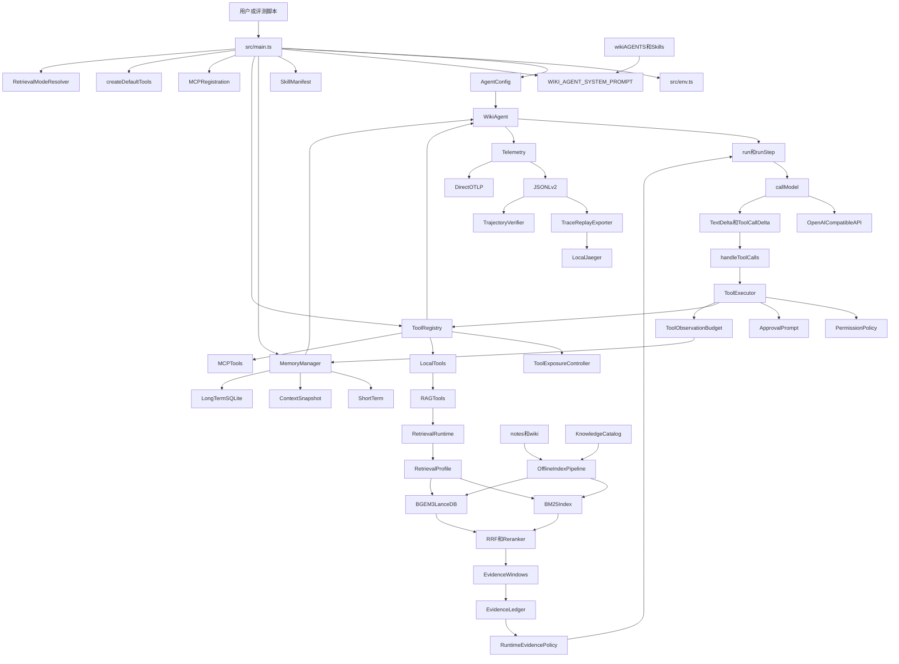
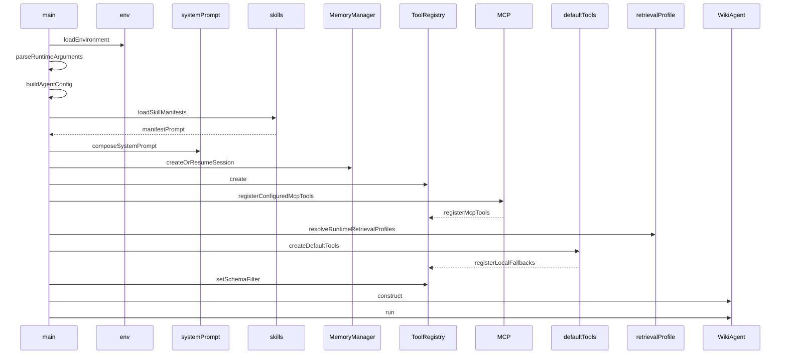
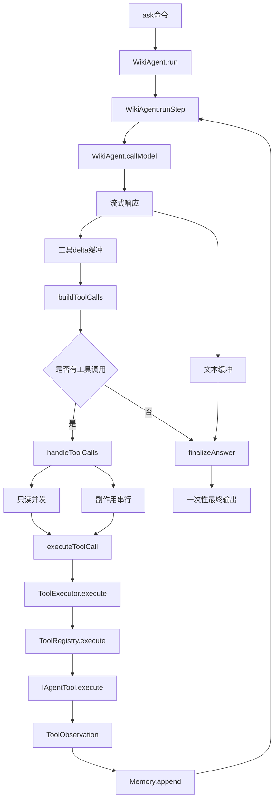
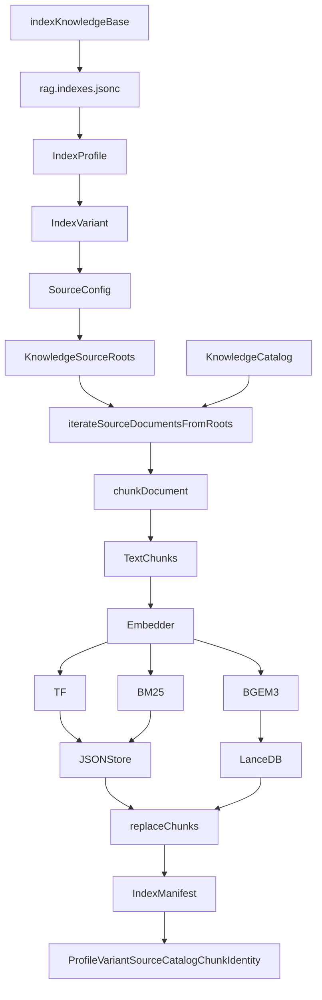
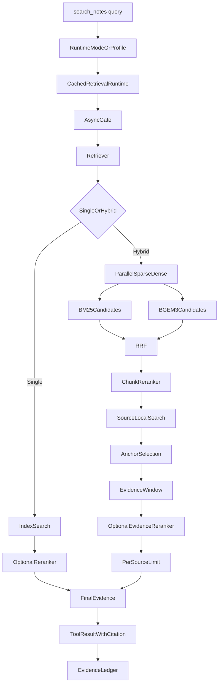
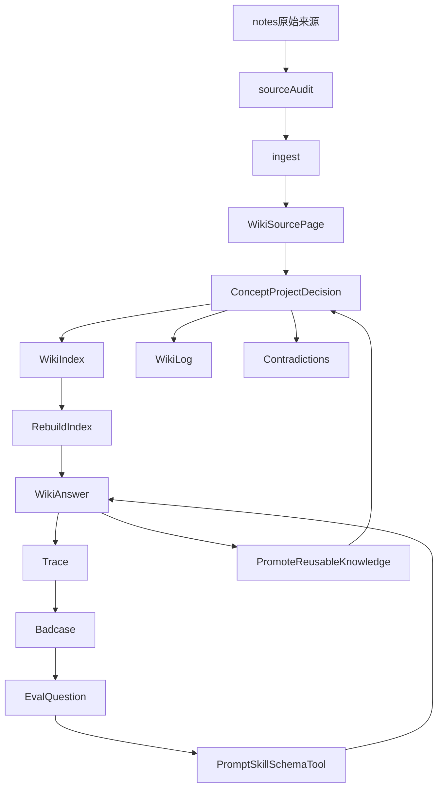

# wiki-agent 系统导读与复杂度审计

> 面向项目作者的“重新接管系统”手册
> 审计基线：仓库 `wiki-agent`，Git `HEAD=b9d53cf`，共 78 次提交
> 审计日期：2026-08-21
> 说明：本文以当前源码、配置、测试和 Git 历史为主，README 与参考文档仅作为辅助材料
> 第二轮校验：已逐项复核 `package.json`、`.env.example`、当前 JSONC 配置、题集、本文引用的脚本入口及其 CLI parser

---

## 0. 先读这一页：你现在拥有什么

wiki-agent 不是一个“已经自动维护 Wiki 的完整产品”。

它现在更准确的定义是：

- 一个已经相当厚的本地 Agent Harness；
- 一个已经相当厚的离线 Hybrid RAG 实验与运行系统；
- 一套已经相当厚的 Trace、Recall Eval 和 Agent E2E Eval 基础设施；
- 一套用于约束 Wiki 维护行为的 schema、目录和 Markdown skills；
- 但还不是一条由 TypeScript 编排、可观测、可回滚、可验收的 Wiki 自动维护流水线。

最重要的边界判断：

- **运行时已实现**：Agent loop、工具协议、权限、审批、Memory、Trace、RAG、证据账本。
- **检索已实现**：BM25、BGE-M3、LanceDB、RRF、Reranker、source-local、evidence window。
- **评测已实现**：开发集 Recall、Holdout、Agent E2E、TaskContract、TrajectoryVerifier、人工复核产物。
- **Wiki 维护主要是协议**：`wiki/AGENTS.md` 与 8 个 `skills/*/SKILL.md` 描述“应该怎么做”。
- **目标态不等于实现态**：README 中的 `raw -> wiki -> answer -> badcase -> improvement` 是产品方向，不是全自动闭环现状。

如果你只记住三个入口：

1. 运行时入口：`src/main.ts` 与 `src/agent.ts`。
2. 检索控制面：`config/rag.indexes.jsonc` 与 `config/rag.retrieval.jsonc`。
3. 评测入口：`scripts/evaluation/evaluateRecall.ts` 与 `scripts/evaluation/evaluateAgent.ts`。

如果你只做三个治理动作：

1. **[代码事实]** `balanced` 已是日常直接默认；`deep` 是 active 的空结果 fallback 和 Agent Eval 默认 profile，但不是日常 `ask` 的直接默认。
2. 冻结新增检索 profile，先清理“消融博物馆”。
3. 决定 Wiki 维护究竟是“人工触发的 skill 工作流”，还是“正式 TypeScript workflow”。

---

## 1. 文档使用说明

### 1.1 本文解决什么问题

本文不是 API 文档，也不是对 README 的改写。

它试图回答作者最需要重新掌控的五类问题：

- 这个系统为什么长成现在这样；
- 每个关键能力究竟在哪里实现；
- 哪些能力只是目标、协议或模板；
- 哪些复杂度有真实收益，哪些只是实验遗留；
- 下一次修改时，应该看哪些文件、跑哪些回归。

### 1.2 建议阅读路径

第一次阅读：

1. 先看第 2 节“产品边界与成熟度”。
2. 再看第 3 节“全局架构”。
3. 再看第 4 节“78 次提交阶段时间线”。
4. 然后按第 22 节“源码阅读顺序”亲自读代码。
5. 最后用第 23 节回答必须由你拍板的产品问题。

修改运行时前：

- 看第 5～10 节。

修改 RAG 前：

- 看第 11～15 节。

修改 Wiki 治理前：

- 看第 17 节。

做删减与重构前：

- 看第 19～21 节。

日常维护：

- 直接使用第 24 节一页速查表。

### 1.3 证据标签

本文使用四种证据标签。

- **[代码事实]**：可以直接从当前 TypeScript、JSONC、JSON Schema、Markdown 协议或测试中确认。
- **[Git事实]**：可以直接从 Git 提交日期、hash、subject、变更文件或 diff 中确认。
- **[设计目标]**：仓库中的 README、system prompt、skill 或设计文档明确表达的目标。
- **[审计推断]**：根据结构、历史和行为作出的工程判断，不冒充作者原始动机。

注意：

- Git 提交多数没有 body。
- 因此“为什么做这次改动”若不能从代码或提交内容直接确认，本文会标为 **[审计推断]**。
- README 中的历史指标可能来自某次特定语料、索引和题集快照。
- 本文不会把这些指标当成当前可复现事实。

### 1.4 状态标签

本文给能力增加四类状态。

- **[active]**：当前主路径直接使用，或配置默认启用。
- **[experimental]**：已有实现，但主要用于试验、消融或尚未成为默认产品路径。
- **[legacy]**：仍可运行或仍被测试覆盖，但已经不是推荐方向。
- **[planned]**：存在目标、schema、skill、模板或参考设计，但缺少完整运行时实现。

状态不是代码质量评价。

例如：

- TF baseline 可以稳定运行，但仍应标为 `[legacy]`。
- Wiki promote 很有产品价值，但当前应标为 `[planned]`。
- Deep profile 已接入 active fallback 和 Agent Eval 默认路径；准确状态应写成“active、日常直接非默认”，不能把整个 profile 简单标为 `[experimental]`。其未被 mode 映射选中的消融变体才属于 `[experimental]`。

### 1.5 准确性边界

本文的基线是 `b9d53cf`。

后续如果出现以下变化，本文需要复核：

- `src/main.ts` 的环境变量装配变化；
- `config/rag.indexes.jsonc` 的 active profile 或 variant 变化；
- `config/rag.retrieval.jsonc` 的 mode 映射变化；
- `src/tools/ragTool.ts` 的 search/read/related 路径变化；
- `src/agent.ts` 的最终答案证据策略变化；
- `wiki/AGENTS.md` 的 schema 变化；
- `evaluation/*.json` 的题集变化。

---

## 2. 产品边界与成熟度

### 2.1 当前产品的真实核心

**[代码事实][active]** 当前最成熟的是 Harness。

Harness 包含：

- OpenAI-compatible 模型调用；
- 多步 Agent loop；
- 流式接收模型响应；
- tool-call delta 拼装；
- 工具注册、暴露、执行；
- 参数校验；
- 权限判断；
- 人工审批；
- 沙箱与 write scope；
- 重复失败预算；
- RAG 调用预算；
- Memory 压缩与持久化；
- JSONL/OTLP Trace；
- 离线和付费评测。

### 2.2 当前最厚的业务能力

**[代码事实][active]** 当前最厚的业务能力是本地知识检索。

它不是单一向量搜索，而是：

- 物理索引 profile；
- 语料 variant；
- source config；
- manifest 身份；
- retrieval profile；
- product mode；
- catalog 治理；
- BM25 稀疏召回；
- BGE-M3 稠密召回；
- RRF；
- Chunk Reranker；
- source-local 检索；
- Anchor 选择；
- Evidence Window；
- 每来源限额；
- 候选和重排缓存；
- 逐阶段诊断。

### 2.3 当前 Wiki 能力的真实成熟度

**[代码事实][planned]** Wiki 维护的“方法”已经写得较完整。

相关资产包括：

- `wiki/AGENTS.md`；
- `wiki/index.md`；
- `wiki/log.md`；
- `wiki/contradictions.md`；
- `skills/ingest/SKILL.md`；
- `skills/distill-topic/SKILL.md`；
- `skills/wiki-answer/SKILL.md`；
- `skills/wiki-lint/SKILL.md`；
- 其他 4 个辅助 skill。

但缺少：

- `promoteAnswer()` 一类正式 TypeScript 服务；
- ingest transaction；
- 跨多个 Wiki 文件的原子更新；
- Wiki diff 预览与审批专用流程；
- schema lint 的 TypeScript 实现；
- orphan link 检查器；
- contradictions 自动登记器；
- Wiki 维护任务的专门 Trace 模型；
- promote/ingest 的 E2E 评测闭环。

### 2.4 目标态与实现态

**[设计目标]** README 把系统描述为：

```text
raw sources
-> agent-maintained wiki
-> wiki-first retrieval
-> cited answer
-> bad case / eval / skill / schema improvement
```

**[代码事实]** 当前真正自动执行的是：

```text
raw_and_wiki_sources
-> offline_index
-> runtime_retrieval
-> agent_answer
-> trace_and_eval_artifacts
```

**[代码事实]** 当前 Wiki 维护依赖模型：

```text
skill_manifest
-> load_skill
-> model_follows_markdown_protocol
-> generic_write_file_with_scope_wiki
```

这两者不是同一成熟度。

### 2.5 成熟度结论

可以把项目划为四个层次：

| 层次 | 当前成熟度 | 主要证据 | 结论 |
|---|---|---|---|
| Agent Harness | 高 | `src/agent.ts`、`src/tools/*`、大量测试 | 已是系统主干 |
| RAG | 高但复杂 | `src/rag/*`、两套配置、Recall Eval | 已产品化一部分 |
| Eval/Trace | 中高 | JSONL v2、TaskContract、Agent E2E | 已可用于工程闭环 |
| Wiki Maintenance | 低到中 | schema、目录、8 skills | 主要是协议，不是工作流引擎 |

**[审计推断]** 项目名称叫 wiki-agent，但代码重心已经偏向“本地 Agentic RAG Harness”。

这不是错误。

**[审计建议]** 为避免产品边界继续扩散，作者需要明确：

- 名称服从长期目标；
- 还是产品边界服从当前实现。

---

## 3. 全局架构图



### 3.1 架构中的三条主数据流

运行时流：

```text
user
-> main
-> memory
-> model
-> tool
-> observation
-> memory
-> final answer
```

离线索引流：

```text
source config
-> document loader
-> chunker
-> embedder
-> vector store
-> manifest
```

质量流：

```text
question set
-> retrieval or agent run
-> JSONL trace
-> deterministic scoring
-> report and review artifacts
```

### 3.2 架构中的主要控制面

- 环境变量控制模型、预算、Memory、Trace 与产品检索模式。
- `rag.indexes.jsonc` 控制物理索引。
- `rag.retrieval.jsonc` 控制查询策略。
- `knowledge.sources.jsonc` 控制 grep 的知识根。
- evaluation source configs 控制索引 variant。
- `knowledge.catalog.jsonc` 控制来源治理元数据和硬过滤。
- `mcp.servers.jsonc` 控制外部工具接入。
- `write.scopes.jsonc` 控制通用写文件根目录。

---

## 4. 78 次提交的阶段时间线

### 4.1 总览

**[Git事实]** 当前历史共 78 次提交。

**[Git事实]** 最早提交为：

- `95efb6a`，2026-06-04，`Initial commit`。

**[Git事实]** 当前 HEAD 为：

- `b9d53cf`，2026-08-21，`feat: performance optimization`。

### 4.2 阶段一：mini-claude-code，06-04～06-06

关键提交：

- `95efb6a`：初始化仓库。
- `fd6e0c1`：完成基础框架。
- `ad6143e`：短期记忆。
- `0bf5042`：文件工具。
- `13020dc`：Shell 工具。
- `07bc97f`：项目分析 Agent。
- `2880100`：终端颜色美化。
- `19c28b5`：使用 Claude Code 生成 README。

**[Git事实]** `07bc97f` 主要修改 `src/agent.ts`、`src/main.ts` 和 `.env.example`。

**[审计推断]** 这一阶段的产品原型更接近 mini-claude-code：

- LLM loop；
- 文件与 Shell；
- 短期上下文；
- 项目分析；
- CLI 体验。

**[审计推断]** 当时的中心问题是“让模型能在项目里行动”，不是“维护长期 Wiki”。

### 4.3 阶段二：07-09 身份转向

关键提交：

- `932fac2`：skill manifest 分层加载。
- `8c07f35`：提取 system prompt。
- `99510fa`：HITL approval。

**[Git事实]** `932fac2` 新增 `src/skills.ts`、`src/tools/skillTool.ts` 和 skill 测试。

**[Git事实]** `99510fa` 新增 `src/cli/approvalPrompt.ts` 与 `src/config.ts`。

**[审计推断]** 07-09 是项目身份变化的起点：

- 从“有工具的代码 Agent”；
- 转向“有 skill、审批和行为协议的 Agent Harness”。

这里的关键不是功能数量，而是系统开始承认：

- 模型能力需要按需注入；
- 高风险动作需要控制；
- Agent 不是一段 prompt，而是一套 runtime contract。

### 4.4 阶段三：07-09～07-15 Harness 成形

关键提交：

- `b92fac7`：Tool Registry。
- `9f60d72`：路径追踪。
- `3521f79`：项目结构调整。
- `68a757e`：重构 agent loop。
- `e8cb35f`：提取 JSON parse。
- `1688509`：tool calling protocol。
- `722302c`：结构化权限。
- `4cd4b10`：基础 coding tools。
- `d1cff88`：工具集合与约束。
- `52f062a`：Trace 支持 grading。
- `47929f6`：三层 Memory。
- `81508f0`：RAG tool。
- `d12d00a`：工具列表。
- `aefd439`：开发与实验 CLI。
- `5f0f152`：测试覆盖率提升。
- `02a57c7`：RAG 分层设计。
- `c69b12a`：MCP。
- `15de75e`：成本监控。
- `27967de`：grep 搜索。
- `4ab1731`：core+group 工具调用。

**[Git事实]** `4ab1731` 新增 `src/tools/exposure.ts`，并修改 Registry、system prompt 与测试。

**[代码事实]** 今天的 `IAgentTool`、`ToolRegistry`、`PermissionPolicy`、`ToolExecutor`、`ToolExposureController` 都能追溯到这条演进线。

**[审计推断]** 这是项目最关键的架构阶段。

因为它建立了后续一切的稳定骨架：

```text
model
-> tool schema
-> protocol
-> executor
-> policy
-> observation
-> memory
```

### 4.5 阶段四：07-16～07-24 Wiki 与设计文档

关键提交：

- `fbb1727`：Trace 可插拔升级。
- `02f18be`：LLM Wiki knowledge layer。
- `96c4ea9`：maintenance skills。
- `7102382`：eval closed loop。
- `f40d1ec`：wiki-first search。
- `cdf1986`：knowledge sources 配置。
- `22b2e9f`：JSONC + JSON Schema。
- `c620191`：流式索引。
- `a6b0822`：评测系统重构。
- `e0f8944`：check:llm。
- `54c61e2`：收紧 grep_notes。
- `2b0fae7`：OTel trace export。
- `b049076`：可观测性重构。
- `f6541a7`：Trace 与 artifacts 关联。
- `559b456`：更少 token、更好可观测性。
- `3f8f468`：参考文档。
- `2efa098`：12-factor-agents principle。
- `9476f2a`：TF/BM25 索引 profile。
- `5af85b5`：评测重构。
- `d83cbcc`：env 优先级。
- `57a0976`：Trace 文件名规范化。
- `5372ad3`：清理。
- `18ed5e6`：Memory 持久化。

**[Git事实]** `02f18be` 创建 `wiki/AGENTS.md`、各 Wiki 子目录、index、log、contradictions。

**[Git事实]** `96c4ea9` 当时创建 4 个维护 skill。

**[Git事实]** `9476f2a` 增加 `rag.indexes.jsonc`、profile/schema/runtime，并让索引支持 TF 与 BM25。

**[Git事实]** `18ed5e6` 增加 `src/context/memoryStore.ts`，把会话与长期记忆落到 SQLite。

**[审计推断]** 这一阶段项目正式拥有“Wiki 愿景”，但实现投入主要仍落在：

- RAG；
- 配置；
- Trace；
- Memory；
- Eval。

Wiki 本身新增的是规范和工作方法。

### 4.6 阶段五：08-05～08-17 Hybrid RAG

关键提交：

- `8c4165f`：受限 write_file。
- `b551bcf`：Markdown 本地化。
- `c166379`：session management。
- `a7de568`：Trace ID 修复。
- `6f9d62f`：评测系统重构。
- `cd2cd0c`：CLI 参数。
- `950ffea`：进度条。
- `129e65f`：评测可观测性。
- `7f36ab0`：deep detection。
- `9fadb4e`：第一版 Hybrid RAG。
- `680f899`：RAG 模型 benchmark。
- `69e4224`：消除 warning。
- `8be543e`：排序优化。
- `157a128`：source 内检索。
- `7d8c49d`：Holdout。
- `aa11c21`：完整检索指标。

**[Git事实]** `9fadb4e` 是一次大规模提交：

- 新增 Hybrid retrieval pipeline；
- 新增 BGE-M3 embedding；
- 新增 Reranker；
- 新增 LanceDB；
- 新增 retrieval profiles；
- 新增缓存与诊断；
- 变更超过 4,000 行。

**[Git事实]** `aa11c21` 补齐阶段指标、缓存统计与 evaluation diagnostics。

**[审计推断]** 从本阶段新增的逐阶段诊断、缓存统计和 evaluation artifacts 看，工程重心转向了“把检索问题变成可测问题”；提交没有 body，因此这不是对作者原始动机的确定性陈述。

系统复杂度在此快速上升：

- 一套物理索引；
- 一套逻辑 retrieval profile；
- 十余个消融 profile；
- 多阶段候选与证据对象；
- 两类缓存；
- 多组评测指标。

### 4.7 阶段六：08-18～08-21 offline-first Harness 与 Agent Eval

关键提交：

- `f072bc8`：Behavioral verification and memory governance。
- `874215d`：Support agent evaluation。
- `7f3f70b`：修改默认模型。
- `99e9780`：Agent Eval 支持 retrieval profile。
- `b9d53cf`：performance optimization。

**[Git事实]** `f072bc8` 新增：

- `ContextSnapshot`；
- `EvidenceLedger`；
- `MemoryProposal`；
- `TaskContract`；
- `TrajectoryVerifier`；
- 相应测试。

**[Git事实]** `874215d` 新增 12 题 E2E 题集、断点续跑、review summary，并删除了 708 行旧 `docs/code-walkthrough.md`。

**[Git事实]** `b9d53cf` 新增：

- `RuntimeEvidencePolicy`；
- `KnowledgeCatalog`；
- RetrievalRuntime 缓存与并发门；
- balanced profile；
- operations SLO；
- catalog 审计。

**[审计推断]** 项目在这一阶段从“RAG 实验平台”进一步变成“可离线验证 Agent 行为的 Harness”。

### 4.8 时间线的总体结论

项目不是一次设计完成的。

它经历了四次中心迁移：

```text
coding_agent
-> agent_harness
-> wiki_rag
-> hybrid_rag_eval_harness
```

**[审计推断]** 当前复杂度的主要来源不是单个模块写得差，而是四个时代的能力同时保留。

---

## 5. 启动装配：从 `main.ts` 看整个系统

### 5.1 入口

**[代码事实][active]** `package.json`：

- `npm run ask` -> `tsx src/main.ts`。
- `npm run start` -> `node dist/src/main.js`。

### 5.2 环境加载

**[代码事实][active]** `src/main.ts` 第一个本地副作用 import 是 `./env.js`。

`src/env.ts` 的优先级是：

```text
进程环境变量
> .env
> .env.example
```

精确行为：

- 先记录进程启动时已经存在的 key；
- 读取 `.env.example`；
- 读取 `.env`；
- 只对“非继承 key”写入；
- 因而 `.env` 会覆盖 `.env.example`；
- 进程环境始终覆盖两者。

### 5.3 `AgentConfig` 装配

**[代码事实][active]** `src/main.ts::main()` 创建 `AgentConfig`。

主要字段：

- `modelName`：`MODEL_NAME`，代码 fallback 为 `deepseek-v4-flash`。
- `temperature`：硬编码 `0.1`。
- `maxLoopSteps`：`MAX_LOOP_STEPS`，代码 fallback `20`。
- `maxRagCalls`：`MAX_RAG_CALLS`，代码 fallback `8`。
- `traceDir`：`TRACE_DIR`，fallback `var/traces`。
- `telemetryBackend`：只有精确值 `otlp` 才选 OTLP，否则 file。
- `otlpTracesEndpoint`：`OTEL_EXPORTER_OTLP_TRACES_ENDPOINT`。
- `otlpProtocol`：只有 `grpc` 才选 grpc，否则 http。
- `capturePromptArtifacts`：只有字符串 `true` 时开启。
- `traceArtifactDir`：fallback `var/traces/artifacts`。
- `approvalMode`：`getApprovalMode()`。
- `requestApproval`：CLI `askToolApproval()` 适配器。

### 5.4 system prompt

**[代码事实][active]** 基础 prompt 是：

- `src/prompts/systemPrompt.ts::WIKI_AGENT_SYSTEM_PROMPT`。

它定义：

- Wiki/raw 证据分层；
- 三态证据语言；
- core 工具；
- grep/search/read/related 路由；
- coding 前先加载 git；
- 风险工具约束。

### 5.5 skills 装配

**[代码事实][active]**：

1. `loadSkillManifests()` 递归寻找 `skills/**/SKILL.md`。
2. 只解析 frontmatter 的 `name` 和 `description`。
3. `buildSkillManifestPrompt()` 把目录注入 system prompt。
4. skill 全文不在启动时加载。
5. 模型需要调用 `load_skill`。

这是一种 prompt lazy-loading。

### 5.6 Memory 装配

**[代码事实][active]**：

- `new MemoryManager(systemPrompt, options)`；
- `sessionId` 来自 `--session`；
- `memoryDirectory` 默认 `var/memory`。

因为 `main.ts` 总是传入 `memoryDirectory`，CLI 路径总是启用持久化。

### 5.7 MCP 装配

**[代码事实][active但可降级]**：

1. 创建 `ToolRegistry`。
2. 创建 `ToolExposureController`。
3. `registerConfiguredMcpTools(registry)`。
4. 每个 server 连接失败只 warning 并跳过。
5. MCP 成功后读取远端工具列表。
6. `McpAgentTool` 适配为统一 `IAgentTool`。

MCP 失败不会阻止 Agent 启动。

### 5.8 本地默认工具装配

**[代码事实][active]** `createDefaultTools()` 构造：

- list/read/write；
- glob/grep search；
- 4 个 RAG tools；
- load_skill；
- propose_memory；
- load_tool_group；
- git status/diff；
- apply_patch；
- run_tests；
- execute_command。

如果 MCP 已覆盖本地能力，本地工具会被跳过。

### 5.9 RAG profile 装配

**[代码事实][active]** `resolveRuntimeRetrievalProfiles()` 只看两个 env：

- `RAG_RETRIEVAL_PROFILE`；
- `RAG_RETRIEVAL_MODE`。

规则：

- 两者同时存在直接报错；
- profile 存在则直接作为 primary；
- mode 存在则映射 profile；
- fast 空结果 fallback balanced；
- balanced 空结果 fallback deep；
- deep 无 fallback；
- 两者都没有则返回 `undefined`。

### 5.10 Agent 装配

最后：

```text
new WikiAgent(config, memory, registry)
```

然后进入：

- one-shot；
- 或 REPL。

每个新用户任务前：

- `toolExposureController.resetToCore()`。

### 5.11 启动装配顺序图



---

## 6. 一次 `ask` 的精确调用链

### 6.1 总调用链

```text
main
-> WikiAgent.run
-> WikiAgent.runStep
-> WikiAgent.callModel
-> WikiAgent.handleToolCalls
-> WikiAgent.executeToolCall
-> ToolExecutor.execute
-> ToolRegistry.execute
-> IAgentTool.execute
```

模型不调用工具时：

```text
run
-> runStep
-> callModel
-> RuntimeEvidencePolicy.finalizeAnswer
-> onTextChunk
-> final
```

### 6.2 `run()`

**[代码事实][active]** `src/agent.ts::WikiAgent.run()`：

1. 重置相同参数失败计数。
2. 清空 `EvidenceLedger`。
3. 重置 RAG 调用预算。
4. 把用户输入写入 Memory。
5. 创建 Telemetry。
6. 开始 `wiki_agent.run` span。
7. 递增 step。
8. 超过 `maxLoopSteps` 时熔断。
9. 调用 `runStep()`。
10. 记录 trajectory step。
11. 得到 final 后结束。
12. finally 中结束根 span。
13. shutdown telemetry。
14. file backend 默认尝试自动重放到本机 Jaeger。

### 6.3 `runStep()`

**[代码事实][active]**：

1. 创建 `wiki_agent.step.N` span。
2. 调用 `callModel()`。
3. 从消息读取文本。
4. 如果没有 tool calls，调用最终证据策略。
5. 最终文本一次性调用 `onTextChunk()`。
6. 把 assistant message 写入 Memory。
7. 有 tool calls 时调用 `handleToolCalls()`。
8. 工具回执写入后返回 `continue`。
9. 无 tool calls 时返回 `final`。

### 6.4 `callModel()`

**[代码事实][active]**：

- 从 Registry 取得当前暴露 schema；
- RAG 预算耗尽时，再过滤所有 `permission === "rag"` 的 schema；
- 从 Memory 获取完整消息；
- 可选写 prompt artifact；
- 调用 `client.chat.completions.create()`；
- 强制 `stream: true`；
- `reasoning_effort: "high"`；
- 收集 usage；
- 累加文本 delta；
- 拼装 tool call delta；
- 记录模型、token、schema 大小等 span attributes。

### 6.5 流式行为的准确描述

**[代码事实]** API 响应是流式接收的。

**[代码事实]** tool call delta 也是流式拼装的：

- `appendToolCallDeltas()`；
- `buildToolCalls()`。

**[代码事实]** 最终答案不是逐 token 输出给用户。

原因：

- `callModel()` 把所有 `delta.content` 累积到 `currentContent`；
- 直到流结束才返回完整 `aiMessage`；
- `runStep()` 先执行证据策略；
- 然后一次性 `onTextChunk(assistantText)`。

因此：

- “传输层流式”是真的；
- “用户看到逐 token streaming”不是真的。

**[代码事实]** 这一缓冲行为使 `runStep()` 可以先调用 `RuntimeEvidencePolicy.finalizeAnswer()`，再把文本交给 `onTextChunk()`；源码没有提供用户可见逐 token 输出的另一条路径。

### 6.6 `handleToolCalls()`

**[代码事实][active]**：

- 只支持 `function` 类型工具；
- 非 function 调用转成 skipped observation；
- `isReadOnly=true` 的调用用 `Promise.all()` 并发；
- 其他调用串行；
- 最终按模型原始 tool-call index 排序；
- 再写回 Memory。

### 6.7 `executeToolCall()`

**[代码事实][active]**：

1. 读取工具名和参数 JSON 字符串。
2. 建立 `tool.execute` span。
3. 若 RAG 预算耗尽，直接返回 `retry_limit_reached`。
4. 否则对 RAG 调用计数。
5. 委托 `ToolExecutor.execute()`。
6. `EvidenceLedger.recordToolResult()`。
7. 计算三态证据。
8. 压缩工具输出为上下文 observation。
9. RAG observation 后附加 runtime policy feedback。
10. 返回 `role="tool"` 消息。

### 6.8 三层失败预算

系统至少有三类预算：

1. **Loop 预算**
   - `MAX_LOOP_STEPS`；
   - 防止无限 model/tool 循环。

2. **RAG 预算**
   - `MAX_RAG_CALLS`；
   - 达到后隐藏 RAG schema；
   - 已发出的超预算调用也会被拦截。

3. **相同参数失败预算**
   - `MAX_CONSECUTIVE_TOOL_FAILURES=2`；
   - 同一工具、规范化后的相同参数；
   - 连续失败两次后，第三次不执行。

此外还有：

- API SDK retry；
- Agent Eval 强制 `maxRetries=0`；
- request timeout；
- shell timeout；
- run_tests timeout；
- Tool Observation 字符预算；
- Memory 消息数和字符预算。

### 6.9 调用链图



---

## 7. 工具系统

### 7.1 `IAgentTool`

**[代码事实][active]** 定义在 `src/types.ts`。

每个工具声明：

- `name`；
- `permission`；
- `riskLevel`；
- `isReadOnly`；
- `requiresApproval`；
- OpenAI tool `schema`；
- 可选 `validateArgs()`；
- `execute()`。

这六个元数据维度解决不同问题：

- `permission`：业务类别；
- `riskLevel`：安全风险；
- `isReadOnly`：调度并发；
- `requiresApproval`：HITL；
- `schema`：模型可见接口；
- `validateArgs`：运行时数据校验。

### 7.2 `BaseAgentTool`

**[代码事实][active]** 本地工具通常继承 `src/tools/base.ts::BaseAgentTool`。

它提供统一成功和失败结果构造。

### 7.3 Registry

**[代码事实][active]** `src/tools/registry.ts::ToolRegistry`：

- `Map<string, IAgentTool>` 保存工具；
- `register()` 同名覆盖；
- `getSchemas()` 应用 schema filter；
- `execute()` 再次解析和校验参数；
- `getTool()` 供调度和权限读取元数据。

### 7.4 Exposure

**[代码事实][active]** `ToolExposureController`：

- 默认 active group 只有 `core`；
- `load_tool_group` 激活新组；
- 新用户任务前 reset；
- 只影响发给模型的 schema；
- 不影响 Registry 中是否存在工具。

工具组：

- `core`；
- `filesystem`；
- `git`；
- `sqlite`；
- `coding`；
- `shell`。

### 7.5 Executor

**[代码事实][active]** `src/tools/executor.ts::ToolExecutor` 负责：

- 查找工具；
- 解析 JSON；
- 工具级参数校验；
- 权限决策；
- 请求审批；
- 调用 Registry；
- 捕获运行时错误；
- 重复失败计数；
- 统一状态输出。

### 7.6 PermissionPolicy

**[代码事实][active]** `src/permissions.ts::PermissionPolicy`：

- dangerous 永久 deny；
- shell 先检查 token 与 executable allowlist；
- auto 自动允许通过安全检查的工具；
- prompt 对 write/network/shell 请求审批；
- deny 拒绝需要审批的工具；
- safe read-only 直接允许。

### 7.7 审批模式

`APPROVAL_MODE`：

- `prompt`；
- `auto`；
- `deny`。

非法值不会报错。

`getApprovalMode()` 会回退 `prompt`。

这是安全的默认，但可能隐藏配置拼写错误。

### 7.8 只读并发与副作用串行

**[代码事实][active]** 并发依据是 `isReadOnly`，不是 permission。

因此新增工具时，`isReadOnly` 标错会产生真实调度风险：

- 把写工具标只读：可能并发写；
- 把读工具标非只读：性能下降，但更安全。

### 7.9 MCP 覆盖

**[代码事实][active]** 装配顺序是 MCP 优先。

MCP 成功注册后，`getLocalToolNamesCoveredByMcp()` 根据远端工具名跳过本地等价能力。

覆盖映射主要包括：

- MCP `read_file` -> 本地 `read_file`；
- MCP `list_directory` -> 本地 `list_dir`；
- MCP `search_files` -> 本地 `glob_search`；
- MCP git status/diff -> 本地 git tools。

### 7.10 MCP 风险

MCP server 配置位于 `config/mcp.servers.jsonc`。

当前配置：

- filesystem；
- git；
- sqlite。

其中：

- filesystem 的远端 `write_file` 被禁用；
- 本地受限 `write_file` 保留；
- Git 默认 safe；
- SQLite 默认 write。

### 7.11 本地工具与 coding 遗留

**[代码事实][active但有遗留]**：

- `apply_patch` 是单文件唯一文本替换，不是标准 unified diff；
- `run_tests` 可执行用户给出的命令；
- `execute_command` 是另一套 shell 工具；
- Git MCP 与本地 Git tools 有覆盖逻辑；
- filesystem MCP 与本地文件工具有覆盖逻辑。

**[审计推断]** coding 工具来自 mini-claude-code 时代。

对于一个 Wiki/RAG 产品，它们不是核心业务能力。

**[审计建议]** 若继续保留，可明确其产品理由，例如：

- 项目明确要做通用自修改 Agent；
- 或需要 Agent 帮作者维护仓库。

否则应归档为可选插件。

### 7.12 write scopes

**[代码事实][active]**：

- 配置：`config/write.scopes.jsonc`；
- 解析：`src/config/writeScopes.ts`；
- 执行：`WriteFileTool`。

当前 scope：

- `sandbox` -> `var/sandbox`；
- `wiki` -> `wiki`。

省略 scope：

- 使用 `sandbox`。

Wiki skills 明确要求：

- `scope: "wiki"`。

### 7.13 双重参数校验

参数会在两处校验：

1. `ToolExecutor.validateToolArgs()`；
2. `ToolRegistry.execute()`。

**[代码事实]** 两处都会 parse JSON 和调用 `validateArgs()`。

**[审计推断]** 这是防御性冗余，但也是维护重复。

后续应明确：

- Executor 是唯一校验边界；
- Registry 只做存储与调用；

或者：

- Registry 是独立可调用公共 API；
- 因而保留校验，并把 Executor 的解析结果直接传入 Registry，避免重复 parse。

---

## 8. 上下文与 Memory

### 8.1 三层 Memory 的准确含义

**[代码事实][active]**：

- Short-term：原始最近消息数组。
- Mid-term：最多 4 个确定性 `ContextSnapshot`。
- Long-term：用户明确批准的 SQLite 记忆。

这不是三个独立检索库。

它们最终都被渲染为 model messages。

### 8.2 Short-term

`ShortTermMemory`：

- append；
- getMessages；
- replace；
- clear。

它保存原始 OpenAI message，包括：

- user；
- assistant；
- tool。

### 8.3 压缩触发

`MemoryManager.compactIfNeeded()` 同时看：

- 原始消息数；
- 全上下文估算字符数。

默认来自 env：

- `MEMORY_MAX_MESSAGES=40`；
- `MEMORY_KEEP_RECENT_MESSAGES=18`；
- `MEMORY_MAX_CHARS=60000`。

当超限：

- 尽量保留最近 18 条；
- 避免从 tool message 中间切开；
- 旧消息生成 `ContextSnapshot`；
- 短期只保留 recent。

### 8.4 ContextSnapshot

**[代码事实][active]** `src/context/contextSnapshot.ts` 是确定性压缩，不调用 LLM。

保留：

- goals；
- confirmedFacts；
- evidenceReferences；
- failedAttempts；
- incompleteItems；
- toolCalls；
- memoryProposalIds；
- trajectorySteps；
- conversationNotes；
- compression metadata。

它不会保留完整工具输出。

被截断正文必须重新读取。

### 8.5 Mid-term

`MidTermMemory`：

- 最多保留最近 4 个 snapshot；
- 暂存 evidence；
- 暂存 trajectory steps；
- 暂存 proposal IDs；
- 压缩时把这些材料合入 snapshot；
- 再清空暂存。

### 8.6 Long-term

`LongTermMemory` 只保存：

- preference；
- constraint；
- fact。

渲染时作为 system message 注入。

### 8.7 SQLite

**[代码事实][active]** `MemoryStore` 使用 Node `node:sqlite` 的 `DatabaseSync`。

默认数据库：

- `var/memory/agent.db`。

共 5 张表：

- `sessions`；
- `session_messages`；
- `long_term_memories`；
- `memory_proposals`；
- `memory_proposal_events`。

SQLite 设置：

- WAL；
- foreign keys；
- busy timeout 5000ms。

### 8.8 会话 Journal

除了 SQLite，还会写：

- `var/memory/journals/YYYY-MM-DD.md`。

只记录 user/assistant；

每条最多截取 400 字符。

因此 Memory 本身也有“双路径”：

- SQLite 结构化状态；
- Markdown 人工可读摘要。

### 8.9 MemoryProposal

**[代码事实][active但复杂]** 状态机：

```text
proposed
-> verified
-> pending_approval
-> approved
-> committed
```

失败分支：

```text
proposed
-> rejected_verify
```

用户拒绝：

```text
pending_approval
-> rejected_user
```

验证规则包括：

- 非空；
- 不超过 1000 字符；
- 不包含疑似凭据；
- 有用户明确记忆请求；
- fact 有 source/evidence ref；
- 不重复；
- 简单冲突检测。

### 8.10 `remember` 与 proposal

**[代码事实]** REPL 仍有 `remember` 快捷命令。

它绕过 proposal 状态机，直接写长期记忆。

语义是：

- 用户已经明确批准。

模型侧使用：

- `propose_memory`。

### 8.11 工具输出预算

工具自身先可能应用：

- `TOOL_OUTPUT_MAX_CHARS`；
- `READ_FILE_MAX_BYTES`；
- grep/read 的结果数限制。

之后所有 `ToolResult` 统一经过：

- `buildToolObservation()`；
- 默认 `CONTEXT_TOOL_RESULT_MAX_CHARS=6000`。

压缩顺序：

1. 完整 JSON；
2. 递归压缩对象；
3. 最多 12 keys；
4. 最多 5 array items；
5. string 最多 800 字符；
6. 仍超限则 bounded preview。

### 8.12 Memory 与 Wiki 的区别

这是系统最容易混淆的边界。

| 维度 | Memory | Wiki |
|---|---|---|
| 目标 | 保持会话和用户偏好连续性 | 保存可审查的领域知识 |
| 默认位置 | `var/memory/` | `wiki/` |
| 是否进 Git | 否 | 是 |
| 数据形态 | SQLite + journal + snapshots | Markdown |
| 写入审批 | proposal 或用户命令 | 通用 write_file + skill 协议 |
| 生命周期 | 会话保留、长期记忆、过期 | draft/active/needs-review/stale |
| 引用要求 | source refs 可选/按 kind | 重要事实应有 source |
| 检索 | 直接注入 prompt | 进入 RAG index |

一句话：

- Memory 记“这个用户和这次任务”；
- Wiki 记“这个领域长期成立的知识”。

---

## 9. EvidenceLedger 与 RuntimeEvidencePolicy

### 9.1 EvidenceLedger

**[代码事实][active]** `EvidenceLedger` 只记录成功的 RAG tool result。

识别工具：

- `search_notes`；
- `grep_notes`；
- `read_note`；
- `related_notes`；
- 或带 MCP 前缀但以这些名字结尾。

每条 evidence 记录：

- toolName；
- query；
- source；
- chunkId；
- citation；
- version；
- authority；
- consistency；
- truncated；
- observedAt。

### 9.2 三态

`assessEvidence()` 返回：

- `insufficient`；
- `partial`；
- `sufficient`。

默认要求：

- 至少 1 条；
- 至少 1 个来源；
- 每条有 citation；
- 允许 truncated。

### 9.3 三态不是答案覆盖判断

**[代码事实]** 默认三态主要检查“证据库存质量”。

它不知道用户问题的全部子问题。

它也没有自然语言蕴含判断。

所以：

- 1 条有 citation 的证据可能得到 sufficient；
- 但它不一定覆盖复杂问题。

`RuntimeEvidencePolicy.buildModelFeedback()` 明确提醒：

- inventory 不代表 coverage。

### 9.4 软约束

以下属于软约束：

- system prompt 要求继续检索或说明缺口；
- 每次 RAG observation 后反馈三态和预算；
- partial 时提醒模型限制结论；
- sufficient 时建议停止检索。

最终仍依赖模型判断：

- 问题是否被覆盖；
- 是否应该引用；
- 是否应该继续检索。

### 9.5 硬约束

以下属于硬约束：

- 超过 `maxRagCalls` 后 `canCallRag=false`；
- `callModel()` 不再暴露 RAG schema；
- 已经发出的超预算 RAG 调用返回 `retry_limit_reached`；
- 特定条件下最终答案强制改成拒答。

### 9.6 最终强制拒答的精确边界

`RuntimeEvidencePolicy.finalizeAnswer()` 允许原答案，只要满足任一：

1. 本次没有调用 RAG；
2. evidenceCount > 0；
3. 文本已经包含拒答/证据不足表达。

只有同时满足：

- 本次调用过 RAG；
- 没有记录任何可引用 evidence；
- 模型也没有明确拒答；

才强制替换答案。

### 9.7 必须理解的边界

**[代码事实]** 系统不会因为 `partial` 强制拒答。

**[代码事实]** 系统不会验证最终每个断言与证据逐句对应。

**[代码事实]** 系统不会在“未调用 RAG”时阻止知识库事实幻觉。

**[代码事实]** 系统只对“调用过 RAG 但完全零证据”的断言进行最终硬拦截。

因此准确表述应是：

- 当前有“空证据最终闸门”；
- 还没有“全面 grounded generation verifier”。

---

## 10. Trace 与可观测性

### 10.1 JSONL v2

**[代码事实][active]** file backend 写：

- `span_start`；
- `span_event`；
- `span_end`。

默认目录：

- `var/traces`。

文件名：

```text
<UTC时间戳>_<traceId>.jsonl
```

### 10.2 Span 层级

主层级：

```text
wiki_agent.run
-> wiki_agent.step.N
   -> gen_ai.chat
   -> tool.execute
      -> rag.search
      -> rag.read_note
      -> rag.related_notes
```

### 10.3 FileTelemetry

`FileTelemetry`：

- 自己生成 traceId/spanId；
- 通过 `JsonlTraceSink` append；
- 使用 `AsyncLocalStorage` 传递 active span。

### 10.4 Direct OTLP

`TELEMETRY_BACKEND=otlp`：

- 不写 JSONL；
- 直接使用 OpenTelemetry SDK；
- 支持 HTTP 或 gRPC exporter；
- endpoint 必填。

### 10.5 JSONL replay

`src/trace/export.ts::exportTrace()`：

- 读取 JSONL；
- 重放 span；
- 保持原 traceId/spanId；
- 可 dry-run；
- 可发往 OTLP HTTP。

CLI：

- `npm run trace:import`。

### 10.6 默认自动导入 Jaeger

**[代码事实][active]** file backend 每次 run 结束后：

- 默认调用 `exportFileTrace()`；
- endpoint 硬编码 `http://127.0.0.1:4318/v1/traces`；
- timeout 3 秒；
- 失败只 warning；
- JSONL 保留。

### 10.7 Prompt artifacts

默认：

- `TRACE_CAPTURE_PROMPTS=false`。

开启后：

- 默认写 `var/traces/artifacts`；
- 保存脱敏后的 messages、tools、model 参数；
- 生成 sha256；
- span 只记录 artifact 路径和摘要。

### 10.8 脱敏边界

`redactSensitiveValues()` 按 key 名匹配：

- api key；
- authorization；
- cookie；
- password；
- secret；
- token。

**[代码事实]** 它不是对任意字符串内容做秘密检测。

所以 prompt artifact 仍可能包含：

- 源码中的秘密；
- 用户直接粘贴在普通字段里的凭据；
- 笔记中的隐私信息。

### 10.9 双路径复杂度

Telemetry 有两套路径：

1. 运行时直接 OTLP；
2. 运行时写 JSONL，再 replay 到 OTLP。

file 默认又隐含两步：

```text
FileTelemetry
-> JSONL
-> autoReplay
-> Jaeger
```

**[审计推断]** 这套设计适合 offline-first 和可重放审计。

但复杂度代价是：

- 两套 SpanHandle 实现；
- 两类 exporter；
- 一套 replay identity generator；
- 自动导入与手动导入并存；
- file backend 其实仍会发生网络行为。

建议把产品语义写清楚：

- `file-only`；
- `file-and-local-jaeger`；
- `direct-otlp`。

当前只有 `file` 和 `otlp` 两个枚举，无法直接表达这三个意图。

---

## 11. RAG 离线索引

### 11.1 离线索引图



### 11.2 显式构建

**[代码事实][active]** 索引脚本无参数只显示帮助。

实际构建必须：

```powershell
npm run index:knowledge -- -- --profile bm25-v1 --variant raw-wiki
```

省略 variant：

- 构建该 profile 的全部 variants。

### 11.3 文档加载

入口：

- `scripts/rag/indexKnowledgeBase.ts`。

核心：

- `iterateSourceDocumentsFromRoots()`；
- `runIndexPipeline()`。

### 11.4 Chunk

当前所有 profile：

- `chunkSize=900` 字符；
- `overlap=120` 字符。

单位是字符，不是 token。

### 11.5 Embedder

物理 index profile：

- `tf-v1`；
- `bm25-v1`；
- `bge-m3-v1`。

TF 与 BM25：

- JSON store。

BGE-M3：

- `Xenova/bge-m3`；
- q8；
- CPU；
- 1024 维；
- CLS pooling；
- maxLength 512 tokens；
- batchSize 4；
- LanceDB。

### 11.6 原子性与缓存

Transformer embedding 使用：

- `CachedEmbedder`；
- `var/cache/embeddings/<profile>`。

Index manifest 临时文件写入后 rename。

Vector store 自身也采用 replace 语义。

### 11.7 Manifest

manifest version 当前写 4。

包含：

- profileId；
- variantId；
- profileFingerprint；
- embedding identity；
- store；
- dataFile；
- chunkSize；
- overlap；
- createdAt；
- sourceConfig identity；
- knowledgeCatalog identity；
- documentCount；
- chunkCount；
- chunkFingerprint。

### 11.8 查询前身份验证

`openIndexRuntime()` 会检查：

- manifest profile；
- variant；
- profile fingerprint；
- store；
- chunk config；
- data file 目录；
- source config fingerprint；
- catalog sha256；
- embedding identity。

不一致：

- 拒绝查询；
- 要求重建。

这是系统最重要的可复现性保障之一。

---

## 12. RAG 在线查询

### 12.1 在线查询图



### 12.2 六层配置模型

为避免把不同控制层混为一谈，需要区分以下六层。

#### 第一层：source

定义哪些目录进入语料。

文件：

- `config/knowledge.sources.jsonc`；
- `config/evaluation/raw-only.sources.jsonc`；
- `config/evaluation/raw-wiki.sources.jsonc`。

#### 第二层：index profile

定义如何构建物理索引。

文件：

- `config/rag.indexes.jsonc`。

示例：

- bm25-v1；
- bge-m3-v1。

#### 第三层：variant

定义同一物理算法使用哪份 source config。

示例：

- raw-only；
- raw-wiki。

#### 第四层：manifest

记录某次实际构建产物的身份。

位置：

- `var/indexes/<profile>/<variant>/manifest.json`。

#### 第五层：retrieval profile

定义在线查询策略。

文件：

- `config/rag.retrieval.jsonc`。

示例：

- single BM25；
- dense；
- hybrid；
- hybrid + reranker；
- source-local；
- source-aggregate。

#### 第六层：mode

定义产品级档位。

示例：

- fast；
- balanced；
- deep。

### 12.3 catalog 是横切层

`knowledge.catalog.jsonc` 不完全属于上述六层之一。

它横切：

- 文档是否进入索引；
- chunk governance metadata；
- reranker metadata；
- soft ranking prior；
- manifest identity。

### 12.4 TF 当前承担什么角色

**[代码事实][legacy]** TF 是词频余弦基线。

**[代码事实]** 从实现、配置和测试可确认的作用：

- 最小离线基线；
- 验证 chunk/index/store 流程；
- 解释 BM25 的增益。

问题：

- 不适合作为当前产品检索；
- 保留为 active 候选会增加选择成本。

**[审计建议]** 可考虑：

- 保留实现和少量测试；
- 从日常文档主路径移到“实验基线”章节。

### 12.5 BM25 当前承担什么角色

**[代码事实][active]**：

- 中文词法基线；
- fast mode；
- hybrid sparse side；
- 精确术语召回；
- 完全离线；
- JSON 可检查。

### 12.6 BGE-M3 当前承担什么角色

**[代码事实][active]**：

- 补足语义召回；
- 处理词面不一致；
- 与 BM25 形成互补；
- 使用 LanceDB 存 1024 维向量。

### 12.7 RRF 当前承担什么角色

BM25 分数与 cosine 分数不可直接比较。

RRF 使用排名而不是原始分数：

```text
score += 1 / (rrfK + rank)
```

当前默认 `rrfK=60`。

**[代码事实]** 当前实现按名次融合，不要求先把 BM25 与 cosine 原始分数校准到同一尺度；“稳定”程度仍应由实际评测报告判断。

### 12.8 Reranker 当前承担什么角色

召回解决“有没有”。

Reranker 解决“排到前面没有”。

当前模型：

- `onnx-community/bge-reranker-v2-m3-ONNX`；
- q4；
- CPU；
- maxLength 512；
- batchSize 8。

### 12.9 metadata-prefixed 当前承担什么角色

`formatRerankDocument()` 可在正文前加：

- source；
- titlePath；
- tags；
- version；
- authority；
- quality；
- consistency。

用途：

- 文件名和标题也参与相关性；
- 治理元数据参与重排上下文。

### 12.10 source-local 当前承担什么角色

全局召回可能：

- 找对文件；
- 但找错文件内 chunk。

source-local：

1. 从融合候选得到 source anchors；
2. 对每个 source 读取全部 chunks；
3. 词法预筛；
4. 强制保留该 source 的全局最佳 chunk；
5. Reranker 在来源内部选最佳片段。

### 12.11 Anchor 当前承担什么角色

Evidence 组装不能对所有候选展开邻接窗口。

Anchor 是：

- 进入 evidence assembly 的中心 chunk；
- 数量由 `anchorLimit` 控制。

### 12.12 source-aggregate 当前承担什么角色

来源内最佳 chunk 可能恢复答案片段。

全局最佳 chunk 可能保留原本排序信号。

source-aggregate 把同一 source 的：

- 全局最佳；
- 来源内最佳；

合并成一个 anchor 文本。

### 12.13 Evidence Window 当前承担什么角色

Chunk 可能截断上下文。

`assembleEvidenceWindows()`：

- 以 anchor 为中心；
- 读取前后 radius 个 chunk；
- 去除字符 overlap；
- 形成更完整证据。

当前主 profile：

- `contextWindow=1`。

### 12.14 source limit 当前承担什么角色

TopK 如果被同一文件占满：

- 来源多样性差；
- 多源问题可能失败。

`maxPerSource=2` 限制最终每来源数量。

---

## 13. 当前默认配置：不要混淆三种“默认”

### 13.1 Active index 默认

`config/rag.indexes.jsonc`：

- `activeProfile=bm25-v1`；
- `activeVariant=raw-wiki`。

当代码调用：

```text
openActiveIndex(undefined, undefined)
```

就使用这组。

### 13.2 Retrieval config 默认

`config/rag.retrieval.jsonc`：

- `activeRetrievalProfile=hybrid-bge-m3-metadata-source-aggregate-v1`；
- `activeRetrievalMode=balanced`。

mode 映射：

- fast -> `bm25-v1`；
- balanced -> `hybrid-bge-m3-balanced-v1`；
- deep -> `hybrid-bge-m3-metadata-source-aggregate-v1`。

### 13.3 `.env.example` 的产品默认

`.env.example`：

- `RAG_RETRIEVAL_MODE=balanced`；
- `RAG_INDEX_VARIANT=raw-wiki`。

因此正常从仓库启动：

- env loader 会加载 balanced；
- `main.ts` 会把它映射为 `hybrid-bge-m3-balanced-v1`；
- 空结果 fallback deep。

### 13.4 `activeRetrievalProfile` 与 env 的关系

这是当前最容易误读的点。

**[代码事实]** `main.ts::resolveRuntimeRetrievalProfiles()`：

- 没有直接读取 `activeRetrievalProfile`；
- 只读取 profile env 或 mode env。

因此：

- 有 `RAG_RETRIEVAL_MODE=balanced` 时，使用 mode 映射；
- 有 `RAG_RETRIEVAL_PROFILE=<id>` 时，使用显式 profile；
- 两者都没有时，不使用 retrieval pipeline；
- 而是 `search_notes` 走 active index fallback。

### 13.5 何时使用 `activeRetrievalProfile`

`loadRetrievalProfilesConfig()` + `resolveRetrievalProfile(config, undefined)` 会使用：

- `activeRetrievalProfile`。

例如 Agent Eval：

- CLI 省略 `--retrieval-profile` 时；
- `resolveRetrievalProfile()` 使用配置 active profile。

### 13.6 准确默认结论

日常 `npm run ask`，在未被本机 `.env` 或进程 env 覆盖时：

```text
balanced
-> hybrid-bge-m3-balanced-v1
-> raw-wiki
-> empty fallback deep
```

若显式清除 mode/profile：

```text
search_notes
-> active index
-> bm25-v1/raw-wiki
-> wiki-first post-ranking
```

Agent Eval 省略 retrieval profile：

```text
activeRetrievalProfile
-> hybrid-bge-m3-metadata-source-aggregate-v1
```

### 13.7 balanced、deep 与 activeRetrievalProfile 的状态结论

- **[代码事实][active][default]** `balanced` 是当前 `activeRetrievalMode`，也是 `.env.example` 的日常 `ask` 默认 mode。
- **[代码事实][active][non-default-direct]** `deep` 映射到 `hybrid-bge-m3-metadata-source-aggregate-v1`；日常 `ask` 不直接默认选择它，但 balanced 空结果时会把它作为 fallback。
- **[代码事实][active][eval-default]** 同一个 deep profile 还是 `activeRetrievalProfile`，所以 Agent Eval 省略 `--retrieval-profile` 时默认使用它。
- **[代码事实]** `activeRetrievalProfile` 不会覆盖 `main.ts` 已由 `RAG_RETRIEVAL_MODE` 或 `RAG_RETRIEVAL_PROFILE` 解析出的运行时选择。
- **[代码事实][experimental]** 其余用于消融或对照的 retrieval profile 都能被显式调用，但没有被当前 mode 映射或 active profile 选中；“能运行”不等于“产品默认”。

---

## 14. Chunk 900 与 BGE 512 token 截断风险

### 14.1 两个单位不同

索引 chunk：

- 900 字符。

BGE-M3：

- maxLength 512 tokens。

不能把 900 字符等同于 900 tokens。

### 14.2 风险

中文、英文、代码和路径的 tokenization 密度不同。

因此某些 900 字符 chunk：

- 可能小于 512 tokens；
- 也可能超过 512 tokens；
- 超过部分会被 embedding tokenizer 截断。

Reranker 也有：

- maxLength 512。

metadata-prefixed 模式还会先加入：

- source；
- title；
- tags；
- governance。

这进一步挤占正文 token。

### 14.3 影响

可能出现：

- chunk 后半段答案没有进入 dense embedding；
- reranker 看不到后半段；
- BM25 能命中但 dense 弱；
- source-local 仍选错 chunk；
- evidence window 返回了内容，但排序信号来自被截断文本。

### 14.4 不能声称什么

不能声称：

- “900 是实验最优 chunk size”。

当前配置只证明：

- 三个物理 profile 使用相同 900/120；
- Hybrid manifest 可验证 chunk snapshot 一致。

除非有专门 chunk-size 消融报告，否则“最优”没有证据。

### 14.5 应做的验证

建议新增离线诊断：

- 对真实 corpus 统计每个 chunk 的 tokenizer token 数；
- 输出 p50/p90/p95/p99/max；
- 统计超过 512 的比例；
- 按 Markdown、代码、中文长文分类；
- 单独统计 metadata-prefixed rerank 文本；
- 用 600/750/900 字符做 Recall 与成本消融。

在完成前，准确表述应是：

- 900/120 是当前统一配置；
- 不是已证明的最优参数。

---

## 15. 四个 RAG 工具不是同一条路径

### 15.1 `search_notes`

**[代码事实][active]** 两条分支。

有 `retrievalProfile`：

- 走 `RetrievalRuntime.retrieve()`；
- 可 single/hybrid；
- 可 BM25+BGE+RRF+Reranker；
- 可 source-local/evidence；
- 默认 hybrid 分支 `wikiFirst=false`；
- 使用 profile 自身排名。

无 `retrievalProfile`：

- `openActiveIndex()`；
- 搜索 `topK*4` 候选；
- `prioritizeWikiMatches()`；
- 再截 topK；
- 这是硬 Wiki-first 后处理。

### 15.2 `grep_notes`

**[代码事实][active]**：

- 不走索引；
- 不走 Hybrid；
- 直接遍历 configured knowledge roots；
- 对每个 root 调 `grepNotes()`；
- 合并后按 root 配置顺序截断；
- 支持自动 regex；
- 默认 10 条、上下文 1 行。

### 15.3 `read_note`

**[代码事实][active]**：

- 使用 `openActiveIndex(indexProfile, indexVariant)`；
- `findBySource(notePath)`；
- titlePath 过滤；
- 简单 query term 包含计分；
- 不走 retrieval profile；
- 不走 Hybrid；
- 不走 Reranker；
- 不走 source-local。

即使 `search_notes` 使用 deep hybrid：

- 后续 `read_note` 仍读取 active/specified 单一物理 index。

### 15.4 `related_notes`

**[代码事实][active]**：

- 使用 `openActiveIndex()`；
- 读取目标 note 全部 chunk；
- 合并标题、tag、link、text 作为 seed；
- 用该 index embedder 搜索；
- 排除原 source；
- 再按 sameDirectory/sourceRoot/global 过滤。

它也不走 Hybrid。

### 15.5 Wiki-first 的准确边界

system prompt 和 tool description 都说“优先 Wiki”。

但在默认 `.env.example` 的 balanced hybrid 路径：

- `SearchNotesTool` trace 明确记 `wikiFirst=false`；
- pipeline 依赖检索分数、metadata、governance prior；
- 没有 `prioritizeWikiMatches()` 硬排序。

因此：

- Wiki 被包含在 raw-wiki variant；
- Wiki metadata 可能帮助排序；
- catalog authority/quality 可能给小幅 prior；
- 但“wiki 一定排在 raw 前”不成立。

硬 Wiki-first 只存在于：

- 无 retrieval profile 的 active-index fallback；
- Recall Eval 的某些 vector/grep experiment 选项。

### 15.6 路径差异表

| 工具 | 文件系统/索引 | Hybrid | Reranker | Wiki 硬优先 | 主要用途 |
|---|---|---:|---:|---:|---|
| search_notes | 索引 | 可 | 可 | fallback 才是 | 概念与语义检索 |
| grep_notes | 文件系统 roots | 否 | 否 | 否 | 精确词、错误、函数名 |
| read_note | 单物理索引 | 否 | 否 | 否 | 指定来源局部阅读 |
| related_notes | 单物理索引 | 否 | 否 | 否 | 关联来源扩展 |

---

## 16. Eval：免费边界、付费边界和可信度

### 16.1 Recall 开发集

文件：

- `evaluation/questions.json`。

用途：

- 日常检索调优；
- 允许反复观察失败；
- 适合 profile 消融。

**[代码事实][active]** 第二轮校验直接统计当前 JSON 中的非空 `id` 字段，共 50 题。

指标仍应以指定 commit、题集 hash、索引 manifest 和实际 report 为准，不能只依据 README 中的历史汇总。

### 16.2 Holdout

文件：

- `evaluation/holdout/questions.json`。

**[代码事实]** 第二轮校验直接统计当前 JSON 中的非空 `id` 字段，共 15 题。

**[设计目标]** README 与题集分层把它定义为不参与日常参数选择的独立 Holdout。

治理原则是正确的：

- 不能看完 Holdout 再针对同一题调参；
- 标注修正要有原文证据；
- 优化后应更换或补充真正未见来源。

### 16.3 Recall Eval

入口：

- `scripts/evaluation/evaluateRecall.ts`；
- `src/rag/evaluation.ts`。

**[代码事实][active]**：

- 不调用 LLM；
- 读取本地索引；
- 可 vector/grep/both；
- 可 raw-only/raw-wiki/both；
- 可显式 retrieval profile；
- 生成 JSON report；
- 生成 JSONL trace。

### 16.3.1 当前 CLI 参数的精确边界

以下清单逐项对照了 `package.json` 与当前 parser；命令示例沿用各脚本 usage 中的 `npm run <script> -- -- <options>` 形式。

`ask`：

- `npm run ask -- "问题"`；
- 可选 `--session <non-empty-id>`；
- 其余位置参数会按空格拼成 instruction；
- parser 会忽略单独的 `--`。

`index:knowledge`：

- 必填 `--profile <profileId>`；
- 可选 `--variant <variantId>`；
- 无参数或唯一参数 `--help` 只打印帮助，不构建索引；
- 命名参数可交换顺序，但每个 option 后必须紧跟非 option 值。

`eval:recall`：

- `--profile <indexProfileId>` 与 `--retrieval-profile <retrievalProfileId>` 是两种检索入口；usage 将二者写成互斥替代，规范调用不要同时传入；
- `--variant raw-only|raw-wiki|both`；
- `--retriever vector|grep|both`；
- `--wiki-first true|false` 必须显式带布尔值，不是无值 flag；
- `--probe-candidate-limit <positive-integer>`；
- `--question-ids <id1,id2,...>`；
- 第一个非 option 参数作为 `[questionsFile]`，规范示例放在末尾；
- parser 默认 `profile=bm25-v1`、`variant=both`、`retriever=vector`，但脚本无参数时只显示帮助。

`eval:agent`：

- 可选 `--retrieval-profile <retrievalProfileId>`；
- `--variant raw-only|raw-wiki|both`，parser 默认 `both`；
- 必须且只能选择 `--all`、`--random-count <n>`、`--question-ids <ids>` 三者之一；
- `--seed <seed>` 只允许与 `--random-count` 一起使用；
- 可选 `--preflight`、`--resume <outputDir>`、`--max-steps <n>`、`--max-output-tokens <n>`、`--max-new-questions <n>`；
- 第一个非 option 参数作为 `[questionsFile]`，规范示例放在末尾；
- 省略 `--retrieval-profile` 时使用 `activeRetrievalProfile`。

离线评测后处理：

- `eval:verify`：必填 `--trace <trace.jsonl>`、`--question-id <id>`；可选 `--questions <questions.json>`、`--answer-file <answer.txt>`；
- `eval:review`：唯一运行形式为 `--review-dir <agent-eval-review-directory>`；
- 二者都不创建 Agent，也不调用模型。

Trace 与运维：

- `trace:import`：必填 `--input <trace.jsonl>`；可选 `--endpoint <OTLP-HTTP-traces-URL>`、`--service-name <name>`、`--dry-run`；
- `--dry-run` 与 `--endpoint` 互斥；
- `ops:summary`：可选 `--dir <trace-directory>` 与 `--since-hours <positive-number>`；
- `check:rag-models -- -- --benchmark` 可再带 `--profile`、`--variant`、`--samples`、`--batches`、`--dtypes`、`--devices`；当前 usage 给出的默认分别为 `bge-m3-v1`、`raw-only`、`64`、`4,8,16`、`q4`、`cpu`。

无业务 CLI 参数的脚本：

- `check:config`、`check:llm`、`check:mcp`、`check:knowledge-catalog`；
- `build`、`clean`、`test`、`test:coverage`。

`start` 与 `ask` 最终都进入 `src/main.ts`，因此 `start` 也接受相同的 instruction 与 `--session <id>` 运行时参数。

**[注意]** 参数“顺序正确”不等于所有 parser 都要求固定顺序：index/recall/agent 的命名 option 是循环解析的；本文命令统一把题集文件放在末尾，并遵守互斥、依赖和必填约束。

### 16.4 Recall 指标

包括：

- candidate source hit；
- Recall@20；
- probe Recall@100；
- Hit@1；
- Hit@5；
- MRR；
- term coverage；
- source term coverage；
- strict/loose pass；
- stage ranks；
- stage transition；
- elapsed p50/p95；
- cache hit/miss；
- candidate counts。

### 16.5 Agent E2E

文件：

- `evaluation/e2e/questions.json`。

**[代码事实]** 第二轮校验直接统计当前 JSON：

- 共 12 个非空 `id`；
- 10 题 rubric 的 `expectedBehavior="answer"`；
- 2 题 rubric 的 `expectedBehavior="insufficient-evidence"`。

入口：

- `scripts/evaluation/evaluateAgent.ts`。

### 16.6 TaskContract

**[代码事实][active]** 定义于 `src/evaluation/taskContract.ts`。

可约束：

- 答案 term coverage；
- required/forbidden phrases；
- expected sources；
- read_note；
- distinct sources；
- evidence sufficiency；
- must/forbid tools；
- max calls；
- max RAG calls；
- 工具组加载顺序；
- max steps；
- max failures；
- termination reason；
- retry limit；
- repeated failures；
- permission denial；
- approval denial。

### 16.7 TrajectoryVerifier

**[代码事实][active]**：

- 直接解析 JSONL v2；
- 不创建 Agent；
- 不调用 LLM；
- 检查 result/process/safety 三层；
- 生成确定性 VerificationReport。

### 16.8 soft 与 hard

`strictness`：

- soft；
- hard。

**[代码事实]** `scoreAgentAnswer()`：

- hard contract 需要 verifier pass；
- soft contract 的 verification failure 不直接让总 pass 失败。

### 16.9 QualityJudge seam

存在：

- `QualityJudge` interface。

不存在：

- 默认实现；
- 自动 LLM Judge。

**[代码事实]** 接口注释将它定义为可选的付费/主观评测 seam，并明确确定性 verifier 不创建或调用其实现；当前仓库没有默认实现。

### 16.10 Agent Eval 的付费边界

以下会调用模型并消耗 token：

- 实际执行 `eval:agent` 题目；
- 每题最多多步模型调用。

以下不生成 token：

- `eval:agent --help`；
- 大部分 preflight 中的本地检索；
- 但 preflight 会请求 `/models`；
- `eval:recall`；
- `eval:verify`；
- `eval:review`；
- `npm test`；
- `npm run build`。

### 16.11 Agent Eval 的保护

**[代码事实][active]**：

- 必须显式 `--all`、random count 或 question IDs；
- Git worktree 必须 clean；
- 必须有 commit；
- manifest 记录 commit 和题集 sha256；
- SDK retry=0；
- timeout 120 秒；
- 每题成功原子写 checkpoint；
- 失败写 failure.json；
- 可 resume；
- 每题独立 memory 和 trace；
- 默认不自动导入 Jaeger。

### 16.12 badcase

当前目录：

- `evaluation/badcases/TEMPLATE.md`。

**[代码事实][planned]** 没有实际 badcase 样本。

`skills/badcase/SKILL.md` 描述：

- 如何创建 badcase；
- 如何转成评测题；
- 如何建议 prompt/tool/schema 修复。

但没有 TypeScript collector。

---

## 17. Wiki 治理与知识生命周期

### 17.1 物理 `notes/` 与逻辑 `raw/`

这是必须明确的概念。

- 物理目录：`notes/`。
- source config name：`raw`。
- 检索结果 source 前缀：`raw/...`。

因此：

- `raw/example.md` 通常不是磁盘上的 `raw/example.md`；
- 它通常映射到 `notes/example.md`。

skills 已明确提醒这一点。

### 17.2 Wiki 物理结构

当前包含：

- `wiki/AGENTS.md`；
- `wiki/index.md`；
- `wiki/log.md`；
- `wiki/contradictions.md`；
- `wiki/sources/`；
- `wiki/concepts/`；
- `wiki/projects/`；
- `wiki/decisions/`；
- `wiki/people/`。

### 17.3 Wiki 页面 schema

`wiki/AGENTS.md` 定义页面类型：

- source；
- concept；
- project；
- decision；
- person；
- contradiction。

状态：

- draft；
- active；
- needs-review；
- stale。

注意：

- 这套状态与本文的 active/experimental/legacy/planned 审计状态不是同一枚举。

### 17.4 index

`wiki/index.md` 是人工维护目录。

当前事实：

- source 摘要为空；
- project 为空；
- decision 为空；
- person 为空；
- 有一个“Agentic RAG” concept。

### 17.5 log

`wiki/log.md` 是追加式维护日志。

当前有一条公开示例记录：

- 2026-08-21 `distill-topic | Agentic RAG`。

该记录与公开示例 Wiki 同步维护。

### 17.6 contradictions

`wiki/contradictions.md`：

- 有模板；
- 当前没有实际待处理项。

### 17.7 8 个 skills

当前 8 个：

1. `badcase`；
2. `distill-topic`；
3. `notes-rag`；
4. `source-audit`；
5. `wiki-answer`；
6. `wiki-lint`；
7. `ingest`；
8. `note-curation`。

### 17.8 各 skill 的角色

`source-audit`：

- 接入真实 notes 前分析目录；
- 输出 source/ignore 策略。

`ingest`：

- 单个来源进入 Wiki；
- 更新 source page、index、log、contradictions。

`distill-topic`：

- 多来源或高质量回答沉淀 concept；
- 强调 evidence/synthesis/uncertainty。

`wiki-answer`：

- Wiki-first 的回答协议；
- Wiki 不足再 raw。

`wiki-lint`：

- orphan、缺来源、重复、stale、conflict；
- 默认只读。

`badcase`：

- 失败转评测与修复建议。

`notes-rag`：

- 基础笔记检索方法。

`note-curation`：

- 普通笔记整理和关联。

### 17.9 知识生命周期的目标态



### 17.10 哪些是 TypeScript 实现

已有 TypeScript：

- source config 加载；
- raw/wiki source prefix；
- 文档 loader；
- catalog 生命周期过滤；
- 索引；
- 检索；
- write scopes；
- load_skill；
- skill manifest；
- Memory；
- Trace；
- Eval。

### 17.11 哪些只是 Markdown 协议

主要是协议：

- ingest 如何更新多个 Wiki 页面；
- source page 怎么写；
- concept 怎么提炼；
- index 怎么同步；
- log 怎么追加；
- contradictions 怎么记录；
- lint 怎么检查；
- badcase 怎么落盘；
- 回答何时 promote。

### 17.12 promote 无实现

仓库参考文档提到 promote。

当前没有：

- promote tool；
- promote service；
- promote CLI；
- promote transaction；
- promote tests。

最接近的是：

- `distill-topic` skill；
- generic `write_file(scope="wiki")`。

因此 promote 状态应标：

- **[planned]**。

### 17.13 catalog records 为空

`config/knowledge.catalog.jsonc`：

- `records: []`；
- 只有注释示例。

因此当前：

- catalog parser/runtime 已实现；
- hard filter 已测试；
- governance prior 已实现；
- 但真实知识库没有采用这套记录。

状态：

- 引擎 `[active]`；
- 实际治理数据 `[planned]`。

**[代码事实]** `src/rag/knowledgeCatalog.ts` 定义：

- 5 种 knowledge status：`active`、`superseded`、`archived`、`quarantined`、`deleted`；
- 3 种 authority：`high`、`normal`、`low`；
- 4 种 consistency state：`clear`、`conditional`、`conflicted`、`unknown`。

这些是 parser 与 runtime 支持的状态数；当前 `records: []`，所以不能把“支持 5 种状态”误写成“已有 5 类真实记录”。

### 17.14 badcase 仅模板

`evaluation/badcases/`：

- 只有 `TEMPLATE.md`。

所以不能声称：

- “项目已经积累了 badcase 数据集”。

准确表述：

- 已有协议与模板；
- 尚无实际案例库。

### 17.15 Wiki 当前实际成熟度

当前真实内容极少：

- 一个 concept；
- 一个 log 记录；
- 无 source summaries；
- 无 project；
- 无 decision；
- 无 people；
- 无 contradictions；
- catalog 无 records；
- badcase 无 records。

**[审计推断]** Wiki 愿景尚未经过足量真实维护任务验证。

---

## 18. 配置控制面板

### 18.1 核心配置表

| 配置 | 当前默认 | 影响 | 修改后回归 |
|---|---|---|---|
| `MODEL_NAME` | `deepseek-v4-flash` | 运行与 Agent Eval 模型 | `check:llm`、小样本 `eval:agent` |
| `MAX_LOOP_STEPS` | `.env.example=50`，代码 fallback=20 | Agent 最大步骤 | agent tests、E2E 负例 |
| `MAX_RAG_CALLS` | 8 | RAG schema 隐藏与拒绝 | runtimeEvidencePolicy tests |
| `APPROVAL_MODE` | prompt | 风险工具执行 | permission/executor tests |
| `TRACE_DIR` | `var/traces` | JSONL 输出 | trace tests、一次 ask |
| `TELEMETRY_BACKEND` | file | JSONL 或 direct OTLP | trace tests、dry-run import |
| `TRACE_CAPTURE_PROMPTS` | false | prompt artifact | promptArtifacts tests |
| `MEMORY_DIR` | `var/memory` | SQLite 与 journal | memoryStore tests |
| `MEMORY_MAX_MESSAGES` | 40 | 压缩触发 | memory/contextSnapshot tests |
| `MEMORY_MAX_CHARS` | 60000 | 压缩触发 | memory tests |
| `CONTEXT_TOOL_RESULT_MAX_CHARS` | 6000 | 工具回执上下文 | toolObservation tests |
| `RAG_RETRIEVAL_MODE` | balanced | 产品检索档位 | retrieval profile tests、Recall |
| `RAG_INDEX_VARIANT` | raw-wiki | 运行语料 | 重建两个物理索引、Recall |
| `RAG_RETRIEVAL_MAX_CONCURRENCY` | 1 | CPU 检索并发 | retrievalRuntime tests |
| `RAG_INDEXES_CONFIG_PATH` | `config/rag.indexes.jsonc` | 物理索引 | check:config、重建 |
| `RAG_RETRIEVAL_CONFIG_PATH` | 内部默认 | 查询策略 | check:config、Recall |
| `KNOWLEDGE_SOURCES_CONFIG_PATH` | `config/knowledge.sources.jsonc` | grep roots | grep tests、Recall grep |
| `KNOWLEDGE_CATALOG_PATH` | `config/knowledge.catalog.jsonc` | hard filter与prior | catalog audit、重建 |
| `MCP_CONFIG_PATH` | `config/mcp.servers.jsonc` | 外部工具 | check:mcp、MCP tests |
| `WRITE_SCOPES_CONFIG_PATH` | `config/write.scopes.jsonc` | write_file 根 | writeScopes/fileTool tests |

### 18.2 物理索引配置

文件：

- `config/rag.indexes.jsonc`。

控制：

- indexDirectory；
- activeProfile；
- activeVariant；
- chunkSize；
- overlap；
- store；
- embedder；
- variants；
- sourceConfigPath。

任何 profile、chunk、embedding 变化：

- 必须重建对应索引。

### 18.3 查询策略配置

文件：

- `config/rag.retrieval.jsonc`。

控制：

- activeRetrievalProfile；
- activeRetrievalMode；
- mode mapping；
- candidate limits；
- RRF；
- reranker；
- stages；
- source-local；
- anchor；
- source limit；
- cache。

### 18.4 source 配置

`knowledge.sources.jsonc`：

- 运行时 grep。

evaluation source configs：

- 离线 index variants。

**[审计推断]** 两者并存容易漂移。

修改语料范围时必须同时问：

- grep 看见什么；
- 索引看见什么；
- raw-only/raw-wiki 是否仍可比。

### 18.5 配置回归命令

基础静态与单元回归：

```powershell
npm run check:config
npm run build
npm test
```

注意：

- `check:config` 会校验 `BASE_URL`、`MODEL_NAME` 与非占位 `API_KEY`，缺少本机密钥时会失败；
- 它会读取并解析 source、index、retrieval、catalog、write scopes 与 MCP 配置；
- 它不连接 LLM，不启动 MCP，也不构建索引。

改 MCP：

```powershell
npm run check:mcp
```

改 catalog：

```powershell
npm run check:knowledge-catalog
```

改本地模型：

```powershell
npm run check:rag-models
```

改索引：

```powershell
npm run index:knowledge -- -- --profile bm25-v1 --variant raw-wiki
npm run index:knowledge -- -- --profile bge-m3-v1 --variant raw-wiki
```

改检索：

```powershell
npm run eval:recall -- -- --retrieval-profile hybrid-bge-m3-balanced-v1 --variant raw-wiki --retriever vector
```

阶段验收：

```powershell
npm run eval:recall -- -- --retrieval-profile hybrid-bge-m3-metadata-source-aggregate-v1 --variant raw-only --retriever vector evaluation/holdout/questions.json
```

---

## 19. 完整功能清单与处置建议

### 19.1 运行时

| 功能 | 状态 | 默认启用 | 入口 | 评测覆盖 | 建议 |
|---|---|---:|---|---|---|
| Agent loop | active | 是 | `WikiAgent.run` | agent tests/E2E | 保留 |
| 流式 API 接收 | active | 是 | `callModel` | agent tests | 保留 |
| 用户逐 token 输出 | planned | 否 | 无 | 无 | 不急做 |
| Tool delta 拼装 | active | 是 | `protocol/toolCalls.ts` | protocol tests | 保留 |
| Loop 熔断 | active | 是 | `maxLoopSteps` | agent tests | 保留 |
| RAG 调用预算 | active | 是 | `RuntimeEvidencePolicy` | policy tests | 保留 |
| 相同失败预算 | active | 是 | `ToolExecutor` | executor tests | 保留 |

### 19.2 工具与安全

| 功能 | 状态 | 默认暴露 | 入口 | 覆盖 | 建议 |
|---|---|---:|---|---|---|
| Registry | active | 间接 | `ToolRegistry` | unit | 保留 |
| Tool groups | active | core | `ToolExposureController` | unit/prompt contract | 保留 |
| PermissionPolicy | active | 是 | `permissions.ts` | unit | 保留 |
| CLI approval | active | prompt | `approvalPrompt.ts` | unit | 保留 |
| MCP | active | 配置开启 | `register.ts` | config/adapter | 保留但简化 |
| local filesystem fallback | active | MCP失败时 | `fileTool.ts` | unit | 保留 |
| local git fallback | active | MCP失败时 | `codingTool.ts` | unit | 可简化 |
| apply_patch | active实现；legacy候选是审计判断 | 否 | coding group | unit | 若不做coding agent则考虑归档 |
| execute_command | active实现；legacy候选是审计判断 | 否 | shell group | unit | 默认保留隔离 |
| write scopes | active | 否 | `write_file` | unit | 保留 |

### 19.3 Memory

| 功能 | 状态 | 默认启用 | 入口 | 覆盖 | 建议 |
|---|---|---:|---|---|---|
| Short-term | active | 是 | `MemoryManager` | unit | 保留 |
| ContextSnapshot | active | 是 | compaction | unit | 保留 |
| SQLite sessions | active | 是 | `MemoryStore` | unit | 保留 |
| Journal Markdown | active实现 | 是 | `appendJournal` | 间接 | 决定是否需要双存储 |
| Long-term memory | active | 是 | remember | unit | 保留 |
| MemoryProposal | active实现 | 是 | propose_memory/REPL | unit | 可考虑简化状态机 |
| heuristic conflict detection | active实现；能力有限 | 是 | verifier | unit | 明确能力边界 |

### 19.4 Trace

| 功能 | 状态 | 默认启用 | 入口 | 覆盖 | 建议 |
|---|---|---:|---|---|---|
| JSONL v2 | active | 是 | FileTelemetry | unit | 保留 |
| 自动 Jaeger replay | active实现 | 是 | `exportFileTrace` | unit seam | 可考虑改为显式开关 |
| Direct OTLP | active可选实现 | 否 | OtelTelemetry | unit有限 | 保留 |
| Prompt artifacts | active可选实现 | 否 | artifacts.ts | unit | 保留但加强警告 |
| operations SLO summary | active CLI | 否 | `ops:summary` | 未见主路径E2E | 观察后决定 |

### 19.5 RAG

| 功能 | 状态 | 默认 | 入口 | 覆盖 | 建议 |
|---|---|---:|---|---|---|
| TF | active实现；legacy profile | 否 | tf-v1 | unit/recall可跑 | 归档为基线 |
| BM25 | active | fast/index active | bm25-v1 | 强 | 保留 |
| BGE-M3 | active | balanced/deep | bge-m3-v1 | 强 | 保留 |
| LanceDB | active | dense | vectorStore | unit | 保留 |
| RRF | active | balanced/deep | retrievalPipeline | unit | 保留 |
| Chunk Reranker | active | balanced/deep | retrievalPipeline | unit/eval | 保留 |
| Evidence Reranker | experimental | 多数主profile关闭 | stages | unit/eval | 归档消融 |
| metadata prefix | active | balanced/deep | formatRerankDocument | unit/eval | 保留 |
| source-local | active | balanced/deep | retrieveSourceLocalCandidates | unit/eval | 保留 |
| source-aggregate | active | balanced/deep | aggregateSourceCandidates | unit/eval | 保留 |
| score fusion | experimental | 否 | profile | unit/eval | 归档 |
| anchor40 | experimental | 否 | profile | eval | 归档 |
| no-source-limit | experimental | 否 | profile | eval | 归档 |
| candidate cache | active | hybrid | cache dir | unit/eval | 保留 |
| reranker cache | active | reranker | score cache | unit/eval | 保留 |
| governance prior | active实现；当前数据为空 | 数据为空 | catalog+ranking | unit | 等真实数据验证 |

### 19.6 RAG tools

| 功能 | 状态 | 默认暴露 | 路径 | 覆盖 | 建议 |
|---|---|---:|---|---|---|
| search_notes | active | 是 | hybrid或active index | 强 | 保留 |
| grep_notes | active | 是 | filesystem roots | 强 | 保留 |
| read_note | active | 是 | single index | 强 | 保留但文档化差异 |
| related_notes | active | 是 | single index | 强 | 保留 |

### 19.7 Eval

| 功能 | 状态 | 付费 | 入口 | 覆盖 | 建议 |
|---|---:|---:|---|---|---|
| Recall dev | active | 否 | eval:recall | 强 | 保留 |
| Holdout | active数据集 | 否 | questions file | 数据治理 | 保留 |
| Agent E2E | active | 是 | eval:agent | 强 | 保留 |
| TaskContract | active | 否 | verifier | 强 | 保留 |
| review artifacts | active | 否 | eval run | unit | 保留 |
| offline review summary | active | 否 | eval:review | unit | 保留 |
| LLM QualityJudge | planned | 可能 | interface only | 无 | 暂不实现 |
| badcase dataset | active空模板；数据积累 planned | 否 | template/skill | 无实例数据 | 先积累真实案例 |

### 19.8 Wiki

| 功能 | 状态 | 默认 | 入口 | 覆盖 | 建议 |
|---|---|---:|---|---|---|
| Wiki schema | active协议 | 是 | `wiki/AGENTS.md` | skill/prompt tests有限 | 保留 |
| Wiki index/log | active人工协议 | 人工 | Markdown | 无运行时验证 | 保留 |
| ingest | active skill协议；自动执行 planned | 否 | skill | 无E2E | 明确人工/模型执行边界 |
| distill-topic | active skill协议；自动执行 planned | 否 | skill | 无E2E | 同上 |
| promote | planned | 否 | 无正式入口 | 无 | 作者拍板 |
| wiki-lint | active skill协议；TS lint planned | 否 | skill | 无TS实现 | 可优先实现只读lint |
| contradictions | active空账本；数据积累 planned | 否 | Markdown | 无实例数据 | 先真实使用 |
| knowledge catalog | active引擎；当前数据为空 | 引擎是/数据否 | config | unit | 小范围试用 |

---

## 20. 复杂度审计

### 20.1 消融 profile 博物馆

`rag.retrieval.jsonc` 当前保存大量 profile：

- bm25；
- bm25-rerank；
- dense；
- hybrid；
- hybrid-rerank；
- chunk-rerank；
- score-fusion；
- anchor40；
- no-source-limit；
- metadata；
- source-local；
- metadata-source-local；
- source-local-only；
- balanced；
- source-aggregate。

价值：

- 保留实验可复现性；
- 解释为什么最终选择某策略。

代价：

- 配置长达数百行；
- 多数参数复制；
- 作者难以知道哪些仍值得运行；
- README 被迫解释每个消融；
- 每次 schema/模型变化都要考虑兼容。

**[审计建议]** 可考虑：

- 产品配置只保留 fast/balanced/deep；
- 消融 profile 移到 `config/experiments/`；
- 用继承或 profile generator 减少复制；
- 每个实验 profile 增加 `status` 与 `supersededBy`。

### 20.2 TF 基线

TF 的工程价值已经完成。

**[审计建议]** 可考虑：

- 代码保留；
- 测试保留；
- 不在快速开始中出现；
- 标为 legacy baseline；
- 不允许成为 activeProfile。

### 20.3 coding 遗留

来源：

- mini-claude-code 时代。

当前问题：

- Wiki 产品不一定需要改代码；
- `apply_patch`、`run_tests`、shell 增加权限面；
- system prompt 仍指导 coding 工作流；
- MCP Git 与本地 Git 并存。

建议作者选择：

- 若产品定位是知识 Agent：归档 coding/shell；
- 若产品定位是通用 Harness：保留，但移到插件包或 optional preset。

### 20.4 local/MCP 双路径

当前优点：

- MCP 失败可降级；
- 可以比较本地与标准协议；
- write_file 保持本地强约束。

当前问题：

- 能力映射靠远端工具名字符串；
- server 工具变化可能改变覆盖；
- 同类工具 schema 不完全一致；
- 测试矩阵变成“有 MCP/无 MCP”。

**[审计建议]** 可考虑：

- 定义 capability ID，不用 remote tool name 做唯一映射；
- 启动时打印最终能力来源清单；
- 记录到 root span；
- 对关键能力选择单一路径。

### 20.5 双重参数校验

Executor 与 Registry 都 parse/validate。

风险：

- 性能影响很小；
- 但职责不清；
- 错误文本可能不一致；
- 以后增加 typed args 时改两处。

**[审计建议]** 可考虑：

- Registry 提供 `executeParsed(tool, args)`；
- Executor 负责协议边界；
- Registry 的字符串 API 仅供测试或兼容。

### 20.6 预算层级过多

当前有：

- max loop；
- max RAG calls；
- identical failures；
- model retries；
- request timeout；
- shell timeout；
- test timeout；
- process buffer；
- tool output；
- context observation；
- memory messages；
- memory chars；
- grep max results；
- read max chunks；
- related topK；
- retrieval candidate limits；
- anchor limit；
- source limit。

这些预算都有理由。

问题是它们散布在：

- env；
- config；
- 代码常量；
- tool schema；
- eval contract。

**[审计建议]** 可考虑建立：

- `RuntimeBudgets` 只读快照；
- 启动打印有效值；
- 写入 root span；
- `check:config` 输出冲突与层级。

### 20.7 MemoryProposal 复杂度

优点：

- 防止模型直接写长期记忆；
- 有验证、审批、事务、事件历史。

问题：

- 7 个状态；
- 简单 CLI 产品却拥有完整状态机；
- `remember` 又可直写；
- conflict heuristic 很弱；
- scope 字段目前没有明显不同提交行为。

**[审计建议]** 可考虑：

- 若真实使用量低，缩为 `pending -> committed/rejected`；
- verifier 结果作为字段，不必成为独立状态；
- 保留事务与审批；
- 先用真实 proposal 数据证明复杂状态的必要性。

### 20.8 Telemetry 双路径

见第 10 节。

**[审计建议]** 可考虑：

- file-only 默认；
- auto Jaeger 改显式 env；
- direct OTLP 用于部署环境；
- replay CLI 保留。

### 20.9 文档滞后

README 很详尽，但风险包括：

- 历史指标可能不再可复现；
- “wiki-first”描述对默认 hybrid 不精确；
- `activeRetrievalProfile` 与 mode/env 关系不够突出；
- 900 chunk 容易被读成优化结论；
- 目标态描述容易被误解为已经实现；
- 旧 `docs/code-walkthrough.md` 已在 `874215d` 删除，说明文档曾大幅失效。

**[审计建议]** 可考虑：

- README 只保留产品和快速开始；
- 复杂技术细节移到本文；
- 每个历史指标绑定 report path、commit、题集 sha；
- 没有 artifact 的指标标为“历史记录，不保证当前复现”。

### 20.10 source config 双路径

grep：

- `knowledge.sources.jsonc`。

index：

- variant 的 evaluation source config。

风险：

- grep 与 search 看到不同语料；
- EvidenceLedger 把两者都当 RAG 证据；
- 用户难解释为什么 grep 有、search 没有。

**[审计建议]** 可考虑：

- 让产品 variant 直接选择统一 source set；
- 或让 grep 接收 variant source config；
- Trace 明确记录 source config fingerprint。

### 20.11 read/related 不走 Hybrid

**[审计推断]** 现有单元测试覆盖了这些独立路径，因此不能仅凭路径不同判定为 bug；但产品文档应显式说明它们不走 Hybrid。

风险：

- search 用 BGE deep 找到 source；
- read 用 BM25 active index 读取；
- 如果两个物理索引快照不一致会有行为差异；
- related 的 seed 与搜索算法取决于 active index。

**[审计建议]** 可考虑：

- read 只需要 source lookup，可建立独立 corpus store；
- related 应显式选择 retrieval profile；
- 或文档明确“related 是 active index 相似度，不是 hybrid relation”。

### 20.12 KnowledgeCatalog 空数据

引擎复杂度已经产生：

- schema；
- parser；
- audit；
- manifest identity；
- ranking prior；
- tests。

但 records 为空。

**[审计建议]** 可考虑：

- 先给 5～10 个真实 source 打标；
- 观察是否改变检索和治理；
- 若 30 天无真实使用，降级为 experimental branch。

### 20.13 Operations SLO

`b9d53cf` 新增 `operations.slo.jsonc` 与 summary。

**[审计推断]** 这是从开发调试走向运行运营的信号。

但在样本量不足前：

- SLO 数字只是初始阈值；
- 不能当成服务承诺；
- 应同时输出 sample count。

### 20.14 总体复杂度判断

必要复杂度：

- Agent loop；
- 统一工具契约；
- 权限；
- Memory 压缩；
- BM25+BGE+RRF；
- Trace；
- Recall/E2E；
- manifest identity。

待证明复杂度：

- 十余个消融 profile 常驻产品配置；
- MemoryProposal 七态；
- Telemetry 默认自动 replay；
- catalog 全套但零 records；
- coding + MCP + local 三类能力并存；
- 大量文档历史指标。

---

## 21. 维护地图

### 21.1 新增工具

先看：

- `src/types.ts::IAgentTool`；
- `src/tools/base.ts`；
- `src/tools/defaultTools.ts`；
- `src/tools/exposure.ts::resolveToolGroup`；
- `src/tools/executor.ts`；
- `src/permissions.ts`。

必须决定：

- name；
- schema；
- permission；
- riskLevel；
- isReadOnly；
- requiresApproval；
- validateArgs；
- tool group；
- MCP 是否覆盖。

回归：

```powershell
npm run build
npm test
```

至少增加：

- 工具自身 unit test；
- defaultTools test；
- exposure test；
- permission/executor test；
- 若影响 prompt，agentPolicy test。

### 21.2 调整权限

看：

- `src/types.ts`；
- `src/permissions.ts`；
- `src/tools/executor.ts`；
- `src/cli/approvalPrompt.ts`；
- MCP `toolAdapter.ts`；
- `config/mcp.servers.jsonc`。

回归：

```powershell
npm test
npm run check:mcp
```

安全检查：

- dangerous 是否永远 deny；
- shell token 与 executable；
- auto 是否意外放行；
- deny 是否保留只读；
- MCP annotation 是否改变 risk。

### 21.3 修改检索

看：

- `config/rag.retrieval.jsonc`；
- `src/rag/retrievalProfiles.ts`；
- `src/rag/retrievalPipeline.ts`；
- `src/rag/ranking.ts`；
- `src/tools/ragTool.ts`；
- `src/rag/retrievalDiagnostics.ts`；
- `src/rag/evaluation.ts`。

先跑 unit：

```powershell
npm run build
npm test
```

再跑开发集：

```powershell
npm run eval:recall -- -- --retrieval-profile <profile> --variant raw-only --retriever vector
```

最后才跑 Holdout。

### 21.4 重建索引

看：

- `config/rag.indexes.jsonc`；
- variant 对应 source config；
- `config/knowledge.catalog.jsonc`；
- `scripts/rag/indexKnowledgeBase.ts`；
- `src/rag/indexRuntime.ts`。

命令：

```powershell
npm run index:knowledge -- -- --profile bm25-v1 --variant raw-wiki
npm run index:knowledge -- -- --profile bge-m3-v1 --variant raw-wiki
```

检查：

- manifest profile；
- variant；
- source fingerprint；
- catalog identity；
- chunk fingerprint；
- document/chunk count；
- 产物路径。

### 21.5 修改 Wiki schema

看：

- `wiki/AGENTS.md`；
- 所有 `skills/*/SKILL.md`；
- `src/prompts/systemPrompt.ts`；
- `src/skills.ts`；
- `config/write.scopes.jsonc`。

回归：

```powershell
npm test
```

特别检查：

- skill 是否仍与 schema 一致；
- frontmatter enum 是否一致；
- index/log/contradictions 规则是否一致；
- write scope 是否明确；
- source path 使用逻辑 `raw/` 还是物理 `notes/`。

### 21.6 新增评测题

Recall：

- `evaluation/questions.json`。

Holdout：

- `evaluation/holdout/questions.json`。

Agent E2E：

- `evaluation/e2e/questions.json`。

看：

- `src/rag/evaluation.ts`；
- `src/evaluation/agent.ts`；
- `src/evaluation/taskContract.ts`；
- `src/evaluation/trajectoryVerifier.ts`。

原则：

- expected source 必须由原文证明；
- expected terms 不能跨无关文档拼接；
- 开发集与 Holdout 分离；
- hard contract 只用于确定性要求；
- 主观质量放人工 rubric。

### 21.7 排查坏回答

顺序：

1. 找该 run 的 JSONL。
2. 看 root termination reason。
3. 看 step 数。
4. 看 model 是否选对工具。
5. 看 RAG 调用预算。
6. 看 retrieval candidate stages。
7. 看 expected source 在哪一阶段丢失。
8. 看 tool observation 是否截断。
9. 看 EvidenceLedger state。
10. 看最终证据策略 action。
11. 看 Memory 是否发生 compaction。
12. 必要时打开 prompt artifact。

分类：

- candidate miss；
- rerank miss；
- source-local miss；
- evidence window miss；
- tool routing；
- context truncation；
- budget exhaustion；
- stale index；
- model synthesis；
- missing Wiki。

命令：

```powershell
npm run trace:import -- -- --input <trace> --dry-run
npm run eval:verify -- -- --trace <trace> --question-id <id>
```

`eval:verify` 默认从 `evaluation/questions.json` 找题；若 trace 对应 E2E 或 Holdout，必须显式传入相应题集，例如：

```powershell
npm run eval:verify -- -- --trace <trace> --question-id <id> --questions evaluation/e2e/questions.json
```

然后：

- 先新增 badcase；
- 再转开发题；
- 再修最小层；
- 不要看到一个坏回答就新增全新 profile。

---

## 22. 建议的源码阅读顺序

### 22.1 第一轮：建立系统骨架

1. `package.json`
2. `.env.example`
3. `src/main.ts`
4. `src/types.ts`
5. `src/agent.ts`

目标：

- 能手画一次 ask 调用链。

### 22.2 第二轮：工具与安全

6. `src/tools/base.ts`
7. `src/tools/registry.ts`
8. `src/tools/exposure.ts`
9. `src/tools/executor.ts`
10. `src/permissions.ts`
11. `src/tools/defaultTools.ts`
12. `src/mcp/register.ts`
13. `src/mcp/toolAdapter.ts`

目标：

- 能回答“某工具为什么可见、为什么被批准、为什么并发”。

### 22.3 第三轮：Memory 与上下文

14. `src/context/memory.ts`
15. `src/context/contextSnapshot.ts`
16. `src/context/toolObservation.ts`
17. `src/context/memoryStore.ts`
18. `src/context/memoryProposal.ts`
19. `src/context/memoryVerifier.ts`

目标：

- 能解释模型每轮真正看到什么。

### 22.4 第四轮：RAG 基础

20. `config/knowledge.sources.jsonc`
21. `config/rag.indexes.jsonc`
22. `src/rag/indexProfiles.ts`
23. `src/rag/documentLoader.ts`
24. `src/rag/chunker.ts`
25. `src/rag/embeddings.ts`
26. `src/rag/vectorStore.ts`
27. `src/rag/indexPipeline.ts`
28. `src/rag/indexRuntime.ts`

目标：

- 能从 source 追到 manifest。

### 22.5 第五轮：Hybrid 查询

29. `config/rag.retrieval.jsonc`
30. `src/rag/retrievalProfiles.ts`
31. `src/rag/retrievalPipeline.ts`
32. `src/rag/retrievalRuntime.ts`
33. `src/tools/ragTool.ts`
34. `src/context/evidenceSufficiency.ts`
35. `src/context/runtimeEvidencePolicy.ts`

目标：

- 能从 query 追到 final evidence。

### 22.6 第六轮：Trace 与 Eval

36. `src/trace/telemetry.ts`
37. `src/trace/export.ts`
38. `scripts/evaluation/evaluateRecall.ts`
39. `src/rag/evaluation.ts`
40. `src/evaluation/taskContract.ts`
41. `src/evaluation/trajectoryVerifier.ts`
42. `scripts/evaluation/evaluateAgent.ts`

目标：

- 能判断一次“通过”到底证明了什么。

### 22.7 第七轮：Wiki 目标态

43. `wiki/AGENTS.md`
44. `skills/ingest/SKILL.md`
45. `skills/distill-topic/SKILL.md`
46. `skills/wiki-answer/SKILL.md`
47. `skills/wiki-lint/SKILL.md`
48. `skills/badcase/SKILL.md`
49. `wiki/index.md`
50. `wiki/log.md`
51. `wiki/contradictions.md`

目标：

- 明确哪些仍是协议。

### 22.8 阅读测试的方法

不要一开始通读全部 63 个测试文件。

按模块读：

- 先读实现；
- 再读同名 test；
- 再读 `agentPolicy.test.ts`；
- 最后读 E2E 问题 contract。

测试是当前真实契约，比 README 更可信。

---

## 23. 作者必须亲自拍板的产品问题

### 23.1 项目到底是什么

**[审计建议]** 建议明确一个第一身份，其他身份作为次要能力或研究资产：

1. 本地 Wiki 产品；
2. Agent Harness 示例；
3. Hybrid RAG 研究平台；
4. 通用 coding + knowledge Agent。

现在四者都存在。

如果长期不拍板，可能出现：

- 每个新功能都会合理；
- 系统持续只增不减。

### 23.2 Wiki 是人工维护还是 Agent 自动维护

选项 A：

- Agent 给建议；
- 人工编辑 Wiki；
- skills 只是操作手册。

选项 B：

- Agent 通过审批写 Wiki；
- 需要正式 workflow、diff、事务、lint、回滚和 E2E。

当前代码处于 A 与 B 中间。

### 23.3 是否真的要 Wiki-first

如果“Wiki 结论优先”是产品承诺：

- 默认 balanced hybrid 需要实现显式 Wiki ranking policy；
- 不能只靠 metadata 和 prompt。

如果只是“Wiki 与 raw 同库，优先参考高质量资料”：

- 应修改文案，避免声称硬优先。

### 23.4 Memory 与 Wiki 的产品交互

需要决定：

- 长期 Memory 能否 promote 到 Wiki；
- Wiki 能否生成 Memory；
- 用户偏好是否永不进入 Wiki；
- 项目事实何时从 session 变成 Wiki page；
- 谁批准。

### 23.5 coding 能力是否属于产品

若不属于：

- coding/shell 从默认仓库归档。

若属于：

- 需要专门的 coding eval；
- 当前知识问答 E2E 不足以覆盖它。

### 23.6 MCP 是默认依赖还是可选集成

当前代码把 MCP 配置为 enabled，但连接失败可降级。

需要决定：

- 文档是否要求安装；
- CI 是否覆盖有/无 MCP；
- 本地 fallback 是否长期维护。

### 23.7 deep profile 的产品定位

deep 是：

- 高质量模式；
- 评测参考；
- 还是实验最优？

如果是产品模式：

- 需要明确延迟、内存和下载成本。

### 23.8 catalog 是否进入真实治理

如果进入：

- 立即给真实来源打标；
- 定义谁维护；
- 定义 status 迁移；
- 用 eval 验证 prior。

如果不进入：

- 不要继续扩展 claim 层。

### 23.9 证据闸门要多强

当前只硬拦“RAG 后零证据”。

可选未来：

- 逐段 citation；
- claim-evidence matching；
- partial 强制限定；
- 复杂问题最少来源；
- 高风险领域强制 read_note。

越强：

- 越可靠；
- 越可能误拒答；
- 越需要 task-specific policy。

### 23.10 是否保留所有历史实验

**[审计建议]** 可考虑：

- Git 已经保存历史；
- 产品配置不必保存所有实验；
- 只保留可复现实验 manifest 和报告索引。

---

## 24. 一页速查表

### 24.1 运行

```powershell
npm run ask -- "问题"
npm run ask -- --session <id> "继续"
```

### 24.2 构建与测试

```powershell
npm run build
npm test
npm run test:coverage
```

### 24.3 检查

```powershell
npm run check:config
npm run check:llm
npm run check:mcp
npm run check:rag-models
npm run check:knowledge-catalog
```

### 24.4 索引

```powershell
npm run index:knowledge -- -- --profile bm25-v1 --variant raw-wiki
npm run index:knowledge -- -- --profile bge-m3-v1 --variant raw-wiki
```

### 24.5 Recall

```powershell
npm run eval:recall -- -- --retrieval-profile hybrid-bge-m3-balanced-v1 --variant raw-wiki --retriever vector
```

### 24.6 Agent E2E

```powershell
npm run eval:agent -- -- --retrieval-profile hybrid-bge-m3-metadata-source-aggregate-v1 --variant raw-wiki --all --preflight evaluation/e2e/questions.json
```

实际付费运行前：

- 确认 Git clean；
- 确认 commit；
- 先 preflight；
- 先跑 1 题；
- 保存输出目录；
- 再 resume。

### 24.7 Trace

默认 JSONL：

- `var/traces/`。

Prompt artifact：

- `var/traces/artifacts/`；
- 默认关闭。

离线校验：

```powershell
npm run trace:import -- -- --input <trace.jsonl> --dry-run
```

### 24.8 Memory

默认：

- `var/memory/agent.db`；
- `var/memory/journals/`。

关键命令：

```text
sessions
session <id>
remember <内容>
propose <内容>
proposals
approve <id>
reject <id>
memories
forget <id>
```

### 24.9 当前默认 RAG

物理 active index：

- `bm25-v1/raw-wiki`。

产品 ask：

- `balanced`；
- `hybrid-bge-m3-balanced-v1`；
- 空结果 fallback `deep`。

deep：

- `hybrid-bge-m3-metadata-source-aggregate-v1`。

### 24.10 改什么看哪里

| 任务 | 第一入口 |
|---|---|
| 改 loop | `src/agent.ts` |
| 改启动 | `src/main.ts` |
| 改 prompt | `src/prompts/systemPrompt.ts` |
| 改工具 | `src/tools/defaultTools.ts` |
| 改权限 | `src/permissions.ts` |
| 改 Memory | `src/context/memory.ts` |
| 改索引 | `config/rag.indexes.jsonc` |
| 改检索 | `config/rag.retrieval.jsonc` |
| 改 RAG tool | `src/tools/ragTool.ts` |
| 改证据策略 | `src/context/runtimeEvidencePolicy.ts` |
| 改 Trace | `src/trace/telemetry.ts` |
| 改 Recall | `src/rag/evaluation.ts` |
| 改 Agent Eval | `scripts/evaluation/evaluateAgent.ts` |
| 改 Wiki schema | `wiki/AGENTS.md` |

### 24.11 排障优先级

坏回答先问：

1. index 是否 stale；
2. source config 是否一致；
3. 候选有没有正确 source；
4. 正确 source 在哪个阶段丢失；
5. read_note 是否读到正确 chunk；
6. observation 是否截断；
7. RAG 预算是否耗尽；
8. model 是否在有证据时仍综合错误。

### 24.12 当前最值得删减的三处

1. 产品配置中的历史消融 profile。
2. 默认自动 Jaeger replay 的隐式网络行为。
3. 若产品不做 coding，coding/shell 遗留。

### 24.13 当前最值得补齐的三处

1. 只读 TypeScript Wiki lint。
2. promote/ingest 的正式审批与事务工作流。
3. chunk token 长度分布与 512 截断审计。

---

## 25. 术语表

### Active Index

`rag.indexes.jsonc` 中 `activeProfile + activeVariant` 指向的默认物理索引。

### Active Retrieval Profile

`rag.retrieval.jsonc` 中逻辑查询策略的默认 ID。

它不会在 `main.ts` 的 mode/profile env 都缺失时自动启用。

### Agent Harness

围绕模型建立的运行基础设施：

- loop；
- tools；
- policy；
- memory；
- trace；
- eval。

### Anchor

进入 Evidence Window 组装的中心候选 chunk。

### ApprovalMode

全局审批模式：

- auto；
- prompt；
- deny。

### BM25

词法检索算法。

当前既是 fast mode，也是 Hybrid sparse side。

### Candidate

检索或融合阶段的候选 chunk。

不等于最终证据。

### Candidate Cache

按索引快照、query 和 candidate limit 缓存稀疏/稠密候选。

### Catalog

`knowledge.catalog.jsonc`。

用于来源生命周期、权威性、质量、一致性和 claim 元数据。

### Chunk

由文档切分得到的索引单元。

当前 900 字符，overlap 120 字符。

### ContextSnapshot

旧消息的确定性结构化压缩。

不是 LLM 摘要。

### Deep

产品检索模式。

当前映射到 source-aggregate 完整 Hybrid profile。

### Dense Retrieval

使用 BGE-M3 embedding 与 cosine/LanceDB 的语义检索。

### Evidence

被选择、可能经过窗口扩展的最终可引用文本。

### EvidenceLedger

当前 run 内结构化记录 RAG 证据的账本。

### Evidence Window

Anchor 加前后 chunk 的上下文窗口。

### Experimental

已实现但主要用于试验或尚未成为稳定产品默认。

### Exposure

控制每轮哪些工具 schema 对模型可见。

不等于工具是否注册。

### Fast

产品检索模式。

当前映射 BM25。

### Governance Prior

由 authority、quality、consistency 产生的小幅软排序加减分。

### Grep

直接对知识源文件做关键词或正则搜索。

不使用向量索引。

### Holdout

不参与日常参数选择的独立题集。

### Hybrid

BM25 与 BGE-M3 双路召回，经 RRF 融合，再可选重排。

### Index Profile

物理索引构建方案：

- store；
- chunk；
- embedder；
- variants。

### Index Variant

同一物理算法下的语料变体。

例如 raw-only 和 raw-wiki。

### Insufficient

EvidenceLedger 没有有效证据。

### JSONL v2

当前 Trace 文件格式，由 span_start/event/end 组成。

### Knowledge Source

被 loader 或 grep 使用的配置化知识根目录。

### LanceDB

BGE-M3 稠密向量的本地存储后端。

### Legacy

仍可运行但不再建议作为主产品路径。

### Long-term Memory

用户明确批准、跨任务注入的 preference/constraint/fact。

它不是 Wiki。

### Manifest

记录物理索引构建身份与语料快照的 JSON 文件。

### MCP

Model Context Protocol。

当前用于 filesystem、git、sqlite 工具接入。

### MemoryProposal

模型提出、经核验和用户审批后才提交的长期记忆候选。

### Metadata-prefixed

在 Reranker 文本前加入 source/title/tags/governance。

### Mid-term Memory

由最多 4 个 ContextSnapshot 构成的中期上下文。

### Offline-first

关键诊断、索引、Trace 与确定性验证可在本地完成。

不代表 Agent 回答不需要在线模型。

### Partial

已有证据，但不满足全部库存要求或存在冲突、低权威、截断等。

### Planned

有设计或协议，但缺少完整实现。

### Profile

本文必须结合上下文理解：

- index profile；
- retrieval profile。

两者不能混用。

### Prompt Artifact

脱敏后的完整模型请求本地文件。

默认关闭。

### Promote

把高价值回答或综合结论写入 Wiki 的目标工作流。

当前没有正式 TypeScript 实现。

### RAG

Retrieval-Augmented Generation。

本项目中也作为工具 permission 类别。

### Raw

逻辑 source 前缀。

物理目录通常是 `notes/`。

### Recall

预期来源是否进入候选或最终 TopK 的指标。

### Related Notes

用指定 note 的内容构造 seed，再在 active 单索引中找相似来源。

不是 Hybrid graph traversal。

### Reranker

对召回候选进行 query-document 相关性重排的模型。

### Retrieval Mode

面向产品的 fast/balanced/deep 档位。

### Retrieval Profile

在线查询管线参数集合。

### RRF

Reciprocal Rank Fusion。

按排名融合稀疏和稠密候选。

### RuntimeEvidencePolicy

管理 RAG 调用预算、给模型反馈证据库存，并实施空证据最终闸门。

### Short-term Memory

最近的原始 OpenAI messages。

### Source-local

在已召回 source 内重新筛选和重排 chunk。

### Source-aggregate

把同一 source 的全局最佳与来源内最佳文本合并成一个 Anchor。

### Sufficient

证据库存满足当前 `assessEvidence()` 的要求。

不自动证明覆盖了整个自然语言问题。

### TaskContract

评测题对答案、证据、工具、轨迹和安全行为的确定性约束。

### Telemetry Backend

当前有 file 与 otlp 两类。

file 默认还会尝试 replay 到本机 Jaeger。

### TF

词频余弦基线。

建议视为 legacy experimental baseline。

### Tool Observation

工具原始结果经上下文预算压缩后写回模型的 JSON 字符串。

### Tool Permission

read/write/shell/rag/mcp 业务类别。

### Tool Risk Level

safe/write/network/shell/dangerous 安全等级。

### Trajectory

一次 Agent run 中的 step、模型、工具、证据和终止过程。

### TrajectoryVerifier

从 JSONL v2 离线验证 TaskContract 的确定性检查器。

### Variant

本文通常指 index variant：

- raw-only；
- raw-wiki。

### Wiki

版本控制中的维护型长期知识层。

当前主要由 schema 与 skills 约束维护。

### Wiki-first

可能有两种语义：

1. prompt 上优先用 Wiki；
2. 排序上强制 Wiki 在 raw 前。

当前默认 Hybrid 主要满足第一种，不保证第二种。

### Write Scope

`write_file` 被允许写入的预配置根目录。

当前有 sandbox 与 wiki。

---

## 26. 最终审计结论

### 26.1 当前已经落地的部分

**[代码事实]** 这个仓库已经跨过“玩具 Agent”阶段。

它有：

- 清晰的 run/step/model/tool 边界；
- 统一工具契约；
- 权限与审批；
- 可复现的索引 manifest；
- 本地 Hybrid RAG；
- 多阶段检索诊断；
- offline-first Trace；
- 确定性轨迹验证；
- 付费 Agent Eval 的成本保护。

这些是应当保留的核心资产。

### 26.2 系统尚未兑现的部分

**[代码事实]** “Wiki 自动维护”仍未成为与 RAG 同等级的实现。

缺口不是再写一份 skill。

缺口是：

- 明确触发；
- 结构化计划；
- 多文件 diff；
- 审批；
- 原子提交；
- schema lint；
- 回滚；
- E2E 评测；
- 真实使用数据。

### 26.3 当前最大风险

最大风险不是某个 bug。

而是：

- 项目把每次实验都固化为永久配置；
- 把每个愿景都写成已完成叙事；
- 作者无法区分核心产品、研究资产与历史遗留。

### 26.4 建议的下一阶段

建议停止新增横向能力，做一次“收敛版本”：

1. 冻结新 profile。
2. 产品配置只保留 fast/balanced/deep。
3. 给历史消融归档。
4. 给 Trace 自动 Jaeger 增加显式开关。
5. 做 chunk token 截断审计。
6. 实现只读 Wiki lint。
7. 用 3 个真实来源完成 ingest。
8. 用 3 次真实回答完成 promote。
9. 记录真实 badcase。
10. 再决定是否值得实现完整 Wiki transaction workflow。

### 26.5 作者重新掌控项目的判据

当你能不看 AI 解释，亲自回答以下问题时，项目才重新回到你手里：

- 一次 ask 最多为什么会调用多少次模型；
- 一次 search_notes 实际用了哪个 profile；
- 为什么 read_note 不走 Hybrid；
- 为什么某个工具需要审批；
- 为什么某条证据被判 sufficient；
- 为什么某个答案仍可能在 sufficient 下答错；
- 一个索引为何会被判 stale；
- balanced 与 deep 的真实差异；
- Wiki-first 是 prompt 偏好还是硬排序；
- Memory 中什么永远不应该进入 Wiki；
- promote 现在究竟有没有实现；
- 哪些 profile 可以删；
- 哪个指标能证明某次修改真的更好。

如果这些答案清晰，AI 才重新成为执行工具，而不是系统事实的唯一持有者。
